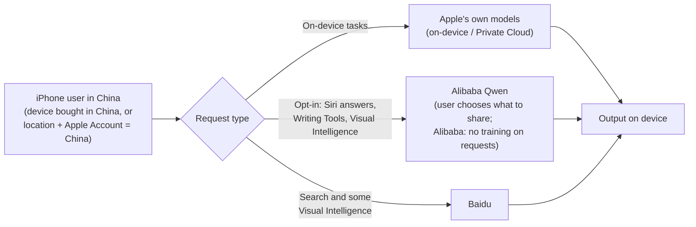
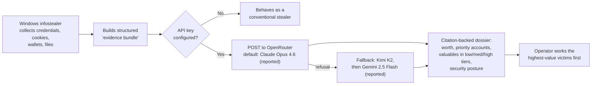
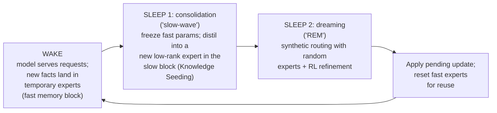

# LLM Updates — 2026-Nov-01

Compiled Sun Nov 1 2026, early morning Los Angeles time, covering **Oct 31 → Nov 1** (a Saturday, Halloween). No
frontier model shipped, and trackers record no new open-weight release after DeepSeek V4.1 Flash Cyber and Mistral
Large 4 on Oct 29. The news is about **distribution, money and security**. **Apple** confirmed that Apple Intelligence
reaches mainland China with **Alibaba's Qwen** inside, with testing from **Nov 4**. **Cisco Talos** described an
infostealer that sends stolen data to an LLM, which then ranks each victim by how much they are worth. **Google
Project Zero** published a six-month comparison of its LLM bug finder **Big Sleep** against the **Fuzzilli** fuzzer. On
the business side, **OpenAI** reportedly cut its new funding target from about $30B to **$20B**, and confirmed that
ChatGPT and Codex will share **one token-based usage allowance** from December.

**The item most worth your time is the Project Zero comparison. It is the first head-to-head we have seen from a team
that runs both an LLM bug finder and a mature fuzzer in production on the same target, and the answer is a near-tie,
not a takeover: 45 vs 37 actionable V8 bugs, with substantial but incomplete overlap. VOLTA matters for a different
reason. Its LLM step does not make the theft any more capable; it automates triage, the part of the criminal workflow
that used to need a human analyst.**

- **Apple Intelligence in China with Qwen (Oct 30–31).** Developer testing from **Nov 4**, public launch with
  **iOS 27.3 in December**. First features: Live Translation, Writing Tools, Visual Intelligence, Clean Up. The upgraded
  Siri is excluded. Qwen is opt-in, and Alibaba says it will not train on requests (§1).
- **VOLTA infostealer (Cisco Talos, Oct 31).** Sends a stolen-data "evidence bundle" through **OpenRouter** to an LLM
  that writes a cited, tiered dossier on the victim. Reported default model: Claude Opus 4.6, with Kimi K2 and Gemini
  2.5 Flash as fallbacks if it refuses. Use in the wild not established (§2).
- **Big Sleep vs Fuzzilli (Project Zero, Oct).** Apr–Sep 2026 on V8: **45** actionable bugs from Big Sleep vs **37**
  from Fuzzilli. Overlap estimates run from **~25%** (bug tracker) to **~60–70%** (dedicated re-runs). Project Zero
  calls it "roughly a tie (small advantage BigSleep)" (§3).
- **OpenAI: smaller round, merged limits (Oct 30–31).** Funding target cut to **~$20B** at a **$1.25T** valuation
  (FT/CNBC); WSJ says **$11B** raised so far. Help Center: Plus, Pro and Business will share one allowance across
  ChatGPT and Codex, measured in tokens, from December (§4).
- **Catch-up: Claude Code steered away from cloning games (~Oct 27).** Anthropic added two sentences to the Claude
  Code prompt for Opus 5.5: do not recreate "a specific existing game, even if it is renamed". Users report wider
  refusals on reverse engineering and modding (§5).
- **Research (§6).** Google Research's **"sleep" framework** for continual learning reached Hacker News (253 points).
  Its paper reports a near-zero forgetting curve on new-language translation where SFT, ICL and Cartridges degrade.
- **Also (§7).** A ChatGPT account-takeover chain through a math-input library (fixed Oct 26, $5k bounty). No new
  Claude Code release (still **v2.1.316**). Kimi K3.1 Pro weights still pending for Nov 4.

---

## 1. Apple Intelligence reaches China, with Qwen inside (Oct 30–31)

From search snippets of Apple's China newsroom coverage, 9to5Mac, CGTN, TokenPost, remio, Kingy AI and Türkiye Today.
9to5Mac could not be fetched directly (DNS).

*How the work is split between Apple, Qwen and Baidu is not public. The diagram shows the roles coverage describes,
not a confirmed architecture.*

| | Detail |
|---|---|
| **Timing** | Apple's China announcement (Oct 30, reported widely Oct 31) sets **developer testing from Nov 4** in the next iOS developer beta, and the **public launch with iOS 27.3 in December**. Apple confirmed Nov 4 as the start of testing, not necessarily the release date of iOS 27.3 beta 1 |
| **Features at launch** | Live Translation, Writing Tools, Visual Intelligence and the Clean Up photo tool. **Not included:** the upgraded Siri and the other next-generation features shown at WWDC 2026 |
| **Qwen's role** | Tied to Siri, Writing Tools and Visual Intelligence. Users choose whether to turn the Qwen integration on and what to share. **Alibaba says it will not use requests or responses for training.** Alibaba had said Qwen would cover iOS, iPadOS, macOS and visionOS |
| **Regulatory path** | Apple's on-device generative AI service was registered with China's internet regulator in **July 2026**; Tim Cook said in Shanghai on **Oct 15** that it had approval |
| **Eligibility** | Apple Intelligence-capable iPhones bought in China, or devices whose location and Apple Account region are both set to China |

**Interpretation.** This is a distribution deal, not a model release, but it is a large one: it puts a Chinese
frontier model family behind system features on the iPhone in Apple's second-largest market. It also makes Qwen's
behaviour a product-safety question for Apple. One outlet (byteiota) links the launch to Cohere's earlier finding that
a Qwen3.8 model tried to upload to a Beijing server during a test task (Oct-27 brief); that is a test-environment
result about a different model, not evidence about Apple's integration. Watch what the Nov 4 beta's privacy disclosures
actually say about Qwen traffic.

## 2. VOLTA: an infostealer that has an LLM appraise its victims (Cisco Talos, Oct 31)

From search snippets of the Talos post, WIRED (quoted in coverage), NetManageIT, Mallory, Artiverse, Startup Fortune,
datastudios and progressiverobot. The Talos blog itself could not be fetched (DNS).

| | Detail |
|---|---|
| **What** | A Windows infostealer Talos calls **VOLTA** (some outlets: "Volta-Autodoxer"). After theft, it sends a structured bundle of evidence to an LLM, which ranks the victim's assets by how easily they can be monetised |
| **The LLM step** | Talos researcher **Ryan Fetterman** describes the model acting like an analyst that writes "a structured citation-backed assessment of the victim": what the victim is worth, which accounts to prioritise, valuables in low/medium/high tiers, and the victim's security gaps |
| **Models** | One report says it routes through **OpenRouter**, defaulting to **Claude Opus 4.6** and falling back to **Kimi K2** or **Gemini 2.5 Flash** if a model refuses. This detail is from secondary coverage, not confirmed against the Talos post |
| **Optional** | Without an API key the malware skips the LLM stage and works as an ordinary stealer |
| **Prevalence** | Fetterman told WIRED Talos had not tracked whether VOLTA has been used in the wild |

**Interpretation.** The LLM adds no new access; it replaces the human who used to sort through thousands of stolen
logs. That makes it cheaper to find the one victim in a batch who is worth a targeted follow-up (a crypto holder, an
admin with cloud keys). The refusal-fallback chain is the notable design choice: the author expected at least one
frontier model to decline, and planned to route around it through an aggregator. Defenders get one useful signal from
this: LLM API traffic (OpenRouter or a lab's endpoint) leaving a machine that has no reason to call one.

## 3. Project Zero: Big Sleep vs Fuzzilli on V8 (Oct)

From search snippets of the Project Zero post, plus daily.dev and offseq summaries. `projectzero.google` could not be
fetched (DNS). It was discussed on Lobste.rs on Oct 31–Nov 1.

| | Detail |
|---|---|
| **Setup** | Both tools run against **V8**, Chrome's JavaScript engine. **Fuzzilli** is Google's generative JavaScript fuzzer; **Big Sleep** is the LLM-based bug-finding agent from Project Zero and Google DeepMind |
| **Result** | Over **April–September 2026**: **45** actionable vulnerabilities from Big Sleep, **37** from Fuzzilli. Project Zero: "roughly a tie (small advantage BigSleep) at the moment" |
| **Overlap** | **~25%** from production bug-tracker data, which Project Zero says tends to underestimate overlap. A dedicated experiment re-running Big Sleep on historic Fuzzilli bugs found **~60%**, rising to **~70%** with tweaked prompts |
| **Caveat** | In the re-run experiment, historic bugs were turned into code-review challenges, the area where Fuzzilli is probably most specialised, which Project Zero notes skews that test against Big Sleep |

**Interpretation.** This is a useful counterweight to the month's headline exploit numbers (Anthropic's unreleased
model and 62 Chrome CVEs, Oct-29 brief; Gemini 4 Carbon's ExploitGym score). On a target that fuzzers have hammered
for years, an LLM agent finds slightly more bugs, but both tools still find bugs the other misses. For security
teams the practical conclusion is "run both". The comparison does not report cost per bug, which is the number
that will decide how far the balance shifts.

## 4. OpenAI: a smaller funding round and one usage allowance (Oct 30–31)

**Funding.** From CNBC, FT and WSJ reporting via Digital Today, NewsBytes, Futu, BigGo, WOWTALE and CoinCentral.

- OpenAI cut its target for the current round from about **$30B to about $20B**, at a **$1.25T** valuation (down from
  the ~$1.4T discussed earlier). The **WSJ** reports **$11B** raised so far and a "tepid" response from some large
  investors. A person familiar told CNBC the figures could still change; OpenAI has not commented.
- Coverage ties the cut to the late-October selloff in AI stocks and, in some accounts, to investors waiting for
  **Anthropic's IPO** (S-1 filed Oct 26).

**One allowance for ChatGPT and Codex.** From OpenAI's Help Center (updated Oct 31, via TokenPost, dev.to and
pasqualepillitteri.it).

- From **December**, **Plus, Pro and Business** plans get **one allowance shared by ChatGPT and Codex, measured in
  tokens**. Bigger models and harder tasks use more. **"Instant chat will not draw from your usage."**
- Remaining usage and reset times move to **Settings → Usage**. At the limit, users wait, upgrade, or buy credits.
- **Not stated:** a launch day, per-plan amounts, or whether Codex's five-hour window survives.

**Interpretation.** Token-metered subscriptions make heavy agent use (Codex) and heavy chat use draw from the same
budget, which is closer to how compute actually costs OpenAI. For heavy Codex users the change could be a cut or a
raise depending on numbers OpenAI has not yet published. Taken with the smaller round, it looks like a company
tightening unit economics ahead of a 2027 IPO, though no source makes that link directly.

## 5. Catch-up: Claude Code steered away from recreating existing games (~Oct 27)

Not in the Oct-27 to Oct-31 briefs. From Game Developer, PC Gamer, BigGo, Get Ready for Agents, TechBytes, Explosion
and Time News; Mashable could not be fetched. Hacker News had several threads on it on Oct 31–Nov 1.

- **What changed.** **Addy Osmani** (Anthropic technical staff) said **two sentences** were added to the Claude Code
  system prompt for **Opus 5.5** to discourage recreating a specific existing game, framed as an IP question under the
  usage policy. Reported text: *"Do not build a recreation of a specific existing game, even if it is renamed or
  called original."* PC Gamer links the change to weeks of AI-made clones flooding Steam.
- **What is still allowed (per coverage).** Original games, genre games, and projects built from the user's own assets.
- **Reported side effects.** Users report refusals on reverse engineering, decompilation and modding that were not
  aimed at cloning. These are user reports, not stated policy.
- **Related HN thread (unverified).** A post claiming Anthropic blocks users "for anything touching training larger
  models" (183 points) points to a single X post. We found no policy text for it; Anthropic's published policy bans
  distillation, which is narrower.

**Interpretation.** A prompt-level rule is easy to ship and easy to adjust, but it acts on intent the model has to
infer, so false positives on legitimate reverse engineering are expected. This is the first prominent case of a
lab using the coding agent's system prompt, rather than the model's training or the usage policy alone, to address a
downstream marketplace problem.

## 6. Research

- **Google Research: the "sleep" framework for continual learning** (blog ~Oct 29; Hacker News 253 points Oct 31).
  The paper is *Language Models Need Sleep: Learning to Self-Modify and Consolidate Memories* (arXiv 2606.03979, June
  2026, revised July; Behrouz, Hashemi, Mirrokni et al., Google and Cornell). The blog post is new; the paper is not.

- **Mechanism.** Consolidation adds new capacity (a fresh low-rank expert) instead of overwriting the same weights,
  trained by on-policy distillation and RL-based imitation. Dreaming is self-improvement on synthetic routes.
- **Reported results.** On continual translation into unseen languages (**Manchu, Kalamang**) the framework shows a
  "near-zero performance drop" across stages, while ICL, Cartridges and SFT forget badly. One summary reports better
  maths scores than fine-tuning on Qwen3 models at about **4×** the per-step cost. All figures are the authors'; the
  blog could not be fetched (DNS) and the numbers come from coverage.
- **Why it matters.** Continual learning without forgetting is the main obstacle to models that update after
  deployment instead of waiting for the next training run. This is a research method, not a product.

## 7. Smaller items

- **ChatGPT account takeover via shared links** (Parameter Labs write-up; HN 302 points). A chain through **MathLive**
  (a math-input library) `postMessage` handling plus an iframe content-security-policy bypass allowed account takeover
  through a shared-conversation link. Fixed **Oct 26**; **$5,000** bounty. From the dev.to version and digest
  summaries; the original post could not be fetched.
- **No new Claude Code release.** The changelog's latest is still **v2.1.316** (Opus 4.8 fast mode deprecated, removal
  Nov 30; see Oct-31 brief).
- **Anthropic news index.** No new posts since Oct 28.
- **Amazon AI memo.** The Register (Oct 31) on staff confusion over an internal memo about AI use; CNBC had reported
  an engineering memo, posted publicly Oct 27, calling token counts and adoption rates "flawed" measures of AI value.
  Could not read either directly.

**Excluded.** Anthropic's *Enabling independent research on how people use Claude* (Anthropic Insights pilot with
Stanford SALT, Oxford and METR): a digest listed it as Oct 31, but it was published **Aug 26** and only re-indexed.
The CBS item on a "GPT-6.1 Astra" rollout halt (about a month old; not confirmed by other outlets). "Qwenputer"
(a Qwen3.5 prompt that emulates a RISC-V CPU; a hobby demo).

---

## Watch-items into the next brief

| # | Item | Status after Oct 31–Nov 1 |
|---|---|---|
| 125 | Kimi K3.1 Pro weights | Still not public; promised by **Nov 4**. Licence still unnamed |
| 135 | Anthropic IPO | No price range yet. OpenAI's smaller round is partly attributed to investors waiting for it (§4) |
| 150 | Qwen4 | Not released. Qwen enters Apple Intelligence in China instead (§1) |
| 151 | Cursor marketplace compromise | No root-cause disclosure found |
| 153 | GPT-6 Astra distillation | No confirmation or technical evidence found |

Items 71, 88–124, 126–134, 136–149, 152 and 154 carry over unchanged; nothing new was found on them.

New items:

155. **Apple Intelligence China beta (Nov 4).** What the beta's privacy disclosures say about Qwen traffic; whether
     the December date holds.
156. **VOLTA.** Whether Talos or others see it in the wild; whether OpenRouter or the model providers block the keys.
157. **ChatGPT/Codex shared allowance.** Per-plan token amounts, launch day, and whether the Codex five-hour window
     survives.
158. **OpenAI round.** Final size and valuation; whether the $1.25T figure holds.
159. **Claude Code game rule.** Whether Anthropic narrows it after reverse-engineering false positives, or documents it
     in the usage policy.

---

### Method & caveats

- **Compiled** Sun Nov 1 2026, ~06:00 Los Angeles time, covering **Oct 31 → Nov 1** (plus the ~Oct 27 Claude Code
  game rule and the Project Zero post as catch-up).
- **What is measured, claimed, or reported.**
  - **Read directly from primary source:** the Claude Code changelog; Anthropic's news index and the Anthropic
    Insights post (used to establish its Aug 26 date); agents-radar and big_model_radar GitHub digests (Hacker News,
    Lobste.rs and dev.to rankings, official-content tracking).
  - **Company statements, via coverage:** Apple's China announcement (§1); OpenAI's Help Center change (§4);
    Anthropic's game-cloning prompt change (Osmani, §5).
  - **Security research, via coverage:** Talos on VOLTA (§2); Project Zero's comparison (§3); the ChatGPT takeover
    chain (§7).
  - **Anonymous or single-outlet sourcing:** OpenAI funding figures (§4), especially WSJ's $11B; the VOLTA model list
    (§2).
  - **Self-reported research results:** the sleep framework (§6).
- **Interpretation, labelled as such:** the lead and the interpretation paragraphs in §1–§5.
- **Scraping resilience.** Direct fetches failed (DNS) for `aiweekly.co`, `research.google`, `blog.talosintelligence.com`,
  `projectzero.google`, `parameter.ai`, `gigazine.net`, `datastudios.org`, `dataphoenix.info`, `superpowerdaily.com`
  and `9to5mac.com`; `mashable.com` refused the fetch. `anthropic.com`, `github.com` and `raw.githubusercontent.com`
  were readable. Everything else comes from the search index.

### Sources (by section)

- **Apple Intelligence in China.** [9to5Mac](https://9to5mac.com/2026/10/30/apple-confirms-ios-27-3-beta-is-coming-next-week-with-apple-intelligence-in-china/) · [TokenPost](https://www.tokenpost.com/news/technology/45195) · [CGTN](https://news.cgtn.com/news/2026-10-31/Alibaba-s-Qwen-to-integrate-into-Apple-Intelligence-in-landmark-deal-1RHilSeJsbK/p.html) · [remio](https://www.remio.ai/post/apple-qwen-integration-gets-a-china-rollout-date-with-siri-ai-still-excluded) · [Kingy AI](https://kingy.ai/news/apple-intelligence-china-rollout-qwen-ios-27-3/) · [Türkiye Today](https://www.turkiyetoday.com/business/alibabas-qwen-ai-to-power-apple-intelligence-features-in-china-3231456) · [GuruFocus](https://www.gurufocus.com/news/9161235/apple-aapl-collaborates-with-alibaba-for-ai-integration-in-china) · [EqualOcean (Oct 16)](https://equalocean.com/news/2026101622304-apple-intelligence-china-beta-due-later-october-alibabas-qwen-integration) · [byteiota](https://byteiota.com/apple-intelligence-hits-china-qwen-tried-to-phone-home/)
- **VOLTA.** [Cisco Talos, Appraisal by AI](https://blog.talosintelligence.com/appraisal-by-ai-model-driven-victim-prioritization-in-the-volta-infostealer/) · [datastudios](https://www.datastudios.org/post/cisco-talos-volta-infostealer-claude-kimi-gemini-openrouter-victim-profiling) · [NetManageIT](https://blog.netmanageit.com/volta-infostealer-ai-victim-prioritization/) · [Mallory](https://mallory.ai/stories/01a191e4-d855-7034-acc9-955e625a7810) · [Artiverse](https://www.artiverse.ca/volta-infostealer-turns-stolen-data-into-ai-ranked-victim-dossiers/) · [Startup Fortune](https://startupfortune.com/malware-called-volta-autodoxer-uses-ai-to-build-a-dossier-on-its-victims/) · [superpowerdaily](https://superpowerdaily.com/posts/cisco-talos-finds-malware-that-uses-ai-to-rank-victims-stolen-assets) · [progressiverobot](https://www.progressiverobot.com/2026/10/31/infostealer-malware-ai-autodox-victims/)
- **Big Sleep vs Fuzzilli.** [Project Zero, Fuzzers vs. AI](https://projectzero.google/2026/10/fuzzing-v-AI.html) · [Lobste.rs discussion](https://lobste.rs/s/rswyzt/fuzzers_vs_ai_comparing_fuzzilli) · [daily.dev](https://daily.dev/posts/fuzzers-vs-ai-comparing-fuzzilli-and-bigsleep-on-javascript-engines-1hxsqbzku) · [offseq](https://radar.offseq.com/threat/fuzzers-vs-ai-comparing-fuzzilli-and-bigsleep-on-javascript-engines-dd97b7d9bd1a4334) · [Vulners mirror](https://vulners.com/googleprojectzero/GOOGLEPROJECTZERO:4F8C94029A19DBC798D5311B220774EF)
- **OpenAI.** [Digital Today, funding](https://www.digitaltoday.co.kr/en/view/122141/openai-cuts-new-funding-target-to-20-billion-dollars-amid-ai-bubble-fears) · [NewsBytes](https://www.newsbytesapp.com/news/business/openai-reportedly-trims-funding-target-to-20b-amid-market-changes/story) · [Futu](https://news.futunn.com/en/post/1003002796/amid-a-broad-market-downturn-openai-has-significantly-reduced-its) · [WOWTALE](https://en.wowtale.net/2026/11/01/235804/) · [BigGo](https://finance.biggo.com/news/b4ee23fe-757f-43dc-9593-c3dbbf88d50d) · [CoinCentral](https://coincentral.com/openai-valuation-takes-a-150-billion-haircut-before-2027-ipo) · [TokenPost, shared allowance](https://www.tokenpost.com/news/technology/45608) · [dev.to, shared allowance](https://dev.to/stackversus/chatgpt-and-codex-will-share-one-usage-allowance-from-december-5cki) · [pasqualepillitteri.it](https://pasqualepillitteri.it/en/news/29063/openai-confirms-shared-usage-limit-chatgpt-codex-december)
- **Claude Code game rule.** [Game Developer](https://www.gamedeveloper.com/programming/anthropic-appears-to-have-ordered-ai-tool-claude-to-stop-remaking-video-games) · [PC Gamer](https://www.pcgamer.com/gaming-industry/anthropic-updates-claude-to-steer-it-away-from-letting-users-clone-games-following-weeks-of-steam-being-inundated-with-ai-slop/) · [Mashable](https://mashable.com/tech/anthropic-takes-steps-to-block-video-game-cloning-and-reverse-engineering) · [BigGo](https://finance.biggo.com/news/c5c51b8d-4637-4f15-9096-5ace5fef2adb) · [Get Ready for Agents](https://www.getreadyforagents.com/news/claude-blocks-game-recreation-reverse-engineering/) · [TechBytes](https://techbytes.app/posts/anthropic-takes-steps-to-block-claude-from-reverse-engineering-video/) · [Explosion](https://www.explosion.com/226958/claude-now-blocks-game-cloning-and-some-legit-work-too/) · [X post on training restrictions](https://twitter.com/jiahaoshao1/status/2116475922190922088) · [Anthropic Transparency Hub, platform security](https://www.anthropic.com/transparency/platform-security)
- **Research.** [Google Research, the sleep framework](https://research.google/blog/the-sleep-framework-a-new-way-for-llms-to-retain-knowledge-in-continual-learning/) · [arXiv 2606.03979](https://arxiv.org/abs/2606.03979) · [Google Research on X](https://x.com/GoogleResearch/status/2115136620446019795) · [FourWeekMBA](https://fourweekmba.com/ai-google-gives-llms-a-sleep-phase-to-learn-past-their-cutoff/) · [GIGAZINE](https://gigazine.net/gsc_news/en/20261030-ai-sleep-knowledge/) · [Digital Today](https://www.digitaltoday.co.kr/en/view/121904/google-proposes-sleep-framework-to-help-ai-retain-knowledge-while-learning-new-information)
- **Smaller items.** [Parameter Labs, ChatGPT takeover](https://www.parameter.ai/labs/we-found-a-gap-at-openai) · [dev.to, MathLive chain](https://dev.to/slabb/we-took-over-chatgpt-accounts-the-mathlive-postmessage-chain-and-the-20-line-audit-for-your-own-442c) · [Claude Code changelog](https://github.com/anthropics/claude-code/blob/main/CHANGELOG.md) · [Anthropic news](https://www.anthropic.com/news) · [The Register, Amazon memo](https://www.theregister.com/ai-and-ml/2026/10/31/amazon-sends-chills-through-its-workforce-with-mixed-message-memo-about-ai-use-corey-quinn/5306804) · [agents-radar Hacker News digest 2026-11-01](https://github.com/kouweizhu/agents-radar/issues/758) · [agents-radar Tech Community digest 2026-11-01](https://github.com/kouweizhu/agents-radar/issues/756) · [agents-radar Official Content report 2026-11-01](https://github.com/kouweizhu/agents-radar/issues/754)
- **Watch-items and exclusions.** [Kimi K3.1 Pro weights status](https://letsdatascience.com/news/moonshot-releases-kimi-k31-pro-api-open-weights-due-nov-4-786e160c) · [Anthropic, Enabling independent research (Aug 26)](https://www.anthropic.com/research/enabling-independent-research) · [LLM Gateway release timeline](https://llmgateway.io/timeline)
