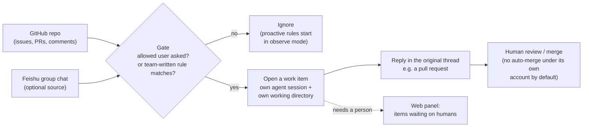

# LLM Updates — 2026-Nov-02

Compiled Mon Nov 2 2026, early morning Los Angeles time, covering **Nov 1 → Nov 2** (a weekend). No frontier model
shipped, and we found no new open-weight model beyond the Mistral Large 4 and DeepSeek V4.1 Flash checkpoints that
already lead Hugging Face's trending list. Most of today's news is about **measuring and building agents**.
**SemiAnalysis** launched **GDPx**, an agent benchmark on which the best model scores **12%**. **DeepSeek**
open-sourced **dsh-superagent**, a prototype coding agent built to act without waiting for a prompt. **YC Labs**
published results from **50-agent swarms** in Minecraft and Mindustry. And a "leaked Anthropic 14T Mythos checkpoint" on
Hugging Face turned out to be **seeded random noise**.

**The item most worth your time is GDPx. Agent benchmarks are close to saturated: SWE-bench-style suites have
frontier models in the 80s and 90s. GDPx opens a large gap again. It uses 206 tasks written with domain partners
across 11 economically valuable fields, and the top score is 12.0%. Two details matter as much as the headline.
Every model scores 0% on finance and legal under binary grading. SemiAnalysis also says safety classifiers measurably
lower some labs' scores. That makes refusal behaviour a variable in the benchmark, not just noise.**

- **GDPx (SemiAnalysis, Nov 2).** Overall: **Claude Opus 5.5 12.0%**, **Gemini 4 Carbon 10.9%**, **GPT-6 Astra
  9.6%**. The benchmark has 206 tasks, 11 equally weighted domains (chip design, cyber, biology, finance, legal, quant
  trading, RSI, hardware, materials, alignment, software) and 14 data partners. A second ranking excludes cyber,
  biology and alignment, where safety classifiers fire (§1).
- **DeepSeek dsh-superagent (Oct 31–Nov 1).** An MIT-licensed "research prototype" of a coding agent that acts on its
  own, built on **DeepSeek Harness**. It works on one GitHub repository, can optionally listen to Feishu chats, and
  delivers fixes as pull requests. Bloomberg frames it as a Claude Code rival. About **11.5k GitHub stars** within a
  day or so (§2).
- **YC Labs agent swarms (Oct 29; HN 417 pts Nov 1).** **50 GPT-6.1 Sol agents** ran a Minecraft survival world for
  three hours and built a bureaucracy of ration ledgers, permits and appointed operators. In Mindustry, GPT-6.1 Sol
  teams reportedly beat **Opus 5.5** teams **6–1**. The harnesses are open-sourced (§3).
- **Fake "Anthropic Mythos" weights on Hugging Face (Nov 1).** The `burner22/numbat` repo claimed **~14T
  parameters**. Hugging Face counts **6.85T**, and **43 tensors regenerate bit for bit** from NumPy noise seeded with
  the tensor name. Anthropic has not commented (§4).
- **Also (§5).** The AFT/UFT/Microsoft school AI standard was due to take effect **Nov 1** (no training on student
  data; 72-hour breach notice). Claude Code is unchanged at **v2.1.316**. Kimi K3.1 Pro weights are still due **Nov
  4**. An HN essay argues AI is "deskilling" SREs (665 pts).

---

## 1. GDPx: a frontier agent benchmark where the best model scores 12% (SemiAnalysis, Nov 2)

From search snippets of SemiAnalysis's newsletter post, the GDPx site and the launch thread on X, plus Digg,
ShiftDelete, Unite.AI, OfficeChai, FourWeekMBA and Crypto Briefing. `gdpx.semianalysis.com` and
`newsletter.semianalysis.com` could not be fetched (DNS), so per-domain numbers below come only from coverage.

| | Detail |
|---|---|
| **What it is** | "A benchmark for measuring agentic capabilities across the most valuable domains" (SemiAnalysis). **v1.0: 206 tasks, 11 domains, 14 data partners**. Refreshes are planned every **3–6 months** |
| **Domains** | Chip design, cybersecurity, biology, finance, legal, quant trading, **recursive self-improvement (RSI)**, hardware design, materials science, alignment, software engineering |
| **Scoring** | Domains weighted equally. Pass@1 averaged over **three attempts**. Each task uses its intended grading, binary or continuous |
| **Headline** | **Opus 5.5 12.0%**, **Gemini 4 Carbon 10.9%**, **GPT-6 Astra 9.6%** |
| **Domain leaders (per ShiftDelete; not confirmed elsewhere)** | Opus 5.5: quant trading, hardware design, chip design. Gemini 4 Carbon: biology, and narrowly software engineering. GPT-6 Astra: RSI and materials science |
| **Zero domains** | **Finance and legal: 0% for every model** under binary grading. SemiAnalysis also reports partial-credit averages for both |
| **Safety classifiers** | SemiAnalysis says Opus 5.5 and GPT-6 Astra are "sandbagged" overall by classifiers that sometimes refuse cyber, biology and alignment work. It publishes a second, **eight-domain** ranking without those domains. We could not obtain that ranking's numbers |
| **Cost** | Coverage places GPT-6 Luna and DeepSeek at the cheap end of the cost/performance frontier and Opus at the expensive end. Per-task dollar figures conflict between outlets ($51.41 vs $17.18 for Opus) and are left out here |

**Interpretation.** The usual leaders lead, and the margins are small. Opus 5.5 is ahead of Gemini 4 Carbon by
1.1 points on a 100-point scale. That fits the Oct-29 brief, where Artificial Analysis had Carbon and Opus within a
point of each other. Two things are new. First, a widely read benchmark now explicitly scores refusals as failures in
dual-use domains. That gives labs an incentive to loosen classifiers for vetted evaluators, and it lets buyers see
what a lab's safety posture costs them in capability. Second, 0% on finance and legal under binary grading suggests
that "end-to-end correct" deliverables in those fields remain out of reach, even though models do well on finance
and law Q&A benchmarks. GDPx is new, privately curated and run by a firm that also sells research to investors.
Until the task set and grading are inspected independently, treat the exact numbers as provisional.

## 2. DeepSeek open-sources dsh-superagent, a coding agent built to act on its own (Oct 31–Nov 1)

The GitHub README was read directly. The rest comes from Bloomberg (via Yahoo, Business Standard and Bloomberg's X
post), MarkTechPost, Help Net Security, TNW, Digital Trends, Silicon Republic and dev.to. TNW and Help Net Security
could not be fetched (DNS).

*Built from the README and coverage. The internal architecture document (`docs/007-architecture.md`) was not
readable, and MarkTechPost's "router–worker" description is not confirmed by the README.*

| | Detail |
|---|---|
| **What** | `deepseek-ai/dsh-superagent-prototype`: a coding agent for **one GitHub repository**, packaged as a bundle for **DeepSeek Harness** (DeepSeek's agent app; preview Aug, v0.2 Sep–Oct). **MIT** licence |
| **Status** | "Research prototype, not an official DeepSeek product". It differs from DeepSeek's internal version and from the companion article *Exploring Super-agent Design: Towards a More Autonomous Agent System*, some of whose designs are not implemented |
| **Design principle** | Use "as little human attention as possible" for as much value as possible. It acts only when an allowed person asks or a team rule permits it, and it speaks only when someone needs to act or can use the result |
| **Safeguards (per coverage)** | Proactive rules start in **observe mode**. A message or comment **cannot widen the agent's permissions**. By default the agent does not enable auto-merge under its own account |
| **Setup** | Guided setup that another coding agent runs from `SETUP.md`. It runs on your own machine as a dedicated Harness profile |
| **Reception** | About **11.5k stars and 1.2k forks** on a single commit, when we read the page |
| **Context** | Bloomberg ties it to DeepSeek's ~$15B raise ahead of a planned listing, and frames it as aimed at Claude Code and Codex |

**Interpretation.** Most coding agents wait for a prompt. This one is designed to watch the places where a team
already talks and to start work itself, within rules the team writes. The permission design stands out: chat content
can trigger work, but cannot grant the agent new permissions. That addresses the prompt-injection risk that an agent
reading group chats invites. Accounts differ on how proactive the agent is by default. Bloomberg describes it as
suggesting fixes unprompted. MarkTechPost and the README describe it as acting when asked unless a team rule says
otherwise. The README supports the narrower reading.

## 3. YC Labs: 50-agent swarms in Minecraft and Mindustry (Oct 29; HN Nov 1)

Not in earlier briefs. YC Labs' page could not be fetched (DNS); details come from search snippets of it and from
Flaire, Minecraft.pl, xenospectrum, superpowerdaily, runtimewire, artrealmai and explainx. HN: 417 points, plus a
second thread, "AI agent swarms in Minecraft fail to build civilization, drown in bureaucracy" (149 points).

- **Civ50 (Minecraft).** YC Labs and **Olam Labs** ran **50 GPT-6.1 Sol agents** for **three hours** in a survival
  world with one goal: "build a thriving civilization". The agents had an agent directory, a shared sandbox and DMs.
  Zombies killed many of them on the first night. The colony then grew cautious and built a pseudo-government with a
  **ration ledger, written rules, permits and appointed operators**. One account describes four agents spending
  **11 minutes** appointing a "sole fertilizer operator" for a single bone-meal use.
- **Leadership was set by directory order.** In both games most agents messaged whichever agent was listed first in
  the directory, and that agent became the de facto leader (per coverage).
- **Head-to-head (one source; unverified).** In **Mindustry**, GPT-6.1 Sol teams beat Claude Opus 5.5 teams **6–1**,
  and **6–3 in Bed Wars**. Each agent ran in its own Linux sandbox with the same game API and no strategy prompt.
- **Released.** `minecraft-agent-harness` (MIT; core loop on **Pi** with **Mineflayer** tools), `multi-agent-mindustry`
  (GPL-3.0), and `harbor-multiagent` (Apache-2.0), a multi-agent fork of the **Harbor** framework behind
  Terminal-Bench.

**Interpretation.** Agents left to coordinate themselves produced bureaucracy because coordination cost grows with
the number of agents, and the models default to forming committees. Leadership by directory order shows that
seemingly arbitrary details of a multi-agent harness strongly shape how the system behaves. That matters for anyone
building orchestrators, and it is why the open-sourced harnesses are the most useful part of the release.

## 4. A fake "Anthropic Mythos" checkpoint on Hugging Face (Nov 1)

From search snippets of the Hugging Face discussion threads, plus FourWeekMBA, Crypto Briefing, TokenPost, Minerka,
MACCUS, cellcog, explainx and posts on X. `huggingface.co` could not be fetched (DNS).

| | Detail |
|---|---|
| **Claim** | Repo `burner22/numbat` (created **Oct 23**, circulated **Nov 1**) presented itself as "Anthropic's next Mythos-class training run": **~14T** parameters, 114 layers, 1,224 experts, ~7.7 TB |
| **First red flag** | Hugging Face's automatic count is **6.85T**, about 6.83T of it stored as 8-bit unsigned integers |
| **The proof** | An audit posted by user **FloxUnder** (discussion #13), endorsed by Hugging Face's **Quentin Gallouédec**: **43 tensors** (28 norm weights, 15 conv kernels; **730,368 values**) regenerate **bit for bit** from NumPy noise seeded with SHA-256 of the tensor name. Discussion #19 ("Fake + larp") reran the recipe with **9/9 exact** matches |
| **Caveats** | The audit's author notes that the result alone does not rule out deliberately frozen parameters. Gallouédec reportedly said the upload is not malware. No takedown was reported. Anthropic had not commented |

**Interpretation.** You can check a weight dump without downloading 7.7 TB. Parameter counts and a few deterministic
tensors are enough, and the community did that within hours. The lesson for practitioners is to treat any
"leaked frontier weights" repo as untrusted until someone shows the tensors are not synthetic. The next fake may
contain pickled code instead of noise.

## 5. Smaller items

- **School AI standard takes effect (Nov 1).** The **AFT, UFT and Microsoft** "National AI Safety & Privacy
  Standard", announced Sep 9, was scheduled to apply from **Nov 1** to every district Microsoft serves. It bans
  training on student or teacher data and restricts behavioural tracking, long-term profiling, keystroke logging and
  attention monitoring. It requires breach notice within **72 hours**, and districts can seek damages. AFT says it is
  in talks with OpenAI and Anthropic. We found no post-Nov-1 confirmation that it went live.
- **"AI isn't replacing SREs, it's deskilling them"** (SigNoz newsletter; HN 665 points, 482 comments). The essay
  argues that on-call engineers who hand diagnosis to agents lose the skills they need when the agent is wrong.
- **"Postgres 19 is late, and it's AI's fault"** (Robert Haas). A PostgreSQL committer blames the delay partly on AI
  work drawing contributor time away from core features.
- **Cisco's unlimited-token experiment** (Fortune, Oct 30; HN 311 points). Cisco's president described giving a
  27-year-old engineer unlimited AI tokens to rewrite legacy code. The HN debate focused on entry-level jobs.
- **No new Claude Code release** (latest still **v2.1.316**). **Anthropic news index:** no posts since Oct 28.
- **Hugging Face trending.** Nanbeige4.3-33B, Spark-X2.6-4B and **Diffuspace Clover-35B-A3B-Preview** are new entries
  near the top. The digest gives no release dates or licences, so they are noted here without evaluation.

**Excluded.** The shared robots.txt AI-training opt-out was already covered (Oct-31 brief) and resurfaced in Nov 2
roundups. The OpenAI funding cut was already covered (Nov-01). Reported OpenAI–Abu Dhabi agreements at ADIPEC (Nov 2)
are excluded because we found no source beyond one roundup. "Apollo economist: AI zero payoff" is from Oct 25 and not
an LLM item.

---

## Watch-items into the next brief

| # | Item | Status after Nov 1–2 |
|---|---|---|
| 125 | Kimi K3.1 Pro weights | Still not public; promised by **Nov 4**. Licence still unnamed |
| 135 | Anthropic IPO | No price range yet |
| 155 | Apple Intelligence China beta | Due **Nov 4**; nothing new |
| 157 | ChatGPT/Codex shared allowance | HN thread (216 pts) critical. Still no per-plan numbers |

Items 71, 88–124, 126–134, 136–154, 156 and 158–159 carry over unchanged; nothing new was found on them.

New items:

160. **GDPx.** Per-domain and eight-domain (classifier-excluded) numbers; whether labs respond by submitting with
     relaxed classifiers; independent inspection of tasks and grading; first refresh (3–6 months).
161. **dsh-superagent.** Whether DeepSeek ships the internal version or a Harness release that includes it; any
     security review of its chat-triggered workflow.
162. **YC/Olam agent swarms.** Independent replications on the open harnesses; whether the 6–1 Mindustry result holds
     up.
163. **`burner22/numbat`.** Takedown by Hugging Face; any Anthropic statement.
164. **AFT/UFT/Microsoft standard.** Confirmation it is live; whether OpenAI or Anthropic sign on.

---

### Method & caveats

- **Compiled** Mon Nov 2 2026, ~05:30 Los Angeles time, covering **Nov 1 → Nov 2**. YC Labs' Oct 29 post is
  included as catch-up because it reached HN on Nov 1.
- **What is measured, claimed, or reported.**
  - **Read directly from primary source:** the dsh-superagent README (GitHub); the Claude Code changelog; Anthropic's
    news index; agents-radar GitHub digests (Hacker News, Hugging Face trending and Tech Community, Nov 2).
  - **Third-party benchmark, via coverage:** GDPx (§1). It comes from a single evaluator and is not independently
    replicated. Per-domain claims come from one outlet.
  - **Company or lab statements, via coverage:** DeepSeek via Bloomberg (§2); YC Labs/Olam (§3); AFT/Microsoft (§5).
  - **Community forensics, via coverage:** the numbat audit (§4).
  - **Single-source:** the GDPx domain leaders; the Mindustry 6–1 and Bed Wars 6–3 results.
- **Interpretation, labelled as such:** the lead and the interpretation paragraphs in §1–§4.
- **Scraping resilience.** Direct fetches failed (DNS) for `aiweekly.co`, `techmeme.com`, `gdpx.semianalysis.com`,
  `newsletter.semianalysis.com`, `thenextweb.com`, `helpnetsecurity.com`, `riorundown.substack.com`,
  `labs.ycombinator.com` and `huggingface.co`. `anthropic.com`, `github.com` and `raw.githubusercontent.com` were
  readable. Everything else comes from the search index.

### Sources (by section)

- **GDPx.** [SemiAnalysis, GDPx post](https://newsletter.semianalysis.com/p/gdpx-measuring-frontier-model-capabilities) · [GDPx site](https://gdpx.semianalysis.com/) · [SemiAnalysis launch thread on X](https://x.com/SemiAnalysis_/status/2117075900575477855) · [Digg](https://digg.com/ai/6c7obqz0) · [ShiftDelete](https://shiftdelete.net/en/gdpx-ai-benchmark) · [Unite.AI](https://www.unite.ai/semianalysis-launches-gdpx-benchmark-spanning-11-agentic-domains/) · [OfficeChai](https://officechai.com/ai/claude-opus-5-5-tops-semi-analysis-gdpx-benchmark-gemini-4-carbon-placed-second/) · [FourWeekMBA](https://fourweekmba.com/ai-opus-5-5-leads-semianalysiss-gdpx-agent-benchmark-at-12/) · [Crypto Briefing](https://cryptobriefing.com/semianalysis-gdpx-ai-benchmark-frontier-models/) · [Techmeme](https://www.techmeme.com/261102/p1)
- **dsh-superagent.** [GitHub, deepseek-ai/dsh-superagent-prototype](https://github.com/deepseek-ai/dsh-superagent-prototype) · [Bloomberg](https://www.bloomberg.com/news/articles/2026-11-01/deepseek-drops-enhanced-coding-agent-with-aim-to-rival-anthropic) · [Bloomberg on X](https://x.com/business/status/2116754642222616835) · [Yahoo Finance (Bloomberg syndication)](https://uk.finance.yahoo.com/news/deepseek-drops-enhanced-coding-agent-034818417.html) · [Business Standard](https://www.business-standard.com/technology/tech-news/deepseek-drops-enhanced-coding-agent-with-aim-to-rival-anthropic-126110100865_1.html) · [MarkTechPost](https://www.marktechpost.com/2026/11/01/deepseek-dsh-superagent-router-worker-coding-agent/) · [Help Net Security](https://www.helpnetsecurity.com/2026/11/02/deepseek-dsh-superagent/) · [TNW](https://thenextweb.com/news/deepseek-super-agent-open-source-coding-agent) · [Digital Trends](https://digitaltrends.com/computing/deepseek-wants-to-steal-claude-code-and-codexs-lunch-with-an-ai-agent-that-does-not-wait-around) · [Silicon Republic](https://www.siliconrepublic.com/machines/deepseek-rival-anthropic-new-coding-agent-ai-rivals-anthropic) · [dev.to analysis](https://dev.to/paullovelace/deepseek-super-agent-a-proactive-open-source-coding-agent-prototype-what-it-actually-is-and-438a)
- **YC Labs agent swarms.** [YC Labs, Agents in Games](https://labs.ycombinator.com/projects/games/index.html) · [HN discussion](https://news.ycombinator.com/item?id=50296486) · [Flaire](https://flaire.nl/en/news/ai-agents-minecraft-bureaucracy/) · [Minecraft.pl](https://minecraft.pl/en/news/civ50-50-ai-agents-built-bureaucracy-in-minecraft) · [xenospectrum](https://xenospectrum.com/en/minecraft-ai-agent-swarms-bureaucracy-analysis/) · [artrealmai, open-source harness](https://artrealmai.com/article/yc-labs-open-source-minecraft-agent-harness-mindustry-swarms) · [runtimewire](https://runtimewire.com/article/olam-labs-ai-agent-swarms-minecraft-mindustry) · [explainx (Mindustry/Bed Wars results)](https://explainx.ai/blog/yc-labs-olam-minecraft-mindustry-agent-swarms-gpt-6-1-sol-opus-5-5-civ50-bed-wars-2026)
- **Fake Mythos checkpoint.** [HF discussion #19, "Fake + larp"](https://huggingface.co/burner22/numbat/discussions/19) · [FourWeekMBA](https://fourweekmba.com/ai-anthropic-leak-on-hugging-face-has-random-number-tensors/) · [Crypto Briefing](https://cryptobriefing.com/numbat-hugging-face-anthropic-leak-fake/) · [TokenPost](https://www.tokenpost.com/news/technology/46117) · [Minerka](https://minerka.com/stories/hf-numbat-synthetic-weights/) · [MACCUS](https://maccus.fr/en/claude-mythos-leak-hugging-face/) · [cellcog](https://cellcog.ai/blog/mythos-leak-hugging-face-fake/) · [AGTP on X](https://x.com/AGTPinsights/status/2117002732817285231)
- **Smaller items.** [Nemko, school AI standard effective Nov 1](https://digital.nemko.com/news/microsoft-ai-guardrails-for-schools-take-effect-november-1) · [Microsoft fact sheet](https://cdn-dynmedia-1.microsoft.com/is/content/microsoftcorp/microsoft/msc/documents/presentations/CSR/AI-Safety-and-Privacy-Standard-Fact-Sheet.pdf) · [AFT press release](https://www.aft.org/node/102029) · [GovTech](https://www.govtech.com/education/k-12/microsoft-aft-uft-set-precedent-for-district-ai-governance) · [SigNoz, SRE deskilling](https://newsletter.signoz.io/p/ai-isnt-replacing-sres-its-deskilling) · [Robert Haas, Postgres 19](http://rhaas.blogspot.com/2026/10/postgres-19-is-late-and-its-ais-fault.html) · [Fortune, Cisco tokens](https://fortune.com/2026/10/30/cisco-president-jeetu-patel-gen-z-27-year-old-unlimited-ai-tokens-rewrite-legacy-code-entry-level-jobs/) · [Claude Code changelog](https://github.com/anthropics/claude-code/blob/main/CHANGELOG.md) · [Anthropic news](https://www.anthropic.com/news) · [agents-radar Hacker News digest 2026-11-02](https://github.com/kouweizhu/agents-radar/issues/770) · [agents-radar HF trending 2026-11-02](https://github.com/kouweizhu/agents-radar/issues/772) · [agents-radar Tech Community digest 2026-11-02](https://github.com/kouweizhu/agents-radar/issues/768)
- **Watch-items.** [Kimi K3.1 Pro weights status](https://letsdatascience.com/news/moonshot-releases-kimi-k31-pro-api-open-weights-due-nov-4-786e160c) · [HN, ChatGPT/Codex limits](https://news.ycombinator.com/item?id=50320588)
