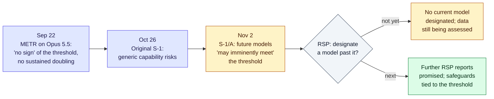

# LLM Updates — 2026-Nov-03

Compiled Tue Nov 3 2026, early morning Los Angeles time, covering **Nov 2 → Nov 3**. It is US midterm election day.
No frontier model shipped, and **Kimi K3.1 Pro's weights are still not on Hugging Face**; Moonshot promised them by
tomorrow, Nov 4. The day's main news is a document: **Anthropic's amended S-1 (S-1/A)**, filed Nov 2.

**The item most worth your time is one sentence in that filing. Anthropic says its internal estimates for *future*
models indicate it "may imminently meet" its Responsible Scaling Policy's definition of "dramatically accelerated
progress attributable to AI". This is the AI R&D threshold, the RSP's term for AI noticeably speeding up AI research.
Anthropic also says no current model has been designated past it. That sentence was not in the Oct 26 S-1. Six weeks
ago, METR's report on Opus 5.5 found "no sign" of that threshold (Sep-24 brief). A lab saying in a securities filing,
where misstatements carry legal liability, that it may soon cross its own AI R&D threshold is a stronger signal than
any blog post on the subject.**

- **Anthropic S-1/A (Nov 2).** Adds the AI R&D threshold language (above) and a related risk factor: Anthropic "may not
  identify a significant acceleration … until after it has occurred". It also adds **Q3 financials**: revenue
  **$16.96B** (+47% QoQ, down from +144% in Q2), net loss **$23.3B** (mostly non-cash), an **operating loss of about
  $567M** after a Q2 operating profit, and **$895.4B** in purchase and lease commitments. There is still no price range
  (§1).
- **China speeds up a comprehensive AI law (NDRC, Nov 3).** The law would cover the whole AI life cycle and require
  developers to disclose safety risks, incidents and vulnerabilities, with sector-specific sandboxes. It would reach
  DeepSeek, Moonshot and Alibaba. There is no draft text or timetable (§2).
- **Apple puts usage limits on Siri AI (Q4 call, Nov 2).** In his first call as CEO, John Ternus confirmed usage limits on
  features that run on server-side models, with paid extra capacity later. Siri AI's cloud costs will land in
  services cost of sales and are part of a lower **45–46%** gross-margin guide (§3).
- **OpenAI merges ChatGPT's Chat and Work tabs (TechCrunch, Nov 2).** This adds to the December shared ChatGPT/Codex
  allowance already reported. Instant chat will not draw on the allowance. Pro $200 limits are unchanged (§4).
- **Also (§5).** **Claude Code v2.1.317** adds a prompt before a tool call sends your account email to the network,
  and an `onFailure: "block"` option for SDK hooks. The OpenAI election "war room" runs through the count. FourWeekMBA
  counts **6 of 12** large AI filers warning that agents may take unauthorized actions. HybridAgent (arXiv) mixes
  latent reasoning with tool calls.

---

## 1. Anthropic's amended S-1: "we may imminently meet" the AI R&D threshold, plus Q3 numbers (Nov 2)

From search snippets of the S-1/A on EDGAR and coverage by CNBC, Quartz, The National, TNW, Shattered, Benzinga,
Gizmodo, FourWeekMBA, The Neuron and cellcog. `sec.gov` could not be fetched (DNS), so quoted wording comes from
search excerpts of the filing and from coverage, not from a full read.

### 1a. The AI R&D threshold sentence

| | Detail |
|---|---|
| **New text** | "Our internal estimates and our expectations regarding future models, rather than our current models, indicate that we may imminently meet our Responsible Scaling Policy's definition of 'dramatically accelerated progress attributable to AI.'" |
| **What it does not say** | "We have not designated any of our current models as exceeding this threshold, and we continue to assess the underlying data." Anthropic says it will publish further reports under the RSP |
| **Related risk factor** | Anthropic "may not identify a significant acceleration in our rate of development until after it has occurred". Its visibility into recent or unreleased models is "limited". AI-assisted development by rivals could also leave it behind |
| **Commitments restated** | Coverage says the filing commits to keeping humans involved in frontier development and to weighing what crossing the threshold would mean |
| **New vs Oct 26** | The threshold sentence was **not in the original S-1** (FourWeekMBA, cellcog). The original already had the general "unexpected capabilities after deployment" language (Oct-27 brief) |
| **External reference point** | Per The Neuron, a separate preliminary METR assessment estimated about **1.5×** acceleration in overall AI capability progress attributable to AI, with substantial uncertainty and (per one summary) about a 30% chance of 2×. Secondary sources disagree on whether this is the Sep 22 Opus 5.5 report and what period it covers |

**Interpretation.** Three readings fit the text. They are not mutually exclusive.

1. **Legal hygiene.** A company about to sell shares must disclose known trends that could matter to investors. If
   internal forecasts point at the threshold, leaving it out would be a liability. On this reading the sentence
   restates a forecast Anthropic already held. It does not mean anything changed in the last week.
2. **A real change in the forecast.** In September, Anthropic and METR found no sign of the threshold. Six weeks later
   Anthropic says "imminently". That suggests the next model's training-run evidence moved the estimate. Headlines
   calling this "recursive self-improvement" (Gizmodo, Benzinga) overstate it: the RSP threshold is about AI
   *speeding up* research, not AI improving itself without humans.
3. **The admission that matters most is the measurement one.** The risk factor admits acceleration may only be
   recognised after it has happened. That weakens any safeguard that is supposed to trigger *at* the threshold. Watch
   whether the promised RSP report states the measurement method, not just the conclusion.

### 1b. Q3 2026 financials

![Figure: Bar chart titled "Anthropic revenue: still growing fast, but growth slowed to +47% in Q3". Quarterly revenue in US dollars: Q1 2026 about 4.7 billion (+132% quarter over quarter, derived), Q2 about 11.5 billion (+144%, derived), Q3 16.96 billion (+47%, reported). Side panel for Q3: net loss 23.3 billion, mostly fair-value changes; operating loss about 0.57 billion after a Q2 operating profit of about 0.97 billion; adjusted operating margin 19% to 15%; commitments 895.4 billion, about 447.5 billion due before end-2030; nine-month revenue 33.24 billion.](nov03_anthropic_quarterly_revenue.svg)

| Line | Q3 2026 / 9M 2026 | Note |
|---|---|---|
| **Revenue** | **$16.96B** in Q3 (CNBC rounds to $17B; some outlets $16.95B). **$33.24B** for nine months, about **+1,200%** YoY | QoQ growth **+47%**, after +144% (Q2) and +132% (Q1) |
| **Net loss** | **$23.3B** in Q3; about **$104B** for nine months | Mostly changes in fair value of convertible notes and derivative liabilities |
| **Operating result** | **Operating loss of about $567M** in Q3 (opex about $17.5B), after a Q2 operating profit of about **$974M** | One outlet instead reports the $974M as a Q3 profit. We follow CNBC and Shattered |
| **Adjusted operating** | $2.2B (Q2) → **$2.5B** (Q3); margin **19% → 15%** | Company-defined (non-GAAP) measure |
| **Commitments** | **$895.4B** in purchase and lease commitments, "substantially all" compute and infrastructure; about **$447.5B** due before end-2030 | One analysis says about $213.8B is conditional |
| **Offering** | Price range and share count still blank; Nasdaq ticker **ANT** | Trackers disagree on timing (week of Nov 9 for terms vs a listing in the week of Nov 16) |

**Interpretation.** These numbers sit uneasily with the AI R&D sentence. Revenue still grew 12× year over year, but
quarterly growth dropped by two thirds. Margins compressed as operating spend outran revenue. The commitments are
about **13×** annualised Q3 revenue. A buyer of ANT is being told two things at once: growth is normalising, and
the technology may be about to speed up its own development.

---

## 2. China's NDRC will speed up a comprehensive AI law (Nov 3)

From search snippets of Bloomberg (via FourWeekMBA), SBS and JKN.

| | Detail |
|---|---|
| **Who / when** | The **National Development and Reform Commission** (state economic planner), at a briefing on **Nov 3**. Speaker: Wang Ruomeng, Deputy Director-General, Department of Innovation and High-Tech Development |
| **Scope** | A "basic, comprehensive" AI law covering the **full AI life cycle**, from development to deployment, including data and computing resources |
| **Obligations** | Developers and operators must strengthen risk management and **disclose safety risks, incidents and vulnerabilities**. Safety standards and ethical guidelines. **Sector-specific sandboxes** |
| **Who is affected** | Per Bloomberg: developers "from DeepSeek to Moonshot and Alibaba" |
| **Missing** | No draft text, timetable or lead drafting body. It is unclear whether incident reporting would be mandatory |

**Context.** This comes on top of China's Oct 16 draft AI export controls (Oct-26 brief). Comments on those are due
Nov 15. The CAC's review of DeepSeek and Moonshot over routing user queries to Claude (Sep briefs) is also still
open. If disclosure applied to all developers, it would go further than the EU AI Act, whose serious-incident
reporting covers only high-risk systems and systemic-risk GPAI providers.

**Interpretation.** No text means nothing to comply with yet. The direction is notable, though. China is moving from
targeted rules (generative AI measures, labelling, export lists) to one framework law. "Disclose vulnerabilities" also
lines up with Moonshot stripping cyber data from Kimi K3.1 Pro's open weights.

---

## 3. Apple: Siri AI gets usage limits, and its cloud costs hit margins (Q4 FY26 call, Nov 2)

From search snippets of MacRumors, Six Colors, The Motley Fool and Benzinga transcripts, AppleInsider and Datastudios.

| | Detail |
|---|---|
| **Results** | Revenue **$114.5B** (+12% YoY), diluted EPS **$2.10**. It was John Ternus's first call as CEO |
| **Usage limits** | Ternus confirmed "some usage limits on features that rely on server-side models, which include Siri AI and intelligent photo editing". Heavy users will be able to buy more capacity later. No prices, plan names or limit sizes yet |
| **Cost accounting** | Siri AI cloud costs are recognised in **services cost of sales**. December-quarter gross margin guide: **45–46%**, hit by memory prices and the Siri AI ramp |
| **Scale** | More than **2.5 billion** Siri requests per day (all Siri, not only Siri AI) |
| **Positioning** | Ternus argued against shipping AI for its own sake. FourWeekMBA reports Apple pitched the Mac mini as an on-device AI box with no cloud token cost, citing Gap. That is single-sourced |

**Interpretation.** Usage limits have now spread from chat products to the default phone assistant. Apple is the
company that most consistently sells "no meter" experiences, so this matters. Paid capacity on top of iCloud+ would make
Apple the third big consumer platform, after ChatGPT and Gemini, to meter AI use directly.

---

## 4. OpenAI merges ChatGPT's Chat and Work tabs (Nov 2)

From search snippets of TechCrunch, BetaNews, AlternativeTo and the OpenAI Developer Community. The December shared
ChatGPT/Codex allowance itself was covered on Nov 1. This section covers only what is new.

- **Tabs.** The Work tab's tools fold into the regular **Chat** tab, starting with a small test group. Codex stays a
  separate experience in the ChatGPT desktop app.
- **Allowance details.** One shared token-based pool covers ChatGPT and Codex for Plus, Pro and Business from
  December. **Instant chat will not draw from it.** OpenAI says it won't reduce limits for **Pro $200**, and that most
  users won't notice, although "some folks might need to wait for resets more frequently".
- **Pushback.** A community thread asking OpenAI to keep the limits separate passed 100 replies.

**Interpretation.** With §3 in view, metering is converging. Both companies count tokens across products and exempt
a cheap default tier: Instant at OpenAI, on-device Siri at Apple.

---

## 5. Smaller items

- **Claude Code v2.1.317** (changelog; previous release v2.1.316). Additions: a prompt before a web or shell tool call
  sends the user's account email to the network; `onFailure: "block"` for Agent SDK hook callbacks (a failed callback
  blocks the action instead of letting it through); a `/schedule` warning when a cloud task gets connectors you did
  not ask for; a cost-report endpoint for the Claude apps gateway (`GET /v1/organizations/analytics/cost`); and new
  OTel attributes (`anthropic.plan`, `anthropic.seat_type`, ...). There are also about 30 fixes, including auto mode
  failing every turn behind gateways that return 403/422 to its safety check.
- **Election day.** OpenAI's **Election Operations Center** puts hundreds of staff on misuse response until votes are
  counted (Politico, Oct 28; catch-up). Anthropic's safeguards (Oct 14) rely on classifiers and voting-information
  integrations rather than a staffed war room. We found no reported incidents as of compile time.
- **Agent risk in filings.** FourWeekMBA counts **6 of 12** large AI filers whose risk factors now warn that AI agents
  may take unintended or unauthorized actions. Google and Microsoft added such language. Single source; the list of
  12 was not available to us.
- **HybridAgent** (arXiv 2610.18861, "Hybrid Reasoning Agents"). Mixes latent (non-text) reasoning with text-based tool
  calls. It reports +10.4% accuracy, 35–55% fewer tokens and 1.8–2.6× faster inference than text-only agents.
  Self-reported; not checked against the paper.
- **Kimi K3.1 Pro weights.** Still absent from `moonshotai` on Hugging Face as of the latest reports. They are due
  **Nov 4**. A third-party repo already announces plans to strip the guardrails once they appear.
- **Anthropic news index.** No new posts since Oct 28. The S-1/A was filed on EDGAR, not announced on the blog.

**Excluded.** The OpenAI–ServiceNow expansion (Oct 28; covered Oct-29). Apple Intelligence in China (covered Nov 1;
testing starts Nov 4). The shared robots.txt opt-out (covered Oct 31). A rumoured "GPT-6.2 Astra, Nov 2–15" window
from one X post, with no confirmation. "NYT and Daily News sue over AI scraping", which appeared in one digest but
which we could not match to a November filing. MIT "models editing other networks", for which we found no source.

---

## Watch-items into the next brief

| # | Item | Status after Nov 2–3 |
|---|---|---|
| 125 | Kimi K3.1 Pro weights | Due **Nov 4**; not yet public |
| 135 | Anthropic IPO | S-1/A filed with Q3; **still no price range** |
| 155 | Apple Intelligence China beta | Due **Nov 4** |
| 157 | ChatGPT/Codex shared allowance | Chat/Work tab merge added; Instant exempt; still no per-plan numbers |

Items 71, 88–124, 126–134, 136–154, 156 and 158–164 carry over unchanged; nothing new was found on them.

New items:

165. **Anthropic AI R&D threshold.** The promised RSP report. Whether a model gets designated past the threshold,
     what the measurement method is, and whether METR or another evaluator publishes an updated estimate.
166. **China comprehensive AI law.** Draft text, lead drafter, and whether incident disclosure is mandatory.
167. **Siri AI usage limits.** Sizes, prices and the iCloud+ tie-in.
168. **Election day AI incidents.** Any reported misuse, and post-election reports from OpenAI and Anthropic.

---

### Method & caveats

- **Compiled** Tue Nov 3 2026, ~05:00–06:00 Los Angeles time, covering **Nov 2 → Nov 3**. The Politico item (Oct 28)
  is catch-up because it is about election day.
- **What is measured, claimed, or reported.**
  - **Read directly from primary source:** the Claude Code changelog (raw.githubusercontent.com); Anthropic's news
    index.
  - **Regulatory filing, via search excerpts and coverage:** the S-1/A (§1). The quoted sentences match across several
    outlets and EDGAR snippets. Financial figures match across CNBC, Quartz, TNW and The National except the
    operating-result conflict noted in §1b.
  - **Derived by us:** Q1 and Q2 2026 revenue in the figure, from the $33.24B nine-month total and the reported growth
    rates. They agree with the original S-1's $16.29B H1 to within rounding.
  - **Company statements, via coverage:** Apple (§3), OpenAI (§4), NDRC (§2).
  - **Single-source:** the Mac mini/Gap remark; the "6 of 12" count; METR's 1.5× estimate (one digest, with
    secondary sources disagreeing on its date and scope); HybridAgent's numbers.
- **Interpretation, labelled as such:** the lead and the interpretation paragraphs in §1–§4.
- **Scraping resilience.** Direct fetches failed (DNS) for `sec.gov`, `arxiv.org`, `theneuron.ai`, `llm-stats.com`,
  `news.ycombinator.com`, `samonai.substack.com`, `aiagentstore.ai` and `etcjournal.com`. The GitHub API for
  third-party digest repos was not enabled for this session. Everything not listed as primary comes from the search
  index.

### Sources (by section)

- **Anthropic S-1/A.** [SEC EDGAR, Anthropic PBC Form S-1/A (Nov 2)](https://www.sec.gov/Archives/edgar/data/2130357/000162828026068676/anthropicpbc-sx1ax1.htm) · [CNBC](https://www.cnbc.com/2026/11/02/anthropic-ant-s-1-quarter-financials.html) · [Quartz](https://qz.com/anthropic-amended-ipo-filing-revenue-growth-110226) · [The National](https://www.thenationalnews.com/news/us/2026/11/02/anthropic-reports-17bn-in-q3-revenue-before-supersized-ipo/) · [TNW](https://thenextweb.com/news/anthropic-ipo-filing-17bn-revenue-commitments) · [Shattered](https://shattered.io/what-the-anthropic-amended-s-1-disclosed-on-november-2/) · [Datastudios](https://www.datastudios.org/post/anthropic-amended-s-1-q3-revenue-17-billion-operating-loss-895-billion-commitments) · [TokenPost](https://www.tokenpost.com/news/business/46734) · [FourWeekMBA, threshold](https://fourweekmba.com/ai-anthropic-filing-it-may-imminently-hit-an-ai-r-d-threshold/) · [FourWeekMBA, "after the fact"](https://fourweekmba.com/ai-anthropic-says-it-saw-past-ai-speed-ups-only-after-the-fact/) · [cellcog](https://cellcog.ai/blog/anthropic-s1a-ai-acceleration/) · [The Neuron](https://www.theneuron.ai/news/how-close-is-anthropic-to-ai-that-can-improve-itself/) · [Benzinga](https://www.benzinga.com/markets/private-markets/26/11/62815173/safety-risk-anthropic-warns-ai-could-soon-start-improving-itself-at-dramatically-accelerated-pace-2026-last-normal-year-says-expert) · [Gizmodo](https://gizmodo.com/anthropic-claims-to-be-closing-in-on-recursive-self-improvement-2000834175) · [Pasquale Pillitteri](https://pasqualepillitteri.it/en/news/29574/anthropic-ipo-s1a-ai-research-threshold) · [Leverage Shares IPO tracker](https://leverageshares.com/us/anthropic-ipo-tracker/) · [METR, Opus 5.5 report (Sep 22)](https://metr.org/blog/2026-09-22-claude-opus-5-5/) · [AI 2027 Tracker, R&D multiplier](https://ai2027-tracker.com/predictions/rd-multiplier/)
- **China AI law.** [FourWeekMBA (Bloomberg)](https://fourweekmba.com/ai-china-speeds-ai-law-deepseek-alibaba-face-disclosure-push/) · [SBS](https://news.sbs.co.kr/english/article.do?news_id=N1008828805) · [JKN](https://news.jkn.co.kr/editions/english/post/1067666)
- **Apple.** [MacRumors takeaways](https://www.macrumors.com/2026/11/02/apple-q4-2026-earnings-takeaways/) · [Six Colors transcript](https://sixcolors.com/post/2026/11/hello-everyone-its-john-apples-q4-2026-earnings-call-transcript/) · [Motley Fool transcript](https://www.fool.com/earnings/call-transcripts/2026/11/02/apple-aapl-q4-2026-earnings-call-transcript/) · [AppleInsider](https://appleinsider.com/articles/26/11/02/apple-beats-wall-street-forecasts-in-first-ternus-led-q4-earnings) · [Datastudios](https://www.datastudios.org/post/apple-q4-2026-results-114-5-billion-revenue-r-and-d-up-32-percent-siri-ai-costs) · [Apple 8-K exhibit](https://www.sec.gov/Archives/edgar/data/0000320193/000032019326000024/a8-kex991q4202609262026.htm) · [FourWeekMBA, Mac mini](https://fourweekmba.com/ai-apple-pitches-mac-mini-as-ai-box-with-no-cloud-token-cost/)
- **OpenAI tabs and allowance.** [TechCrunch](https://techcrunch.com/2026/11/02/openai-is-finally-merging-chatgpts-chat-and-work-tabs/) · [BetaNews](https://betanews.com/article/chatgpt-work-merge-codex/) · [AlternativeTo](https://alternativeto.net/news/2026/11/openai-will-merge-chatgpt-and-codex-usage-allowances-starting-in-december/) · [OpenAI Developer Community thread](https://community.openai.com/t/please-keep-chatgpt-and-codex-usage-limits-separate-in-december-2026/1411466/107)
- **Smaller items.** [Claude Code CHANGELOG](https://github.com/anthropics/claude-code/blob/main/CHANGELOG.md) · [Anthropic news](https://www.anthropic.com/news) · [Tech Policy Press, midterm plans](https://techpolicy.press/how-openai-google-and-anthropic-plan-to-handle-the-2026-us-midterms) · [Runtime Wire, OpenAI election operations center](https://runtimewire.com/article/openai-election-operations-center-midterms-2026) · [Anthropic, Preparing for the 2026 US midterms](https://www.anthropic.com/news/2026-us-midterms) · [FourWeekMBA, 6 of 12 filers](https://fourweekmba.com/ai-google-microsoft-add-ai-agent-risk-to-filings-6-of-12-do/) · [arXiv 2610.18861, Hybrid Reasoning Agents](https://arxiv.org/html/2610.18861v1) · [OrcaRouter, Kimi K3.1 Pro weights](https://www.orcarouter.ai/blog/kimi-k3-1-pro-open-weights) · [Digital Applied, Kimi K3.1 Pro](https://www.digitalapplied.com/blog/kimi-k3-1-pro-release-pricing-weights)
- **Exclusions.** [OpenAI–ServiceNow](https://openai.com/index/openai-servicenow-partnership-expansion/) · [Mark Kretschmann on X, release rumours](https://x.com/mark_k/status/2117323044213625181) · [The Neuron, Nov 2 digest](https://www.theneuron.ai/digest/everything-that-happened-in-ai-today-monday-november-2-2026/) · [The Neuron, Nov 3 digest](https://www.theneuron.ai/digest/everything-that-happened-in-ai-today-tuesday-november-3-2026/)
