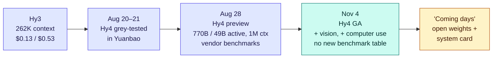
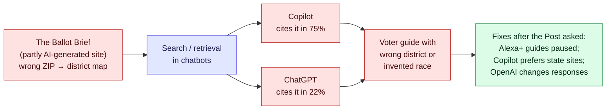

# LLM Updates — 2026-Nov-04

Compiled Wed Nov 4 2026, early morning Los Angeles time, covering **Nov 3 → Nov 4**. It is the day after the US
midterms. No US frontier lab shipped a model. The one model release is from China: **Tencent made Hy4 generally
available**, the first model in its Hy series that can read images and operate a computer. **Kimi K3.1 Pro's weights
were due today, and as of compile time we found no report that they are on Hugging Face.**

**The item most worth your time is RSI-Dojo (arXiv 2611.03698, listed Nov 4). It is a set of 281 executable training
environments that teach an LLM agent to run another model's post-training, which is one concrete step of AI R&D. The
team built them by converting human research artifacts automatically, then fine-tuned small open models on trajectories
recorded from frontier models. A 35B-A3B model trained this way gains about 17 points on PostTrainBench. It lands a day
after Anthropic's S-1/A said its future models "may imminently meet" its AI R&D threshold (Nov-03 brief). Read together,
the two show that "AI doing AI research" is now something that has training data and a benchmark, not only a risk-factor
sentence.**

- **Tencent Hy4 GA (Nov 4, Beijing time).** A 770B-total / ~49B-active mixture-of-experts model with a 1M-token
  context. It adds vision and computer use from both the command line and a GUI. The API costs **$0.834 / $2.501** per
  million input/output tokens, about 6.4× and 4.7× Hy3's prices. Weights and a system card are promised "in the coming
  days". There is no GA benchmark table (§1).
- **Anthropic's chip team uses Claude (The Information, Nov 3).** In IPO investor meetings, Anthropic said its new
  15-person custom-silicon team uses Claude to shorten chip design work. Cadence shares fell about 4.5% and Synopsys
  about 2.5% on the day (§2).
- **Washington Post tests AI voter guides (Nov 3).** Six chatbots produced 3,000+ voter guides, one for an address in
  each US county. Guides that named a congressional district got it wrong **22%** of the time. Many errors traced back
  to a single website, *The Ballot Brief*. Amazon paused Alexa+ voter guides, and Microsoft and OpenAI changed their
  systems after the Post contacted them (§3).
- **RSI-Dojo (arXiv, Nov 4).** Agents trained to post-train models. Details and caveats are in §4.
- **Also (§5).** **Claude Code v2.1.318** adds an `effort` option for a mod's forked side jobs and warns before a
  stored claude.ai sign-in expires. The OpenAI newsroom lists a Chief Corporate Affairs Officer hire and a "Grid
  Protectors Program", neither of which we could confirm beyond the listing. We found no reported election-day AI
  incident.

---

## 1. Tencent Hy4 goes GA with vision and computer use (Nov 4)

From search snippets of eesel, OrcaRouter, DataLearner, OpenRouter's listings, Apiyi, Shattered, Felloai, ShiftDelete,
Emergent and KuCoin flash news. Tencent's own announcement page was not in the search index, and direct fetches of the
secondary pages failed (DNS). This is the first time Hy4 appears in these briefs: the **Hy4 preview** came out on
**Aug 28** and we missed it, so the table below includes its figures for context.

| | Detail |
|---|---|
| **What shipped** | The general-availability release of **Hy4**, after the Aug 28 preview. It is the first Hy model with image understanding and the first with **computer use** through both CLI and GUI |
| **Architecture** | **770B total / ~49B active** mixture-of-experts, 78 layers, 256 routed experts + 1 shared (preview figures from DataLearner). One source notes Tencent's GA post gave no parameter count and the 770B number comes from TechNode |
| **Context** | **1,048,576 tokens**, up from about 262K for Hy3 |
| **Price (OpenRouter)** | **$0.834 input / $2.501 output / $0.042 cache hit** per million tokens. Hy3: $0.13 / $0.53. Domestic price: ¥6 / ¥18 (¥0.3 cached), against ¥1 / ¥4 for Hy3. Other aggregators list the preview at $0.75 / $2.25 |
| **Access** | Tencent Cloud (TokenHub), OpenRouter (`tencent/hy4-preview`, served by several hosts), and Tencent's own apps: Yuanbao, WorkBuddy, CodeBuddy, ima |
| **Weights** | Tencent says open weights and a **system card** will follow "in the coming days". Several sources describe the preview as Apache-2.0 open weights; others say no weights have shipped. We could not check Hugging Face (proxy blocked) |
| **Benchmarks (preview, vendor-reported)** | Terminal-Bench 2.1 **85.4** (Hy3 71.7); SWE-bench Multilingual **82.9%**; SWE-bench Pro **65.7**; DeepSWE 64.3; GPQA Diamond **92.3**; Tencent finance eval 3.04. The GA release shipped **without** a benchmark table, and one analysis finds Hy4 first on none of 12 benchmarks it compared (best: second) |
| **Not found** | Any computer-use benchmark score (OSWorld or similar), any independent evaluation, or Artificial Analysis placement |

**Interpretation.** Hy4 is priced like a mid-tier Western model rather than like the Chinese open models it is usually
compared with. At $0.83 / $2.50 it costs slightly more than Mistral Large 4 ($0.70 / $2.10, Oct-30 brief) and about
six times Hy3. That price makes sense only if the vision and computer-use features work well, and there is not yet a
number on them. The system card is the item to wait for. It should say whether Tencent did any cyber or agentic-misuse
testing on a model that can now drive a GUI.

---

## 2. Anthropic tells IPO investors that Claude helps design its chips (Nov 3)

From The Information's report as carried by Yahoo Finance, KuCoin, AI Weekly and Shopifreaks. The Information is
paywalled and was not read directly. Anthropic has not made a public statement on the claims below.

| | Detail |
|---|---|
| **Claim** | Anthropic's in-house custom-silicon team (publicly confirmed in early August; Aug-14 brief) has **about 15 people** and uses Claude models to finish chip design work in less time than traditional workflows at Nvidia or AMD |
| **Where it was said** | Recent meetings with prospective IPO investors |
| **EDA angle** | An executive at an AI chip design startup told The Information that Anthropic approached electronic design automation (EDA) companies about buying or using their **design data** |
| **Strategy stated** | A "multi-chip approach" continues: Nvidia and AMD GPUs, AWS Trainium and Google TPUs |
| **Market reaction** | Cadence fell about **4.5%** and Synopsys about **2.5%** on Nov 3, with intraday drops of up to 4% reported |
| **What is not known** | Any tape-out, product, or plan to sell chip-design capability. Reported talks with Samsung about manufacturing are unconfirmed |

**Interpretation.** This is the commercial side of the S-1/A's AI R&D sentence (Nov-03 brief): Anthropic is telling
investors that its models speed up its own hardware work, a day after it told the SEC it may soon cross a threshold for
AI-accelerated progress. The EDA share drop is the market treating "model companies as EDA competitors" as possible,
although Anthropic has not said it will sell anything. GDPx (Nov-02 brief) had Opus 5.5 leading its chip-design domain,
which is the only public number we have on this.

---

## 3. The Washington Post's AI voter-guide test (Nov 3)

From search snippets of the Post's article and coverage by Let's Data Science, Tech Times, Futurism, Gadget Review,
the US Vote Foundation and NPR. The Post was not fetched directly. Amazon's executive chairman Jeff Bezos owns the
Post, which the article discloses.

| | Detail |
|---|---|
| **Method** | Six popular chatbots were asked to make a voter guide for an address in **every US county**: more than **3,000** guides in all. Coverage does not list all six by name; ChatGPT, Copilot and Alexa+ are named |
| **District errors** | Chatbots failed to name the correct congressional district **48%** of the time. Of the guides that named a district, **22%** named the wrong one |
| **Examples** | ChatGPT included a **Missouri US Senate race** that is not on the 2026 ballot, listed a House candidate in Washington who is not on the ballot, and described Wyoming municipal candidates as federal candidates |
| **Source loop** | A little-known site, **The Ballot Brief**, mapped some ZIP codes to the wrong districts. ChatGPT cited it in **22%** of election answers and Copilot in **75%**. The Post says parts of the site appear to be AI-generated |
| **Company responses** | **Amazon** found the cause and **paused Alexa+ voter guides**. **Microsoft** says Copilot now prioritises official state election sources. **OpenAI** and Amazon changed how their assistants respond to voter-guide requests after the Post asked |
| **Usage context** | Pew: **8%** of US adults used chatbots for 2026 election information. A National Conference on Citizenship survey: about **2 in 5**. NPR separately found misleading errors in **5.9%** of answers in its own test (Nov 2) |

**Interpretation.** The failure here is in retrieval, not in the model's own knowledge. One bad source with an
authoritative-looking ZIP-to-district table was enough to spread errors through several assistants. That is the same
pattern as the voter-guide sourcing study in the Oct-26 brief (X and partisan guides as top citations). The fixes
the companies describe are source whitelists for one topic. They do not address the general case of a confident-looking
site that is wrong.

---

## 4. RSI-Dojo: training agents to run post-training (arXiv 2611.03698, Nov 4)

From the arXiv abstract page and listing, via the search index. `arxiv.org` could not be fetched (DNS), so everything
below is from the abstract only.

| | Detail |
|---|---|
| **Paper** | "Training LLM Agents to Automate LLM Post-Training with RSI-Dojo", Shuzheng Gao, Zhaojian Yu, Penghao Yin, Yuling Shi, Kai Cai, Shilin He, Michael R. Lyu |
| **Environments** | **RSI-Craft**, an automatic pipeline, turns human research artifacts into executable model-training environments. Filtering by data size, execution reliability and discriminability leaves **281 seed tasks** (RSI-Dojo) |
| **Training data** | Trajectories recorded from frontier models running an improved harness, kept only if they pass rubric-based and outcome-based filters |
| **Models** | **RSI-Dojo-9B** and **RSI-Dojo-35B-A3B** |
| **Result** | **+8.74** and **+16.87** PostTrainBench points over their base models |
| **Benchmark** | PostTrainBench (ICML 2026): an agent must post-train a model autonomously within a fixed budget of **10 hours on one H100** |
| **Not in the abstract** | Absolute scores, comparison with the frontier models that produced the trajectories, contamination checks between RSI-Dojo tasks and PostTrainBench |

**Interpretation.** The paper is a distillation result: small open models learn to do a bounded AI R&D task by copying
filtered frontier-model behaviour. It does not show self-improvement. What it does show is that the "post-train a model
in 10 GPU-hours" skill can be packaged into environments and taught cheaply, so that skill will spread beyond the
frontier labs whatever the labs' own thresholds say. The automated environment builder (RSI-Craft) may matter more
than the scores, since it removes the human bottleneck in making such tasks.

---

## 5. Smaller items

- **Claude Code v2.1.318** (changelog; previous release v2.1.317). Additions: an `effort` option on a mod's
  `$.model.fork` so a side job can run at `low` effort; the sign-in expiry date in `claude auth status`
  (`loginExpiresAt`) and in `claude -p` JSON (`credential_expires_at`), with a stderr warning from 10 days before it
  expires; `assume_role` for `mantle` upstreams of the Claude apps gateway; a record of your answer when asked to turn
  on mods. There are about 50 fixes, including `--continue` losing earlier conversation after malformed tool-call
  retries (regression in 2.1.314) and idle compaction replacing a conversation with a reply that was not a summary.
  Claude Code no longer installs or updates the IDE extension when started in an IDE terminal.
- **Kimi K3.1 Pro weights.** Due today. As of the latest indexed reports, Artificial Analysis still listed the weights as
  "not published" and no K3.1 repo was visible under `moonshotai`. Modal and an AMD host have announced day-0 support.
  The K3 weights arrived on the promised day (Jul 27). Per Notebookcheck, Moonshot removed cyber-related data from the
  open-weights version's training.
- **OpenAI newsroom.** The listing shows two Nov 3 entries we could not open: "Jill Hazelbaker joins OpenAI as Chief
  Corporate Affairs Officer" and a research post, "Accelerating engineering for the physical world". It also lists a
  "Grid Protectors Program" (dated Nov 2 or Nov 3). Fortune reported in the spring that Hazelbaker, Uber's chief
  corporate affairs officer, had turned down OpenAI's communications role. We found no coverage of the appointment, so
  treat it as listed but unconfirmed. Background: OpenAI met power companies about grid security in September.
- **Election day.** We found no reported AI-driven incident on Nov 3. OpenAI's Election Operations Center runs until the
  count ends. A Tech Policy Press piece (late October) found LLM image tools still produced election deepfakes days
  before the vote.
- **Google Cloud (Nov 3).** Gemini Enterprise can now connect to Salesforce data by federation (GA). An integration
  change, not a model.

**Excluded.** Marvell–Lumentum ($115B all-stock; optical networking, not LLMs). Salesforce–Cresta (one digest; no
confirming source found). "Goldman pulls AI coding tools from traders" (the only match was the April 28 Hong Kong
Claude restriction). The Anthropic–Lambda $35B deal (Sep 1, already covered). Menlo Ventures' 2026 enterprise report
(no 2026 edition found; the 2025 one is from Dec 2025). A blog claim that OpenAI released "GPT-6.1 Sol" (no primary
source). The Anthropic AI R&D threshold and Q3 numbers (covered Nov-03). Mistral Large 4 weights (covered Oct-30).

---

## Watch-items into the next brief

| # | Item | Status after Nov 3–4 |
|---|---|---|
| 125 | Kimi K3.1 Pro weights | Due **today**; not confirmed as of compile time |
| 135 | Anthropic IPO | No price range yet; chip-team pitch to investors reported |
| 155 | Apple Intelligence China beta | Testing was due to start Nov 4; no report yet |
| 165 | Anthropic AI R&D threshold | No RSP report yet; RSI-Dojo (§4) is related outside work |
| 168 | Election-day AI incidents | None found; WaPo voter-guide test (§3) is the main finding |

Items 71, 88–124, 126–134, 136–154, 156–164, 166 and 167 carry over unchanged; nothing new was found on them.

New items:

169. **Tencent Hy4 weights and system card.** Whether weights ship under Apache 2.0, and whether the system card
     covers computer-use or cyber evaluations. Also any independent scores (Artificial Analysis, OSWorld).
170. **RSI-Dojo follow-ups.** Code and environment release, contamination analysis against PostTrainBench, and whether
     anyone reproduces the gains.
171. **OpenAI newsroom items.** Confirm the Hazelbaker hire, the "physical world" research post and what the Grid
     Protectors Program is.

---

### Method & caveats

- **Compiled** Wed Nov 4 2026, ~05:00–06:00 Los Angeles time (PST), covering **Nov 3 → Nov 4**. Hy4's GA date is Nov 4
  Beijing time, which is Nov 3 in the US.
- **What is measured, claimed, or reported.**
  - **Read directly from primary source:** the Claude Code changelog (raw.githubusercontent.com).
  - **Abstract only, via search index:** RSI-Dojo (§4).
  - **Vendor-reported, via secondary sources:** all Hy4 benchmarks (§1). Prices come from OpenRouter listings as shown
    in search results and may differ by host.
  - **Single outlet, paywalled:** The Information on Anthropic's chip team (§2).
  - **Press investigation:** the Washington Post voter-guide test (§3), via coverage and snippets.
  - **Listing only:** the OpenAI newsroom items in §5.
- **Interpretation, labelled as such:** the lead and the interpretation paragraphs in §1–§4.
- **Scraping resilience.** Direct fetches failed (DNS) for `openai.com`, `theneuron.ai`, `shiftdelete.net` and
  `emergent.sh`; `huggingface.co` was refused by the session proxy, so Kimi and Hy4 weight status could not be checked
  first-hand. `arxiv.org` was not retried after failing in earlier runs. Everything not listed as primary comes from
  the search index.

### Sources (by section)

- **Tencent Hy4.** [eesel, Hy4 specs and pricing](https://www.eesel.ai/blog/tencent-hy4) · [eesel, Hy4 review](https://www.eesel.ai/blog/tencent-hy4-review) · [eesel, Hy4 pricing](https://www.eesel.ai/blog/tencent-hy4-pricing) · [ShiftDelete](https://shiftdelete.net/en/tencent-hy4) · [Emergent](https://emergent.sh/news/tencent-hy4-launch-770b-vision-model-computer) · [OrcaRouter, Hy4 vs Hy3](https://www.orcarouter.ai/blog/tencent-hy4-vs-tencent-hy3) · [OrcaRouter, Hy4 preview launch](https://www.orcarouter.ai/blog/tencent-hy4-preview-launch) · [DataLearner, Hy4 preview](https://www.datalearner.com/en/ai-models/pretrained-models/hy4-preview) · [DataLearner, Hy4 preview vs Hy3](https://www.datalearner.com/en/ai-models/compare/hy4-preview/vs/tencent-hy3) · [OpenRouter, hy4-preview](https://openrouter.ai/tencent/hy4-preview) · [OpenRouter, compare](https://openrouter.ai/compare/tencent/hy4-preview) · [Apiyi](https://help.apiyi.com/en/tencent-hy4-770b-vision-computer-use-pricing-en.html) · [Felloai, Hy4 preview](https://felloai.com/tencent-hy4-preview/) · [Shattered, Hy4 preview](https://shattered.io/tencent-hy4-preview-770b-2026/) · [KuCoin, Hy4 open-sourced](https://www.kucoin.com/news/flash/tencent-s-hunyuan-hy4-open-sourced-with-770b-total-parameters-and-1m-context) · [KuCoin, Yuanbao grey test](https://www.kucoin.com/news/flash/tencent-s-hunyuan-hy4-appears-in-yuanbao-app-entering-gray-testing) · [Crypto Briefing](https://cryptobriefing.com/tencent-hy4-preview-770b-ai-model/)
- **Anthropic chip team.** [Yahoo Finance (The Information)](https://finance.yahoo.com/technology/ai/articles/anthropic-touts-claude-chip-design-153547636.html) · [Shopifreaks](https://www.shopifreaks.com/anthropic-tells-ipo-investors-that-its-15-person-chip-team-uses-claude-to-design-custom-ai-chips-in-less-time-than-usual/) · [KuCoin](https://www.kucoin.com/news/flash/anthropic-uses-claude-to-design-ai-chips-aiming-to-challenge-traditional-vendors) · [AI Weekly](https://aiweekly.co/alerts/anthropic-tells-ipo-investors-claude-helps-design-its-chips) · [DCD, team confirmed (Aug)](https://www.datacenterdynamics.com/en/news/anthropic-publicly-confirms-its-putting-together-an-in-house-chip-design-team/) · [Quartz (Aug)](https://qz.com/anthropic-custom-ai-chip-design-team-claude-080526) · [36Kr](https://eu.36kr.com/en/p/3954320898227588) · [Boing Boing, $895B commitments](https://boingboing.net/2026/11/03/anthropic-895-billion-compute-commitments.html)
- **Voter guides.** [Washington Post](https://www.washingtonpost.com/technology/2026/11/03/doing-last-minute-research-midterms-be-careful-with-ai-chatbots/) · [Let's Data Science](https://letsdatascience.com/news/washington-post-tests-six-chatbots-on-voter-guides-finds-err-64c77967) · [Tech Times](https://www.techtimes.co.uk/ai-chatbots-election-voter-guide-errors-2026-midterms-1809640) · [Futurism](https://futurism.com/artificial-intelligence/chatgpt-ai-chatbot-misinformatin-election-voters) · [Gadget Review](https://www.gadgetreview.com/chatgpt-is-giving-voters-serious-misinformation-as-the-midterms-hit-fake-candidates-and-wrong-election-information) · [ADN, The Ballot Brief](https://www.adn.com/nation-world/2026/10/30/how-an-obscure-website-became-a-force-in-americas-election-information-machine/) · [US Vote Foundation](https://www.usvotefoundation.org/why-and-how-ai-chatbots-fail-voters) · [NPR](https://www.npr.org/2026/11/02/nx-s1-6025407/chatbots-midterms-voting-advice) · [WVXU/NPR](https://www.wvxu.org/news-from-npr/2026-11-02/ai-chatbots-are-becoming-political-advisers-their-answers-can-mislead-voters)
- **RSI-Dojo.** [arXiv 2611.03698](https://arxiv.org/abs/2611.03698) · [HTML](https://arxiv.org/html/2611.03698) · [arXiv cs.AI new listing](https://arxiv.org/list/cs.AI/new) · [PostTrainBench](https://arxiv.org/html/2603.08640v2) · [PostTrainBench ICML poster](https://icml.cc/virtual/2026/poster/63667)
- **Smaller items.** [Claude Code CHANGELOG](https://github.com/anthropics/claude-code/blob/main/CHANGELOG.md) · [Alexey Fateev on X, Kimi day-0 support](https://x.com/superalesha/status/2117652019997544531) · [Notebookcheck, Kimi K3.1 Pro](https://www.notebookcheck.net/Kimi-K3-1-Pro-Free-to-try-hacking-skills-deliberately-weakened.1433507.0.html) · [cellcog, Kimi weights date](https://cellcog.ai/blog/kimi-k3-1-release-date/) · [Let's Data Science, Kimi weights due Nov 4](https://letsdatascience.com/news/moonshot-releases-kimi-k31-pro-api-open-weights-due-nov-4-786e160c) · [OpenAI company announcements](https://openai.com/news/company-announcements/) · [Moneywise (Fortune), Hazelbaker](https://moneywise.com/news/top-stories/openai-chief-communications-officer-search) · [Tech Policy Press, deepfakes](https://www.techpolicy.press/llms-are-still-making-election-deepfakes-just-days-before-the-us-midterms/) · [NewsNation, election-day monitoring](https://www.newsnationnow.com/politics/2026-midterm-elections/openai-anthropic-election-day-monitor-misuse-ai/) · [Google Cloud release notes](https://docs.cloud.google.com/release-notes)
- **Exclusions.** [Enoumen, Nov 3 digest](https://enoumen.substack.com/p/anthropic-warns-self-improving-ai) · [Goldman Hong Kong Claude restriction (Apr)](https://www.zawya.com/en/special-coverage/ai-shaping-digital-future/goldman-sachs-bars-hong-kong-bankers-from-using-anthropic-ai-source-says-x1v0fukk) · [TNW, Anthropic–Lambda (Sep 1)](https://thenextweb.com/news/anthropic-lambda-35bn-cloud-deal) · [mean.ceo, OpenAI November claims](https://blog.mean.ceo/open-ai-news-november-2026/)
