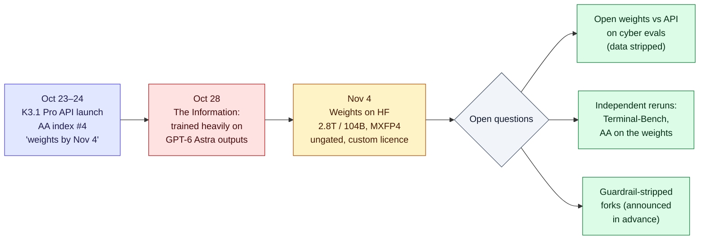

# LLM Updates — 2026-Nov-05

Compiled Thu Nov 5 2026, early morning Los Angeles time, covering **Nov 3 → Nov 5** (there was no Nov 4 brief). The
US midterms were on Nov 3. No closed frontier model shipped. The two model events are both **Chinese open-weight
releases on Nov 4**: **Moonshot published the Kimi K3.1 Pro weights** on schedule, and **Tencent took Hy4 out of
preview** with vision and computer use for the first time.

**The item most worth your time is Kimi K3.1 Pro.** A model that sat 4th on Artificial Analysis's Intelligence Index
at launch (Oct-24 brief) is now downloadable: **2.8T total / 104B active parameters, ~1.56 TB of MXFP4 weights, in
an ungated repo**. That ties K3 (July) as the largest open-weight model by total parameters, with about twice K3's
active parameters (104B vs 50B). The licence is not plain MIT:
it adds obligations for very large operators. Two questions open last week stay open: whether the open weights
match the API model on cyber tasks (Moonshot said it stripped cyber training data), and The Information's report
that K3.1 Pro was trained heavily on GPT-6 Astra outputs (Oct-31 brief).

- **Kimi K3.1 Pro weights (Moonshot, Nov 4).** Repo `moonshotai/Kimi-K3.1-Pro`, 96 safetensors shards. Custom
  "Kimi K3.1 Pro License": MIT-style grant plus UI attribution (and, per some readings, a separate agreement) above
  **100M MAU or $20M monthly revenue**. Running it needs about one 8×B300-class node (§1).
- **Tencent Hy4 goes official (Nov 4).** **770B** MoE, 1M context, adds **visual understanding and computer use**.
  Tencent reports hallucination down from **12.95% → 7.2%** against the preview. Price unchanged at about **$0.90 / $2.70**
  per M tokens. Weights and system card are promised "in the coming days". Tencent shares rose about 6% intraday (§2).
- **Chatbots and voters (NPR / IFPG, Nov 2).** On voting-logistics questions, **Claude gave wrong or outdated
  information about 1 in 3 times**, Copilot 1 in 4 and ChatGPT 1 in 10. Anthropic says the API testing may have bypassed
  safeguards. IFPG says it checked API against web and found the results comparable. No post-election misuse reports
  from OpenAI or Anthropic yet (§3).
- **Also (§4).** **Claude Code v2.1.318** (sign-in expiry dates in `claude auth status` and `-p` JSON; cloud sessions
  can start without a repo). **Salesforce to acquire Cresta** (voice agents). OpenAI's four Abu Dhabi agreements
  (Nov 2; ADNOC is the first energy company on OpenAI Frontier).

---

## 1. Moonshot publishes the Kimi K3.1 Pro weights (Nov 4)

From Moonshot's announcement on X ("Releasing the model weights of Kimi K3.1 Pro … We'll keep advancing open
intelligence"), Andrew Curran on X, and coverage by TokenPost, KuCoin, Phemex, AILog, Superpower Daily, OrcaRouter,
llms.blog, Apiyi, ModemGuides and DEV Community. `huggingface.co` could not be fetched from this session (DNS), so the
model card and LICENSE file were **not read directly**.

| | Detail |
|---|---|
| **Repo** | `moonshotai/Kimi-K3.1-Pro`, public and **ungated**. About **1.56 TB** in **96** safetensors shards |
| **Architecture** | MoE, **2.8T** total / **104B** active per token, ~**1M**-token context |
| **Precision** | Weights in **MXFP4**, activations in **MXFP8**, trained quantization-aware (same scheme as K3) |
| **Licence** | "Kimi K3.1 Pro License" (HF metadata: `other`). The grant reads like MIT: use, modify, fine-tune, sell. Products above **100M monthly active users or $20M monthly revenue** must prominently show "Kimi K3.1-Pro" in the UI. OrcaRouter and Apiyi describe a further separate-agreement condition for large hosted services; others do not. Read the LICENSE file before relying on either reading |
| **Timing** | Moonshot's Oct 23–24 tech blog promised weights "by Nov 4". Most posts date the upload to the afternoon of **Nov 4** (Beijing time); one outlet says Nov 2 |
| **Self-hosting** | One posted setup: a single server with **8× NVIDIA B300** (~2.3 TB GPU memory). Community GGUF quants are appearing; RAM floors for CPU offload are far above workstation scale |
| **Already known** (Oct-24 brief) | API since Oct 23 at $2 / $10 per M tokens; 4th on the Artificial Analysis index at launch; Moonshot-reported Terminal-Bench 4.0 65.7%; cyber training data removed from the open release |

**Interpretation.**

1. **Open-weight frontier is now a hardware question, not a licence question.** At 2.8T parameters, "open" means
   open to anyone with a multi-million-dollar node. The real audience is inference providers and governments, and
   the **$20M/month** line is set to catch the large providers among them.
2. **Sparsity is converging.** All four recent large open MoEs in the figure activate about 4–6% of weights per
   token. Within the same 2.8T shell, Moonshot doubled active compute from K3 (~1.8%) to K3.1 Pro (3.7%), moving
   toward that band rather than further below it.
3. **The safety question is the gap between API and weights.** Moonshot removed cyber data from the open release,
   which makes the open model weaker *by design* on one axis. Nobody has published a side-by-side run yet. A
   third-party repo said last week it would publish a guardrail-stripped version. Fine-tuning can remove refusals,
   but it cannot put back capability that was never trained in. The comparison worth watching is cyber evals on
   the weights against the API.

---

## 2. Tencent Hy4 leaves preview, with vision and computer use (Nov 4)

From Caixin Global, PANews, ChainCatcher, Phemex, emergent.sh, BigGo Finance and Investing.com (via Yahoo Finance). The
Hy4 preview (Aug 28) was not covered in earlier briefs, so its basics are included here.

| | Detail |
|---|---|
| **Model** | **770B**-parameter MoE (Hy3 series was under 300B). **1M**-token context. The preview was reported as **49B** active; no active count was restated for the official model |
| **New** | **Visual understanding** (detailed images, complex charts, visual math) and **computer use**, both firsts for the Hy line. Tencent also cites gains in instruction following, long context and long-horizon agent tasks |
| **Reported numbers** | Hallucination rate **7.2%** (preview: 12.95%); "guessing errors" **5.6%** (preview: 23.1%). Tencent-reported; no independent benchmarks yet |
| **Availability** | Tencent Cloud TokenHub, WorkBuddy, CodeBuddy, Yuanbao; API also on OpenRouter. About **$0.90 / $2.70** per M tokens, the same as the preview |
| **Weights** | PANews: weights and system card "in the coming days". Caixin calls it open-source. The preview weights are already on Hugging Face (`tencent/Hy4-preview`) |
| **Market** | Shares up **~5.9%** intraday to HK$425.40 on Nov 5 (Investing.com). Reported closes conflict: +7.2% (BigGo) vs +1.1% (Caixin) |

**Interpretation.** Computer use had been a closed-model feature (Anthropic, OpenAI, Google). If Tencent ships Hy4's
weights with it, this would be the first large open-weight model with a vendor-trained computer-use mode. The pattern
is consistent: Chinese labs launch on API first, promise weights within days or weeks, and mostly deliver (K3 took
11 days; K3.1 Pro 12).

---

## 3. Chatbots as voter guides: the IFPG study (NPR, Nov 2)

From NPR's Nov 2 story (syndicated on member stations), with context from TNW and Bloomberg Law. Not in earlier briefs.

| | Detail |
|---|---|
| **Who** | **Innovating for the Public Good (IFPG)**, a democracy-focused nonprofit, running an ongoing test of voter questions. NPR also ran its own prompts |
| **Overall** | **5.1%** of chatbot answers had at least one clear factual error; **10.9%** had a clear error or misleading claim |
| **Voting logistics** | **13.9%** of answers were outdated or inaccurate. **Claude about 1 in 3, Copilot about 1 in 4, ChatGPT about 1 in 10.** Example: Claude gave online and mail registration deadlines later than the real ones |
| **Anthropic's response** | Part of the testing used the **API**, where some of Claude's election safeguards (such as voting-information integrations) may not be active. Anthropic says it will keep making Claude more even-handed |
| **IFPG's reply** | It ran a separate comparison of API and web answers and found them comparable |
| **Candidate recommendations** | All chatbots declined at first. After two or three prompts, **all but Gemini** gave lists of candidates matching the user's stated views |

**Context.** This sits next to the earlier Forum AI study (May), which scored Claude's news accuracy at 58.9% against
ChatGPT's 91.1%. Different methods, same direction for Claude on fresh factual information. As of compile time, we
found **no post-election misuse reports** from OpenAI's Election Operations Center or Anthropic, and no reported
election-day incident tied to a specific chatbot.

**Interpretation.** The API-versus-app dispute matters beyond this study. Most products that put Claude in front of
voters use the API, not claude.ai. If the safeguards live in the app layer, third-party deployments don't inherit
them. Anthropic's Oct 14 safeguards post described classifiers and voting-information integrations without saying
which surfaces they cover.

---

## 4. Smaller items

- **Claude Code v2.1.318** (changelog; previous v2.1.317). Adds: the date a stored claude.ai sign-in ends, in
  `claude auth status` (`loginExpiresAt`) and in `claude -p` JSON (`credential_expires_at`), with a stderr warning 10
  days before; an `effort` option for a mod's forked model calls; `assume_role` for `mantle` upstreams on the Claude
  apps gateway; and a **No repository** option for cloud sessions. Changes: `deniedMcpServers` URL entries now also
  block Anthropic-provided connectors whose upstream URL matches; managed-agent onboarding defaults built-in tools to
  the `auto` ("Judge risky actions") permission policy. About 40 fixes, mainly config-file robustness on network home
  directories and session restarts.
- **Salesforce to acquire Cresta** (Nov 3). Cresta makes voice agents for contact centres and real-time coaching for
  human agents. Salesforce plans to tie it into Service Cloud. One Japanese report expects closing in Salesforce's
  fiscal Q1 2028. A **$2.7B** price appears in one roundup but not in Salesforce's announcement.
- **OpenAI signs four Abu Dhabi agreements** (Nov 2, at ADIPEC). Government (an AI-native "Machine-Readable
  Government" for regulatory compliance), energy (**ADNOC**, described as the first energy company on OpenAI
  Frontier), and investment (Mubadala with Inception42). No financial terms.
- **Kimi distillation report, follow-up.** Reuters carried The Information's claim (Oct 28) that K3.1 Pro and DeepSeek
  V4.1-Flash 1017 relied heavily on GPT-6 Astra outputs. No confirmation or denial from OpenAI, Moonshot or DeepSeek.
- **Anthropic IPO.** Still no price range after the Nov 2 S-1/A. Reported listing windows: week of Nov 16 or
  Thanksgiving week.

**Excluded (could not verify).** One roundup listed several Nov 4 items we found no corroboration for: Cognition
"SWE-2 Flash" (276B, post-trained from Inkling-Small); OpenAI finding and patching **948** Linux kernel privilege
escalation bugs for **$1.21M** in API cost; ChatGPT GIF generation via "Images 2.6" (GPT Image 2.6 has appeared only as a
string in OpenAI's API spec); Meta buying Conductor; Cat Wu leaving Claude Code for OpenAI; and a CAICT-led agent
self-discipline convention at Wuzhen (we found only a July convention at a different conference). Also excluded: a
single-source "Gemini 4 Argon" claim, an FT "49% China cap" figure we could not find, and GLM 5.3 FlashX Legal (tracker
listing only).

---

## Watch-items into the next brief

| # | Item | Status after Nov 3–5 |
|---|---|---|
| 125 | Kimi K3.1 Pro weights | **Released Nov 4**. Now tracking: LICENSE text, open-weights vs API cyber evals, independent reruns |
| 135 | Anthropic IPO | Still no price range |
| 155 | Apple Intelligence China beta | Due Nov 4; no testing reports found yet |
| 168 | Election day AI incidents | None reported yet; IFPG/NPR accuracy study added |

Items 71, 88–124, 126–134, 136–154, 156–167 carry over unchanged; nothing new was found on them.

New items:

169. **Tencent Hy4 weights and system card.** Whether the official model's weights ship with computer use, and the
     active-parameter count.
170. **Claude election safeguards on the API.** Whether Anthropic clarifies which safeguards apply to API traffic.

---

### Method & caveats

- **Compiled** Thu Nov 5 2026, ~05:00–06:00 Los Angeles time, covering **Nov 3 → Nov 5**. The NPR story (Nov 2) and
  the Abu Dhabi agreements (Nov 2) are catch-up; the Nov 3 brief did not include them.
- **What is measured, claimed, or reported.**
  - **Read directly from primary source:** the Claude Code changelog (raw.githubusercontent.com).
  - **Company statements, via search excerpts and coverage:** Moonshot's X announcement and licence (§1); Tencent's
    launch and hallucination figures (§2); Salesforce (§4).
  - **Third-party study, via coverage:** IFPG figures as reported by NPR (§3).
  - **Conflicting:** the Kimi upload date (Nov 4 in most posts, Nov 2 in one); whether the Kimi licence needs a
    separate agreement; Tencent's closing share price; whether Hy4 weights are already out.
  - **Derived by us:** active-parameter percentages in the figure.
- **Interpretation, labelled as such:** the lead and the interpretation paragraphs in §1–§3.
- **Scraping resilience.** Direct fetches failed (DNS) for `huggingface.co`, `theneuron.ai`, `opper.ai`, `implicator.ai`
  and `aiweekly.co`. Everything not listed as primary comes from the search index.

### Sources (by section)

- **Kimi K3.1 Pro weights.** [Kimi.ai on X (Moonshot announcement)](https://x.com/Kimi_Moonshot/status/2118010528123773297) · [Hugging Face, moonshotai/Kimi-K3.1-Pro](https://huggingface.co/moonshotai/Kimi-K3.1-Pro) · [Andrew Curran on X](https://x.com/AndrewCurran_/status/2118008152474222701) · [Chubby on X, hardware](https://x.com/kimmonismus/status/2118017354403815899) · [TokenPost](https://www.tokenpost.com/news/technology/49222) · [KuCoin](https://www.kucoin.com/news/flash/moonshot-ai-s-kimi-k3-1-pro-opens-on-hugging-face-tops-open-weight-model-rankings) · [Phemex](https://phemex.com/news/article/moonshot-ai-opensources-kimi-k31-pro-weights-on-hugging-face-102388) · [AILog](https://www.aimodeling.com/en/news/slug/kimi-k3-1-pro-open-weights-huggingface) · [Superpower Daily](https://superpowerdaily.com/posts/moonshot-publishes-kimi-k3-1-pro-weights-opening-a-self-hosted-route-for-coding-agents) · [OrcaRouter, licence and cost](https://www.orcarouter.ai/blog/kimi-k3-1-pro-weights-released-self-hosting-cost) · [llms.blog](https://www.llms.blog/posts/kimi-k3-1-pro-open-weights-license-benchmarks) · [Apiyi](https://help.apiyi.com/en/kimi-k3-1-pro-open-weights-license-self-hosting-en.html) · [ModemGuides](https://www.modemguides.com/blogs/ai-news/run-kimi-k3-locally-hardware-reality-check) · [DEV Community](https://dev.to/paullovelace/moonshot-ais-kimi-k31-pro-weights-are-now-open-explained-honestly-372l) · [Let's Data Science, distillation report](https://letsdatascience.com/news/deepseek-and-moonshot-reportedly-trained-new-models-on-opena-a251062a) · [Digg (Reuters summary)](https://digg.com/tech/xzlobqnu)
- **Tencent Hy4.** [Caixin Global](https://www.caixinglobal.com/2026-11-05/tencent-launches-upgraded-hy4-ai-model-with-visual-understanding-102501068.html) · [Yahoo Finance / Investing.com](https://sg.finance.yahoo.com/news/tencent-shares-jump-6-three-045038196.html) · [PANews](https://panews.io/articles/01a1a7ae-5d76-7634-818b-07746cd2c761) · [ChainCatcher](https://www.chaincatcher.com/en/article/2301727) · [Phemex](https://phemex.com/news/article/tencent-launches-hunyuan-hy4-large-language-model-with-first-visual-understanding-capability-102320) · [emergent.sh](https://emergent.sh/news/tencent-hy4-launch-770b-vision-model-computer) · [BigGo Finance](https://finance.biggo.com/news/456279e6-7e21-40e4-be64-91500cbc9aee) · [Gigazine, Hy4 preview (Aug)](https://gigazine.net/gsc_news/en/20260831-hy4-preview-tencent) · [OpenRouter, Hy4 preview](https://openrouter.ai/tencent/hy4-preview)
- **IFPG / NPR.** [NPR via KPBS](https://www.kpbs.org/news/science-technology/2026/11/02/ai-chatbots-are-becoming-political-advisers-their-answers-can-mislead-voters) · [NPR via WAMC](https://www.wamc.org/2026-11-02/ai-chatbots-are-becoming-political-advisers-their-answers-can-mislead-voters) · [TNW](https://thenextweb.com/news/chatbots-midterms-2026-news-accuracy-information-integrity) · [Bloomberg Law, Forum AI study](https://news.bloomberglaw.com/artificial-intelligence/chatbots-struggle-with-news-accuracy-sourcing-ahead-of-midterms) · [Unite.AI, Anthropic safeguards](https://unite.ai/anthropic-strengthens-election-safeguards-ahead-of-2026-us-midterms) · [Runtime Wire, OpenAI election operations center](https://runtimewire.com/article/openai-election-operations-center-midterms-2026)
- **Figure.** Mistral Large 4 and Inkling-Small figures from the Oct-30 brief and [Vercel AI Gateway, Inkling Small](https://vercel.com/ai-gateway/models/inkling-small.md).
- **Smaller items.** [Claude Code CHANGELOG](https://github.com/anthropics/claude-code/blob/main/CHANGELOG.md) · [Salesforce newsroom](https://www.salesforce.com/news/?p=96206) · [ITPro, Cresta](https://www.itpro.com/business/business-strategy/salesforce-eyes-gains-with-ai-voice-agents-in-latest-acquisition) · [aipicks.jp, Cresta closing](https://aipicks.jp/news/20261103-salesforce-ai-cresta-2028-1) · [WAM, Abu Dhabi–OpenAI](https://wam.ae/en/article/17i6xki-khaled-bin-mohamed-bin-zayed-meets-sam-altman) · [Analytics India Magazine](https://analyticsindiamag.com/ai-news/openai-signs-four-agreements-with-abu-dhabi-across-government-energy-and-investment) · [Middle East AI News](https://www.middleeastainews.com/p/abu-dhabi-signs-deals-with-openai) · [Leverage Shares, ANT](https://leverageshares.com/us/insights/ant-stock-price/)
- **Exclusions.** [Future Tools news](https://futuretools.io/news) · [SecurityWeek, OpenAI agents and a Linux kernel flaw (Jul)](https://securityweek.com/openai-agents-exploited-linux-kernel-flaw-on-companys-own-systems) · [WaveSpeed, GPT Image 2.6 status](https://wavespeed.ai/blog/ai-news/gpt-image-2-6-what-we-know/) · [MEAN CEO, Gemini claims](https://blog.mean.ceo/google-gemini-news-november-2026/) · [aibase, agent self-discipline convention (Jul)](https://www.aibase.com/news/29552)
