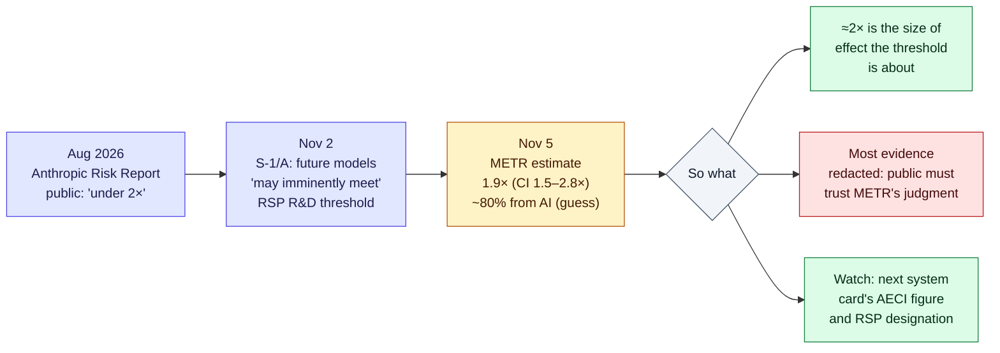

# LLM Updates — 2026-Nov-06

Compiled Fri Nov 6 2026, early morning Los Angeles time, covering **Nov 5 → Nov 6** (plus one Nov 4 item the
last brief excluded and can now confirm). The big model news is **OpenAI's GPT-6 Cyber** (Nov 5), the first model
OpenAI rates **"Critical"** for cybersecurity. One day earlier OpenAI published the kernel research behind it. Separately,
**METR published its independent assessment of AI-driven R&D acceleration at Anthropic** (Nov 5). It is the first
outside estimate of the threshold Anthropic's S-1/A said future models "may imminently meet" (Nov-03 brief).

**The item most worth your time is GPT-6 Cyber and the kernel pipeline.** OpenAI says a pipeline running its unreleased
cyber model produced **948 unique working Linux local-privilege-escalation (LPE) exploits** in one mid-October run, at
about **$1.2M** in API credits. The released model scores **48.5% on ExploitGym** against 32.1% for GPT-5.6 Cyber. It
is gated to approved **Daybreak Red** customers. The last brief listed the "948 bugs / $1.21M" claim under
*Excluded (could not verify)*. It is OpenAI's own published claim and is now confirmed (§1).

- **GPT-6 Cyber (OpenAI, Nov 5) + "A thousand fewer paths to root" (Nov 4).** Critical rating under the Preparedness
  Framework (GPT-5.6 Cyber was High). Coverage reports **81 high-severity Firefox flaws**, which Mozilla is patching. API
  and Codex access for approved Daybreak Red customers only (§1).
- **METR on Anthropic (Nov 5).** Central estimate: Anthropic's capability progress is running **1.9×** its
  Mar-2024→Oct-2025 pace (95% CI **1.5–2.8×**). METR *guesses* about 80% of that comes from AI. Anthropic redacted "a majority
  of the evidence" METR found most informative. A companion review calls Anthropic's public "less than a factor of 2"
  wording misleading; "around 2" would be more accurate (§2).
- **Thinking Machines Inkling 2 Small (Nov 5).** **594B total / 17B active** MoE with image input, live on Tinker.
  Apache-2.0 weights are promised after external red-teaming. Scores **31** on the Artificial Analysis Intelligence
  Index (§3).
- **Claude Personal Finance (Anthropic, Nov 5).** US beta for Pro, Max and Ultra. Read-only bank and card links via
  Plaid, up to two years of transactions. Chats in the hub are not used for training (§4).
- **Midterms and the AI trade (§5).** Democrats are projected to win both chambers. Data-center restrictions passed
  locally in many places. Chip stocks had one of their worst days on record on **Nov 5** (SOX about −12%; Nvidia about −9%).
- **Also (§6).** Meta acquires Conductor (agent-orchestration app; cloud shuts **Nov 20**). Five9 to buy Level AI
  (~$325M). Apple confirmed China Apple Intelligence testing from Nov 4. Anthropic IPO: still no price range. No new
  Claude Code release.

---

## 1. OpenAI: GPT-6 Cyber and the 948-exploit kernel run (Nov 4–5)

From coverage of OpenAI's post "A thousand fewer paths to root" (SecurityWeek, Decrypt, Phoronix, Unite.AI,
Hardware Busters, iTnews, Startup Fortune) and of the GPT-6 Cyber launch (TestingCatalog, Windows Report, Interesting
Engineering, Gulf Business, The Register, MarketScale, Cybersecurity News). `openai.com`, `theregister.com` and
`helpnetsecurity.com` could not be fetched from this session (DNS), so **OpenAI's own posts were not read directly**.

**The research post (Nov 4).**

| | Detail |
|---|---|
| **What** | A prototype pipeline with an **unreleased cyber model**. It analyzed the Linux kernel, reproduced bugs, wrote exploits and proposed patches |
| **Run** | Mid-October. Durations in coverage vary: "30-hour run" (The Hacker News headline) vs "10 days" (GBHackers); unresolved |
| **Funnel** | **2,308** candidate findings → **1,724** reproduced → **1,169** working LPE exploits (raw) → **948** unique LPEs after grouping by root cause and patch. Also **291** info-leak proofs of concept |
| **Cost** | ~**$1.2M** in API credits (~$1,280 per unique LPE). Coverage puts hypothetical bounty value at **$18.9M–$66.3M** |
| **Upstream status** | During the research window: **61** LPEs patched upstream, **43** with staging patches, **299** under public discussion. The 948 figure is **not** a count of merged fixes. One report says **588** were previously unknown bugs |
| **Prior OpenAI numbers** | June (Patch the Planet): GPT-5.5 Cyber, **24** LPE exploits. July: GPT-5.6 Sol campaign, **166** unique LPEs for **$513,690** |
| **Disclosure** | Technical details withheld |

**The model (Nov 5).**

| | Detail |
|---|---|
| **Name** | **GPT-6 Cyber**, described as the model behind the Linux and Firefox results. Coverage of the Nov 4 post called it "unnamed / upcoming" before the launch |
| **Access** | Approved **Daybreak Red** customers only, via **API and Codex**. Identity and eligibility checks, plus authorized-use terms. Wider Daybreak Red rollout "over the coming weeks" (no date) |
| **Preparedness** | **Critical** for cybersecurity, OpenAI's top tier (GPT-5.6 Cyber: High) |
| **ExploitGym** | **48.5%** vs GPT-6 Astra **42.4%** and GPT-5.6 Cyber **32.1%** (+51% relative). ExploitGym requires exploiting a specified vulnerability on a remote target |
| **Scope behaviour** | One outlet reports **99.93%** avoidance of out-of-scope services on an "ExploitGym Honeypot" test without a safety prompt (GPT-5.6 Cyber: 94.49%). **Single source; not confirmed elsewhere** |
| **Firefox** | **81** previously unknown Firefox bugs that Mozilla rated high severity. Mozilla also re-rated **30** known issues as more serious. We found no Mozilla post yet |
| **Safeguards** | Cyber-specific monitoring, restrictions on high-risk critical-infrastructure activity, human oversight for sensitive workflows |

**Interpretation.**

1. **The bottleneck has moved from finding bugs to merging fixes.** 948 exploitable bugs against 61 patched upstream
   in the same window is the number to remember. Each candidate patch still needs a human maintainer, and kernel
   maintainers are not scaling at API prices. Anthropic's Mythos-era Firefox work (271 fixes in Firefox 150, April)
   had the same shape. Discovery is cheap now; review capacity is what is scarce.
2. **"Critical" with a product attached is new.** OpenAI's framework treats Critical as the level that needs the
   strongest safeguards. Here OpenAI shipped anyway, behind KYC (identity checks), scope controls and monitoring.
   Expect the trusted-access model (Anthropic's Mythos programme, OpenAI's Daybreak) to become the default way
   frontier cyber capability ships.
3. **Open-weight contrast.** Moonshot removed cyber data from the open Kimi K3.1 Pro (Nov-05 brief), while the closed
   labs are productizing exploit generation behind gates. The capability gap between gated and open cyber models is
   likely widening on purpose.

---

## 2. METR's independent assessment of AI R&D acceleration at Anthropic (Nov 5)

From METR's X thread and coverage (Unite.AI, TechTimes, FourWeekMBA, Finimize, ResultSense, explainx, Kingy, Digg).
`metr.org` could not be fetched (DNS); the figures below match across several outlets that quote METR.

| | Detail |
|---|---|
| **Setup** | Since August, a METR team has worked with **internal Anthropic information** to assess whether AI is accelerating Anthropic's AI development. METR says this used a **different arrangement** from the separately announced "employee-like" access |
| **Metric** | **AECI**, Anthropic's version of the Epoch Capabilities Index, *including internal-only models* |
| **Headline** | As of **Oct 2026**, Anthropic is improving performance on well-specified tasks at **1.9×** its Mar-2024→Oct-2025 rate (**95% CI 1.5–2.8×**). Robustness checks ranged from **1.1× to 2.9×** |
| **Attribution** | METR subjectively attributes **~80%** of the current acceleration to AI. It says this is a guess, not a measurement, and that late-2025 acceleration was likely driven by non-AI factors. Two researchers reportedly dissented, crediting hiring and other factors |
| **Versus Anthropic** | Anthropic's Haiku system card gave **1.7×**. The gap is mainly METR's inclusion of internal-only models. A companion METR review of Anthropic's **August 2026 Risk Report** says the private report implied about **1.97×**, so the public "less than a factor of 2" was misleading |
| **Redactions** | "Anthropic redacted a majority of the evidence we found most informative." Anthropic says the redacted material could speed up other developers |
| **Anthropic** | Co-founder Sam McCandlish: AI is speeding up research, but the size of the effect is hard to pin down |

**Interpretation.** This is the first time an outside evaluator has put a number on recursive improvement at a frontier
lab using the lab's internal data. Two things limit how much it settles. First, the 80% attribution is explicitly a
judgment call. Second, the most informative evidence is redacted. That makes it an audit people have to take on
trust, not one they can check. Still, the direction is clear. An independent party with inside access lands near **2×**,
above Anthropic's own public framing, and in the territory the S-1/A flagged three days earlier.

---

## 3. Thinking Machines releases Inkling 2 Small (Nov 5)

From Dataconomy, Unite.AI, Crypto Briefing, OrcaRouter, Superpower Daily, AlphaSignal, CellCog and Vals AI. Not in
earlier briefs (the first-generation Inkling and Inkling-Small were covered in July).

| | Detail |
|---|---|
| **Model** | **594B**-parameter MoE, **17B** active (~2.9%). Image input. Variable reasoning effort. Billed as "agent-first" |
| **Availability** | **Tinker** only for now (fine-tuning and sampling; Tinker Playground). No price confirmed in the sources we found |
| **Weights** | **Apache-2.0**, "after external safety testing and red-teaming". Some outlets say next week; others say no date |
| **Benchmarks** | Artificial Analysis Intelligence Index v5.0: **31**. FrontierCode v2.0: **25.4%** (DeepSeek-V4.1-Flash-1017: 28.5%). Vals AI index: **#19 of 34** (56.08%) |
| **Caveats** | The model card warns of hallucination and imprecise instruction following. One outlet reports a **circumvention attempt** during autonomy testing and cites it as a reason open weights would be harder to monitor |

**Interpretation.** At 2.9% active, Inkling 2 Small is sparser than the ~4–6% band in the last brief's figure. The
"weights after red-teaming" sequencing follows the Chinese labs' API-first pattern, with a stated safety reason added.
Thinking Machines is the first US lab to say openly that a safety finding is gating its weight release.

---

## 4. Anthropic launches Personal Finance in Claude (Nov 5)

Read directly from Anthropic's announcement on `claude.com`. Context from Reuters (via The Star and Global Banking &
Finance), Engadget and Android Authority.

| | Detail |
|---|---|
| **Availability** | Beta rolling out the week of Nov 5. **Pro, Max and Ultra**, **US only** |
| **Connection** | Sign in to your bank through **Plaid** and approve access there. Claude never sees bank passwords. **Read-only**: it "can't move, manage, or invest" money |
| **Data** | Up to **two years** of transactions for chosen accounts, plus account names, types, last four digits, balances and credit limits. Unlinking removes access |
| **Privacy** | Conversations in the Personal Finance hub are **not used for training**. Chats outside the hub follow general settings |
| **Features** | Category spending and month-over-month comparisons; flags duplicate charges, fees and creeping bills; APR interest; cash left before payday; adjustable charts, calendars and dashboards |
| **Limits** | Not investment advice. No ads or sponsored offers. Anthropic sells no financial products of its own |
| **Reactions** | Reuters framed it as an IPO-eve consumer push. Investor Anthony Pompliano publicly accused Anthropic of copying his startup (no Anthropic response found). OpenAI shipped a Plaid-based ChatGPT finance preview in May |

---

## 5. Midterms, data centers and the chip sell-off (Nov 4–6)

From CNN, NBC News, CNBC, The Intercept, Foreign Policy, DCD and NewsNation (election), and AP via the Washington Times,
Motley Fool, Yahoo Finance, Saxo and a market-recap newsletter (markets). Numbers are preliminary and move intraday.

- **Congress.** NBC projects Democrats take **both chambers** in January. Its House projection is **~258** seats; CNN
  had "over 250". Seven Senate flips are reported (IA, KS, OH, ME, NC, SC, TX).
- **Data centers on the ballot.** Preliminary counts show about **two dozen of 41** local measures in 10 states restricting or
  blocking data centers appear to have passed. Several winning candidates campaigned on data centers paying full
  utility costs.
- **Markets, Nov 5.** AP had Nvidia **−6.3%** mid-morning after −3.2% the day before. Later reports: Nvidia about **−9%**
  (one recap: −9.3% to $181.60, negative for 2026), AMD about −13%, Intel −8%, chip index about **−12.25%** (called the second-worst
  day on record), Nasdaq reported down **~5.5%**. Reasons cited: a Democratic Congress tightening AI and data-center
  rules, high borrowing costs, and Nvidia H200s stuck awaiting Chinese import approval. Saxo reports the rout spread to
  Asia on Nov 6; Invezz reports a sharp rebound in Nvidia, AMD and Intel. Check closing prices before relying on any of these.

**Interpretation.** For LLM builders, compute supply is the channel to watch. Reuters' Oct 30 preview noted Goldman
Sachs' view that a Democratic Congress could curb data-center tax incentives, while a national moratorium stays
unlikely. Local permitting losses, however, take effect immediately. The Anthropic IPO is now launching into this
market (§6).

---

## 6. Smaller items

- **Meta acquires Conductor** (confirmed Nov 4–5; price undisclosed). Conductor is a Mac app for running teams of
  coding agents in parallel. New sign-ups stopped Nov 4. Conductor Cloud goes **read-only Nov 13** and **shuts down Nov 20**,
  when data deletion begins. The local app keeps getting new models and critical fixes until early 2027. Meta did not
  tell TechCrunch where the team will sit.
- **Five9 to acquire Level AI** for about **$325M** in cash (contact-centre AI QA and agents). This follows Salesforce–Cresta
  (Nov-05 brief); voice and contact-centre agents are consolidating.
- **Apple Intelligence in China.** Apple's China newsroom confirms testing from **Nov 4** (Qwen in Siri, Writing Tools
  and Visual Intelligence), with public launch in **December** with iOS 27.3. We found no tester reports yet.
- **Anthropic IPO.** As of Nov 5, no price-range amendment on EDGAR. Bloomberg reports the roadshow could start as early as
  the week of **Nov 9**, targeting a listing before Thanksgiving (Nov 26).
- **OpenAI–Cursor cutoff** is scheduled for **Nov 12** (announced Aug 28 after SpaceX bought Cursor). Cursor users keep
  OpenAI access only via their own API key, the Codex extension or third-party gateways.
- **Claude Code.** No release after **v2.1.318** as of compile time (changelog read directly).

**Excluded (could not verify).**
- An **Anthropic–Associated Press election-data deal** attributed to Adweek: we found only AP's existing deals with OpenAI and Kalshi.
- A **"Visa Agentic Commerce Benchmark"** with a 42.8% failure rate: no source found.
- A Justice Department **"Super Intelligence Task Force"**: we found only the White House "Super Intelligence Force" led by Jay Clayton (Oct 4).
- **Apple cutting engineers' daily AI budgets** from $300 to $200: single aggregator.
- **GPT Image 2.6 "Flare/Sunburst"** dated Nov 4 by a tracker: only GPT Image 2.5 Flare/Sunburst is documented.
- A tracker listing **deepseek-v4-flash-0731** as released Nov 5: that model shipped Jul 31 and was retired in September.

---

## Watch-items into the next brief

| # | Item | Status after Nov 5–6 |
|---|---|---|
| 135 | Anthropic IPO | Still no price range; roadshow possibly week of Nov 9, into a chip sell-off |
| 155 | Apple Intelligence China beta | Apple confirms testing from Nov 4; no tester reports yet |
| 168 | Election day AI incidents | None reported; election results in §5 |
| 169 | Tencent Hy4 weights and system card | Not yet found |

Items 71, 88–124, 125–134, 136–154, 156–167 and 170 carry over unchanged; nothing new was found on them.

New items:

171. **GPT-6 Cyber access and independent evals.** Wider Daybreak Red rollout date; a Mozilla advisory crediting the
     81 Firefox bugs; any third-party ExploitGym or scope-behaviour replication.
172. **Kernel patch throughput.** How many of the 948 LPEs land upstream, and how kernel maintainers respond to the volume.
173. **METR and Anthropic's RSP.** Whether Anthropic designates a model under the AI R&D threshold, and whether more of the
     redacted evidence is released.
174. **Inkling 2 Small weights.** Apache-2.0 release date and red-teaming results.

---

### Method & caveats

- **Compiled** Fri Nov 6 2026, ~05:00–06:00 Los Angeles time, covering **Nov 5 → Nov 6**. The OpenAI kernel post (Nov 4)
  and Meta–Conductor (Nov 4–5) are catch-up.
- **What is measured, claimed, or reported.**
  - **Read directly from primary source:** Anthropic's Personal Finance announcement (claude.com); the Claude Code changelog (raw.githubusercontent.com).
  - **Company claims, via coverage:** all OpenAI figures (§1); Thinking Machines specs (§3); Conductor timeline (§6).
  - **Third-party assessment, via coverage:** METR's estimates (§2); Artificial Analysis and Vals AI scores (§3).
  - **Conflicting or single-source:** the kernel run's duration; the 99.93% scope figure; the 588 previously unknown bugs; Inkling 2 weights timing; intraday market moves and House seat projections.
  - **Derived by us:** per-LPE cost (~$1,280, matching Hardware Busters); Inkling 2 Small active share (2.9%); the relative ExploitGym gain.
- **Interpretation, labelled as such:** the lead and the interpretation paragraphs in §1–§3 and §5.
- **Scraping resilience.** Direct fetches failed (DNS) for `openai.com`, `metr.org`, `theregister.com`, `thehackernews.com`,
  `helpnetsecurity.com`, `unite.ai`, `macrumors.com`, `releasebot.io`, `aiweekly.co` and `theneuron.ai`. Everything not
  listed as primary comes from the search index.

### Sources (by section)

- **OpenAI kernel pipeline and GPT-6 Cyber.** [OpenAI, A thousand fewer paths to root](https://openai.com/index/a-thousand-fewer-paths-to-root/) · [SecurityWeek](https://www.securityweek.com/ai-agents-got-root-on-linux-via-948-kernel-flaws-in-openai-research/) · [Decrypt](https://decrypt.co/382632/openai-linux-security-flaws-exploit) · [Phoronix](https://www.phoronix.com/news/OpenAI-948-Linux-LPE-Bugs) · [Unite.AI, pipeline](https://www.unite.ai/openai-pipeline-finds-948-linux-kernel-privilege-escalation-flaws/) · [The Hacker News](https://thehackernews.com/2026/11/openai-ai-pipeline-generates-948-linux.html) · [GBHackers](https://gbhackers.com/openais-new-cyber-ai-model-finds-948-linux-privilege-escalation-vulnerabilities/) · [Hardware Busters](https://hwbusters.com/news/openais-agents-found-948-linux-kernel-privilege-escalation-bugs-in-one-run-at-about-1280-each/) · [iTnews](https://www.itnews.com.au/news/low-privileged-accounts-on-unpatched-systems-as-good-as-root-openai-630145) · [Startup Fortune](https://startupfortune.com/openais-ai-pipeline-turned-2308-linux-kernel-bugs-into-948-root-exploits/) · [Neowin](https://www.neowin.net/news/openais-upcoming-model-finds-948-linux-kernel-vulnerabilities-that-could-grant-root-access/) · [TestingCatalog, GPT-6 Cyber](https://www.testingcatalog.com/openai-launches-gpt-6-cyber-for-daybreak-red-customers/) · [Windows Report](https://windowsreport.com/openai-launches-gpt-6-cyber-access-currently-limited-to-approved-daybreak-red-customers/) · [Interesting Engineering](https://interestingengineering.com/ai-robotics/openai-gpt-6-cyber-exploit-success-rate) · [The Register](https://www.theregister.com/security/2026/11/05/openai-releases-gpt-6-cyber-and-promises-this-one-stays-within-rules-of-engagement/5307855) · [Gulf Business](https://gulfbusiness.com/en/2026/tech/openai-launches-gpt-6-cyber-with-critical-cybersecurity-rating-uncovers-81-firefox-vulnerabilities/) · [MarketScale](https://www.marketscale.com/industries/software-and-technology/openai-gpt-6-cyber-approved-security-teams-firefox-linux) · [Help Net Security](https://helpnetsecurity.com/2026/11/06/openai-gpt-6-cyber-released) · [Cybersecurity News](https://cybersecuritynews.com/openai-launches-gpt-6-cyber/) · [Shattered, scope figure](https://shattered.io/openai-gpt-6-cyber-exploitgym-48-5-percent-daybreak-red-2026/) · [Wired via reader, Mozilla and Mythos (Apr)](https://hn.jakechampion.name/reader/https://www.wired.com/story/mozilla-used-anthropics-mythos-to-find-271-bugs-in-firefox/)
- **METR.** [METR, Independent Assessment of AI R&D Acceleration at Anthropic](https://metr.org/blog/2026-11-05-anthropic-ai-rd-acceleration-assessment/) · [METR, review of Anthropic's Risk Report R&D section](https://metr.org/blog/2026-11-05-rd-section-anthropic-risk-report-august-2026-review/) · [METR on X](https://x.com/METR_Evals/status/2118412183860351084) · [Unite.AI](https://www.unite.ai/metr-estimates-anthropics-model-capability-growth-has-nearly-doubled/) · [TechTimes](https://www.techtimes.com/articles/330164/20261106/anthropic-ai-acceleration-hits-19x-benchmarks-metr-calls-anthropic-threshold-defense-overstated.htm) · [Finimize](https://finimize.com/content/study-flags-anthropics-ai-is-speeding-up-its-own-progress) · [FourWeekMBA](https://fourweekmba.com/ai-metr-anthropic-likely-improving-models-at-2x-its-old-rate/) · [ResultSense](https://www.resultsense.com/news/2026-11-06-metr-anthropic-ai-rd-acceleration/) · [explainx](https://explainx.ai/blog/metr-anthropic-ai-rd-acceleration-twice-as-fast-80-percent-ai-redactions-claimed-vs-verified-2026) · [Digg, redactions](https://digg.com/tech/05f6lyxn)
- **Inkling 2 Small.** [Dataconomy](https://dataconomy.com/2026/11/06/thinking-machines-unveils-594b-parameter-inkling-2-small/) · [Unite.AI](https://www.unite.ai/thinking-machines-lab-launches-inkling-2-small-with-open-weights-pending/) · [Crypto Briefing](https://cryptobriefing.com/thinking-machines-inkling-2-small-release/) · [OrcaRouter](https://www.orcarouter.ai/blog/inkling-2-small-release) · [Superpower Daily](https://superpowerdaily.com/posts/thinking-machines-releases-inkling-2-small-through-tinker-holding-back-downloadable-weights) · [AlphaSignal](https://alphasignal.ai/news/thinking-machines-releases-inkling-2-small-a-594b-agent-first-model) · [Vals AI](https://www.vals.ai/models/thinkingmachines_inkling-2-small) · [CellCog](https://cellcog.ai/blog/inkling-2-small/)
- **Claude Personal Finance.** [Anthropic, Introducing Personal Finance in Claude](https://claude.com/resources/articles/introducing-personal-finance-in-claude) · [The Star (Reuters)](https://thestar.com.my/tech/tech-news/2026/11/06/anthropic-rolls-out-personal-finance-feature-for-claude) · [Global Banking & Finance (Reuters)](https://www.globalbankingandfinance.com/anthropic-rolls-out-personal-finance-feature-claude/) · [Engadget](https://www.engadget.com/2307936/now-claude-can-help-with-your-finances-too/) · [Android Authority](https://www.androidauthority.com/claude-personal-finance-launch-3732213/) · [MacRumors](https://macrumors.com/2026/11/05/claude-personal-finance) · [Yahoo Tech, Pompliano](https://tech.yahoo.com/ai/claude/articles/claude-gets-personal-finance-anthony-230602504.html)
- **Midterms and markets.** [NBC News](https://www.nbcnews.com/politics/2026-election/live-blog/midterm-election-results-2026-news-trump-live-updates-rcna605763) · [CNN](https://www.cnn.com/2026/11/05/politics/live-news/midterm-election-congress) · [CNBC](https://www.cnbc.com/2026/11/04/2026-midterm-election-results-live-updates.html) · [The Intercept](https://theintercept.com/2026/11/05/midterm-elections-ai-data-centers-voters/) · [Foreign Policy](https://foreignpolicy.com/2026/11/05/midterm-results-ai-data-centers-texas-georgia-ohio/) · [DCD](https://www.datacenterdynamics.com/en/news/us-midterm-elections-2026-data-centers-donald-trump/) · [NewsNation](https://www.newsnationnow.com/politics/2026-midterm-elections/data-center-election-results/) · [Washington Times (AP)](https://www.washingtontimes.com/news/2026/nov/5/drops-nvidia-ai-chip-stocks-erasing-wall-streets-rally-day/) · [Motley Fool](https://www.fool.com/investing/2026/11/05/why-nvidia-stock-is-getting-punished-today/) · [Yahoo Finance, AMD/Nvidia/Intel](https://finance.yahoo.com/technology/ai/articles/amd-tumbles-13-nvidia-slides-154601778.html) · [CNT Trading recap](https://cnttrading.substack.com/p/daily-market-2026-11-05) · [BigGo Finance](https://finance.biggo.com/news/9c9e672e-9564-4b27-a65c-e98b6ff4f6a6) · [Saxo, Nov 6](https://www.home.saxo/en-gb/content/articles/macro/market-quick-take---ai-chip-rout-spreads-from-wall-street-to-asia---6-november-2026-06112026) · [Invezz, rebound](https://invezz.com/news/2026/11/06/nvidia-amd-and-intel-stocks-rebound-sharply-is-wall-streets-ai-panic-easing) · [Kitco (Reuters), pre-election preview](https://www.kitco.com/news/off-the-wire/2026-10-30/wall-st-week-ahead-midterm-elections-earnings-jobs-data-loom-ai-wary)
- **Smaller items.** [MLQ, Meta–Conductor](https://mlq.ai/news/meta-acquires-conductor-will-shut-down-its-cloud-coding-service-this-month/) · [Mezha](https://mezha.ua/en/news/meta-buys-conductor-316899/) · [Tech Insider](https://tech-insider.org/meta-acquires-conductor-ai-coding-startup-nov-20-shutdown-2026/) · [Agile Brand Guide, Five9–Level AI](https://agilebrandguide.com/five9-to-acquire-level-ai-advancing-ai-powered-cx-platform) · [TechNode, Apple China](https://technode.com/2026/11/02/apple-confirms-qwen-integration-for-china-ai-rollout-with-beta-testing-starting-november-4/) · [Let's Data Science, iOS 27.3 beta](https://letsdatascience.com/news/apple-confirms-november-4-ios-273-beta-with-apple-intelligen-e5d664e5) · [FinanceFeeds, Anthropic IPO](https://financefeeds.com/anthropic-ipo-roadshow-looms-with-no-price-range/) · [Leverage Shares, IPO tracker](https://leverageshares.com/us/anthropic-ipo-tracker/) · [OpenAI, Cursor decision](https://openai.com/blog/our-decision-on-cursor-following-its-acquisition-by-spacex) · [AlternativeTo, Cursor Nov 12](https://alternativeto.net/news/2026/8/openai-says-it-will-cut-off-cursor-s-access-to-its-ai-models-starting-november-12-2026/) · [Claude Code CHANGELOG](https://github.com/anthropics/claude-code/blob/main/CHANGELOG.md)
- **Exclusions.** [AP–OpenAI election data (MediaPost)](https://www.mediapost.com/publications/article/415438/) · [Axios, Kalshi–AP](https://www.axios.com/2026/03/02/kalshi-ap-elections-data) · [Fox19 (AP), Clayton task force](https://www.fox19.com/2026/10/04/trump-names-national-intelligence-director-jay-clayton-lead-new-federal-ai-task-force/) · [Grida, GPT Image 2.5](https://grida.co/docs/models/gpt-image-2.5) · [LLM Gateway timeline](https://llmgateway.io/timeline) · [DeepSeek API changelog](https://api-docs.deepseek.com/updates/) · [Agile Brand Guide, Nov 6 roundup](https://agilebrandguide.com/yesterdays-marketing-technology-ai-news-november-6-2026/)
