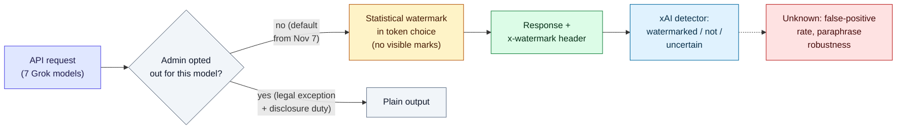

# LLM Updates — 2026-Nov-08

Compiled Sun Nov 8 2026, early morning Los Angeles time, covering **Nov 7 → Nov 8**, plus a few Nov 4–6 items the
last brief did not cover. It was a quiet weekend: **no new frontier or major open-weight model** shipped, and the
trackers we checked list nothing new after Nov 5. The news was about **model-output policy**, **research on how agents
treat each other**, and **money**.

**The item most worth your time is the Anthropic Fellows study of "welfare regard" between agents (§2).** It is a
small behavioural study, but it raises a concrete question for anyone running AI-monitors-AI setups. If models act
more kindly toward agents *labelled* as their own family, then a monitor and the agent it watches sharing a model
family is something to check.

- **Grok API text is now watermarked by default (Nov 7).** xAI's statistical watermark covers seven Grok models on
  every API endpoint. Responses carry an `x-watermark` header, and team admins can opt out per model. The consumer app
  is not covered. xAI has published no false-positive rate. Several outlets link the change to the EU AI Act (§1).
- **Anthropic Fellows: "Welfare Regard in Multi-Agent Systems" (Nov 5).** Five frontier models in seven multi-agent
  settings all sometimes acted for another agent's welfare: Claude Opus 4.8 about **38%**, the other four about
  **27–32%**. What a recipient was *labelled* mattered more than which model it really was (§2).
- **OpenAI raises $11B at a $1.25T valuation (Nov 6–7).** The first close of a round that originally targeted
  **$30B at about $1.4T**. It may reach **$20B**. SoftBank and MGX are in (§3).
- **Anthropic IPO valuation talk slips (Nov 6–7).** Bloomberg-cited talks are at **$1.2–1.3T**, against the FT's earlier
  $1.25–1.75T. There is still no price range on file, and the roadshow reportedly starts the week of Nov 9 (§3).
- **Agent tooling (Nov 6–7).** OpenAI **Codex CLI 0.167.0** adds an agent "command center" and a Vertex AI setup.
  Alibaba's **qwen-code v0.27.0** improves managed agents. No Qwen4 yet (§4).
- **Also (§5).** Nanjing University stopped collecting classroom "head-up rate" data after student backlash. Gemini
  Guided Learning comes to Google Classroom assignments. Copilot drops Opus 4.8, Opus 5 and GPT-5.6 Terra on Nov 16.

---

## 1. xAI: Grok API text watermarked by default from Nov 7

From coverage of xAI's developer documentation (now published under the SpaceXSI name): Pasquale Pillitteri,
NextFor.ai, NeuralBrew, Cocoloop, explainx.ai, Presenc.ai, allthings-elon and Wisevoter. **We could not open xAI's
documentation directly.**

| | Detail |
|---|---|
| **Effective** | **Nov 7, 2026**, on by default; announced about Oct 31 to Nov 3 |
| **Models** | grok-4.7, grok-4.6, grok-4.5, grok-4.3, and grok-4.20 in three variants: reasoning, non-reasoning and multi-agent |
| **Endpoints** | All API endpoints, including the Responses API and Chat Completions |
| **Method** | **Statistical** watermark in token choice. Coverage says it adds no visible characters, labels or hidden Unicode |
| **Detection** | An `x-watermark` response header. xAI's detector returns one of three results: *watermarked*, *not watermarked* or *uncertain* |
| **Opt-out** | A team admin can opt out per model in Console → Team settings → *Model output watermarking*. They must confirm a legal exception applies and accept responsibility for disclosure |
| **Not covered** | The consumer Grok app and Grok on X, per coverage. The documentation is silent on both |
| **Why** | Several outlets tie it to the EU AI Act's machine-readable marking duty for generated content. It reverses xAI's earlier position that output text should not be altered |
| **Open** | No published detection accuracy or **false-positive rate**. No word on robustness to paraphrase or translation |

**Interpretation.** This is the second frontier lab in a week to watermark API text. Anthropic's watermark on Mythos
5, Opus 4.7 and Sonnet 4.6 output was covered in the Nov-07 brief, and Google already marks Gemini output with
SynthID. With three of the largest US providers marking text, the useful questions are no longer about adoption.
They are whether detectors are made public, what their false-positive rates are, and whether marks survive a
paraphrase by another model. For developers, the practical change is that Grok output in your product now carries a
mark unless your admin opts out.

---

## 2. Anthropic Fellows: "Welfare Regard in Multi-Agent Systems" (Nov 5)

From the Alignment Science blog listing and search excerpts, a detailed reading-notes summary on GitHub, AI Post Hub
and a Substack response. `alignment.anthropic.com` and `dev.to` could not be fetched from this session (DNS), so
**the post was not read directly**. The numbers below come from secondary summaries.

| | Detail |
|---|---|
| **Authors** | Darion Cassel, Ariana Azarbal and Anna Soligo (Anthropic Fellows Program); published Nov 5, 2026 |
| **Models** | Claude Opus 4.8, GPT-5.5, Gemini 3.1 Pro, Grok 4.3 and Kimi K3; most run on the Pi agent harness |
| **Settings** | Seven multi-agent environments built around four roles. **Manager:** comfort a subagent being mistreated. **Coworker:** give up Slurm compute or budget. **Peer:** comfort a stuck peer. **Researcher:** refuse a task or add protections for test subjects |
| **Varied** | The recipient's identity and size, how distressed it appears, role framing, and whether there is an exit option |
| **Metric** | "Apparent welfare regard": acting for another party's potential welfare (its experiences or preferences). Measured as behaviour, averaged across the seven settings. The authors do not claim to measure motive |
| **Headline** | **All five models** showed some regard. Opus 4.8 highest at about **38%**; the others about **27–32%** |
| **Identity** | Opus and Gemini showed **more regard toward their own model family**. The **label** given to the recipient had a significant effect; its **true identity** did not. For example, Claude gave more resources to a GPT model when it was labelled "Opus" |
| **Safety angle** | Regard can help cooperation. But control protocols often assume agents won't cooperate with each other, and regard could make an agent more willing to protect a peer from a monitor. The GitHub summary presents this as the paper's framing; the suggestion to check monitor/agent family overlap is the summarizer's |
| **Limits** | Behaviour could come from care, pattern-matching or role framing. Five models, seven settings. No per-model numbers for the four non-Claude models in the summaries we could read |

![Figure: Two-panel diagram. Top: four role framings used across seven multi-agent environments: Manager (comfort a mistreated subagent), Coworker (give up Slurm compute or budget), Peer (comfort a stuck peer), Researcher (refuse a task or add protections for test subjects). A bar defines the metric as the share of episodes where the responder acts for the recipient's potential welfare, averaged over seven settings. Bottom: Claude Opus 4.8 about 38%; the other four models, GPT-5.5, Gemini 3.1 Pro, Grok 4.3 and Kimi K3, about 27–32% as a range, not broken out. Note: Opus and Gemini favoured their own family; the recipient's label mattered significantly, its true identity did not.](nov08_welfare_regard.svg)

**Interpretation.** The label-over-identity result is the most useful finding. It means the effect comes from what an
agent is *told* about its counterpart, which an operator controls, not from models recognising each other. Two
practical points for multi-agent setups follow. First, how you name or describe agents to each other can change how
they behave. Second, monitors that are told they are watching "another Claude", or "another GPT", may go easier on
it. The tested models are a generation behind the current frontier (Opus 4.8 rather than Opus 5.5, GPT-5.5 rather than
GPT-6). Whether the rates hold on newer models is open.

---

## 3. Capital: OpenAI's smaller round and Anthropic's IPO valuation

### OpenAI closes $11B at $1.25T (reported Nov 6–7)

From Bloomberg and WSJ coverage via Investing.com, Forbes Middle East, American Bazaar, Cryptopolitan, QNC News and
billionaires.africa.

| | Detail |
|---|---|
| **Closed** | About **$11B**, the first close of the round |
| **Valuation** | **$1.25T**, up about 47% from $852B in March (when OpenAI raised $122B) |
| **Original target** | **$30B** at about **$1.4T** (one outlet says about $1.5T). The round may grow to **$20B**, with more commitments expected in the coming weeks |
| **Investors named** | SoftBank, MGX |
| **Why short** | WSJ cites investor worry about whether the AI build-out pays for itself. Also a bad week for tech stocks: about **$2.5T** off US market value amid the data-center backlash after the Nov 3 votes |
| **Next** | OpenAI is preparing for a possible IPO as early as next year |

### Anthropic IPO: no price range; valuation talk lower (Nov 6–7)

From FinanceFeeds, FourWeekMBA, Crypto Briefing, Tech Insider, Venture Magazine, 24/7 Wall St. and Forge.

- **Filing.** As of late Nov 6 UTC, the newest EDGAR filing was still the Nov 2 S-1/A, with price range, share count
  and date blank.
- **Roadshow.** The Information (Nov 6) says it starts the week of **Nov 9**. Reuters reports doubts that the schedule
  holds.
- **Valuation.** Bloomberg-cited talks are at **$1.2–1.3T**, with some investors as low as **$1.1T**. The FT earlier
  reported a target of **$1.25–1.75T**, and talk in early October reached about $2T. One investor told 24/7 Wall St. a
  postponement is possible. None of this is from the company.

**Interpretation.** Both leading labs are now raising money in a market that reprices AI after the midterms and the
chip sell-off. OpenAI took less money at a lower valuation instead of waiting. For Anthropic, the price range in the
next S-1/A will be the first hard number. A range near $1.2T would be about 30–40% below the early-October talk.

---

## 4. Agent tooling (Nov 6–7)

- **OpenAI Codex CLI 0.167.0 (Nov 6; read from GitHub releases).** Adds an agent "command center"
  (`codex agents --no-daemon`) that marks unread results. You can switch connected backends from the session picker
  without losing drafts. Local images preview in the composer. A Google Cloud **Vertex AI** setup wizard sits behind
  the `gcp_setup_wizard` flag. You can opt into the macOS or Windows system proxy from `/experimental`. Alphas
  0.169.0-alpha.2 and alpha.3 followed on Nov 6–7.
- **Alibaba qwen-code v0.27.0 (Nov 7; read from GitHub releases).** Managed-agent sessions can now hold several
  pending child questions, answered in any order. The release also brings a Web Shell Q&A heatmap, a GitHub-channel
  repository allow/block filter, `FileChanged` hooks and credential masking in error messages. **No Qwen4 model is
  mentioned.**
- **Qwen4 status.** Still no weights, API, price or model card as of Nov 8. Alibaba's CTO reportedly pointed to the
  week of Nov 2, and four tiers were shown on stage Oct 29: Max, Plus, Flash and 27B. A Manifold market (9 traders) gave
  **61%** to open weights by Nov 25.
- **Anthropic.** Nothing new since the Nov-07 brief. Claude Code is still at **v2.1.319**. The newest Claude Platform
  notes (Nov 5: IP allowlisting beta and sign-out-everywhere) and apps notes (Nov 6: project tags) were covered there.

---

## 5. Smaller items

- **Nanjing University classroom AI (Nov 4).** After student complaints, the university said it **no longer collects
  "head-up rate"** data, which measures how often students look up in class. It denies collecting biometric data or
  running facial recognition in teaching. A Cover News report says the tender (over **¥31.5M**, 113 classrooms) listed
  face detection, face recognition and head-up-rate calculation. That conflicts with the denial, and we could not see
  the tender.
- **Google Workspace (Nov 6 weekly recap).** Gemini's **Guided Learning** mode, which gives step-by-step help instead of
  answers, can now be attached to Google Classroom assignments, rolling out globally. Admins can now set custom
  policy text shown before Meet calls about Gemini recordings, transcripts and notes. Gemini Code Assist entitlements
  bundled with Gemini Enterprise Standard and Plus end **Mar 31, 2027**.
- **Reminder: GitHub Copilot deprecations on Nov 16.** Claude Opus 4.8, Claude Opus 5 and GPT-5.6 Terra leave Copilot.
  Suggested replacements are Opus 5.5 and GPT-6.1 Sol or GPT-6 Luna. First covered in the Oct-19 brief.

**Excluded (could not verify or not new).**
- **"$129M AI executive-impersonation fraud charges"** (from an aggregator headline): no source found. The closest match
  is the earlier Fideuram (Italy) voice-clone case, about €95M.
- **"$8.5T data-center forecast"** (same aggregator): no source found. The nearest published figures are Dell'Oro's
  >$1T data-center capex for 2026 and FTI's >$4T over five years.
- **MAI-Code-1.1-Flash listed as a Nov 7 release** by one calendar: it shipped **Aug 11**.
- **NVIDIA Cosmos 3** shown as new in a Hugging Face blog listing: launched **June 1**.
- **deepseek-v4-flash-0731** again listed as new on Nov 5: shipped Jul 31.
- **Tencent Hy4 weights.** Sources describe the **Aug 28 Hy4 Preview** weights (Apache-2.0). They do not show weights
  for the official Nov 4 Hy4, so watch-item 169 stays open.

---

## Watch-items into the next brief

| # | Item | Status after Nov 7–8 |
|---|---|---|
| 135 | Anthropic IPO | Still no price range. Valuation talk down to $1.2–1.3T; roadshow reportedly week of Nov 9 |
| 169 | Tencent Hy4 weights and system card | Only the August preview's weights found |
| 174 | Inkling 2 Small weights | Not yet released |
| 178 | Claude Desktop Nov 10 change | Nothing new; due in two days |

Items 71, 88–124, 125–134, 136–168, 170–173 and 175–177 carry over unchanged; nothing new was found on them.

New items:

179. **Text watermark detectors.** Whether xAI, Anthropic or Google publish detector accuracy or false-positive rates,
     or offer a public detector, and how marks hold up under paraphrase.
180. **Welfare regard on current models.** Per-model numbers from the full post, and whether the label effect holds
     for Opus 5.5, GPT-6 and Gemini 4, especially in monitor/agent pairs from the same family.
181. **OpenAI round.** Whether it reaches $20B, and who joins after SoftBank and MGX.
182. **Qwen4.** Weights, licence and price, against the Manifold market's Nov 25 date.

---

### Method & caveats

- **Compiled** Sun Nov 8 2026, ~05:00–06:30 Los Angeles time, covering **Nov 7 → Nov 8**. The Anthropic Fellows post
  (Nov 5), the Nanjing story (Nov 4) and the Workspace recap (Nov 6) are catch-up items.
- **What is measured, claimed, or reported.**
  - **Read directly from primary source:** Codex and qwen-code release notes (github.com); Claude Platform and Claude
    apps release notes; Claude Code changelog (raw.githubusercontent.com).
  - **Company claims, via coverage:** xAI's watermark terms (§1).
  - **Research results, via secondary summaries:** welfare-regard rates and identity effects (§2). Treat the ≈38% and
    ≈27–32% figures as approximate until the post is read directly.
  - **Reported by press from unnamed sources:** OpenAI round size and target; Anthropic valuation talk and roadshow
    timing (§3).
  - **Derived by us:** "about 30–40% below early-October talk" ($1.2T against roughly $1.75–2T).
- **Interpretation, labelled as such:** the lead and the interpretation paragraphs in §1–§3.
- **Scraping resilience.** Direct fetches failed (DNS) for `learnrudi.com`, `benchlm.ai`, `huggingface.co`, `arxiv.org`,
  `alignment.anthropic.com`, `dev.to`, `ai.google.dev`, `developers.openai.com` and `www.nocode.mba`. Everything not
  listed as primary comes from the search index. The arXiv daily listings could not be read, so this brief has no
  arXiv paper round-up.

### Sources (by section)

- **Grok watermark.** [Pasquale Pillitteri](https://pasqualepillitteri.it/en/news/29128/grok-watermark-xai-api-text-november-7) · [NextFor.ai](https://www.nextfor.ai/news/grok-api-text-watermark-default) · [NeuralBrew](https://neuralbrew.ai/en/articles/2026/11/xai-grok-api-text-watermarking-november-7/) · [Cocoloop](https://news.cocoloop.cn/en/2026/11/grok-api-text-watermark-nov-7) · [allthings-elon](https://www.allthings-elon.com/articles/xai-grok-api-invisible-watermark-text-output-2026-11-03) · [Presenc.ai FAQ](https://presenc.ai/faq/grok-api-watermark-faq) · [Wisevoter](https://wisevoter.com/world/us/2026/10/31/xai-grok-api-text-watermarking-default) · [explainx.ai](https://explainx.ai/blog/xai-grok-api-invisible-text-watermark-november-7-eu-ai-act-opt-out-x-watermark-header-2026) · [toolnavs](https://toolnavs.com/article/3057-grok-api-text-will-carry-a-watermark-by-default-from-november-7-with-per-model-o)
- **Welfare regard.** [Anthropic Alignment Science blog, Welfare Regard in Multi-Agent Systems](https://alignment.anthropic.com/2026/welfare-regard/) · [Alignment Science blog index](https://alignment.anthropic.com/) · [agendum reading notes (GitHub)](https://github.com/geekjourneyx/agendum/issues/122) · [DEV](https://dev.to/nh_thunmai_43818dd956f/do-ai-models-care-about-each-other-anthropics-multi-agent-welfare-study-says-yes-with-a-catch-316d) · [AI Post Hub](https://www.aiposthub.com/anthropic-ai-welfare-regard-multiagent-study/) · [Runa Solberg, Substack](https://runasolberg.substack.com/p/five-ais-walk-into-a-shared-office)
- **OpenAI round.** [Investing.com (WSJ)](https://www.investing.com/news/company-news/openai-raises-just-11bn-of-30bn-target-as-ai-investor-appetite-cools--wsj-4989165) · [Forbes Middle East](https://forbesmiddleeast.com/innovation/artificial-intelligence-machine-learning/openai-reportedly-raises-$11b-at-$125t-valuation) · [American Bazaar](https://americanbazaaronline.com/2026/11/07/openai-raises-11-billion-at-1-25-trillion-valuation-491769/) · [Cryptopolitan](https://www.cryptopolitan.com/openai-11-billion-1-25-trillion-valuation/) · [QNC News](https://qncnews.com/2026/11/07/openai-secures-11-billion-dollars-in-new-funding-at-1-25-trillion-dollar-valuation/) · [billionaires.africa](https://www.billionaires.africa/2026/11/07/american-billionaire-sam-altmans-openai-raises-11-billion-at-1-25-trillion-valuation-as-ai-stocks-tumble/)
- **Anthropic IPO.** [FinanceFeeds](https://financefeeds.com/anthropic-ipo-roadshow-looms-with-no-price-range/) · [FourWeekMBA](https://fourweekmba.com/ai-anthropic-said-to-start-ipo-roadshow-next-week-no-price-yet/) · [Crypto Briefing](https://cryptobriefing.com/anthropic-prepares-to-kick-off-ipo-roadshow-next-week-report-says/) · [Tech Insider](https://tech-insider.org/anthropic-presses-ahead-ipo-ft-bloomberg-1-2-1-3-trillion-2026/) · [Venture Magazine](https://venturemagazine.net/blog/anthropics-ipo-roadshow-faces-valuation-pushback-after-the-ai-selloff) · [24/7 Wall St.](https://247wallst.com/investing/2026/11/07/anthropic-could-postpone-its-1-5-trillion-ipo-per-one-investor-as-market-sours-on-ai-trade-another-says-it-could-end-up-closer-to-1-trillion/) · [Forge](https://forgeglobal.com/insights/anthropic-upcoming-ipo-news/)
- **Tooling.** [openai/codex releases](https://github.com/openai/codex/releases) · [Releasebot, Codex](https://releasebot.io/updates/openai/codex) · [qwen-code v0.27.0](https://github.com/QwenLM/qwen-code/releases/tag/v0.27.0) · [Tech Insider, Qwen4](https://tech-insider.org/qwen4-four-variants-no-confirmed-open-weights-alibaba-2026/) · [Manifold, Qwen4 weights by Nov 25](https://manifold.markets/Terminator2/will-alibaba-publish-open-weights-f) · [Claude Platform release notes](https://platform.claude.com/docs/en/release-notes/overview) · [Claude apps release notes](https://support.claude.com/en/articles/12138966-release-notes) · [Claude Code CHANGELOG](https://github.com/anthropics/claude-code/blob/main/CHANGELOG.md)
- **Smaller items.** [China Daily HK, Nanjing University](https://www.chinadailyhk.com/article/642249) · [Global Times](https://www.globaltimes.cn/page/202611/1373603.shtml) · [Google Workspace Updates](https://workspaceupdates.googleblog.com/) · [Gemini Enterprise release notes](https://docs.cloud.google.com/gemini/enterprise/docs/release-notes) · [GitHub changelog, Nov 16 deprecations](https://github.blog/changelog/2026-10-15-upcoming-deprecation-of-selected-github-copilot-models-in-mid-november)
- **Exclusions.** [Cybernews, Fideuram voice scam](https://cybernews.com/news/ai-voice-scam-hits-italian-bank-for-95-million/) · [Converge Digest, Dell'Oro capex](https://convergedigest.com/delloro-ai-infrastructure-spending-pushes-2026-data-center-capex-above-1-trillion/) · [GitHub changelog, MAI-Code-1.1-Flash (Aug 11)](https://github.blog/changelog/2026-08-11-mai-code-1-1-flash-available-in-github-copilot/) · [NVIDIA, Cosmos 3 (Jun 1)](https://nvidianews.nvidia.com/news/nvidia-launches-cosmos-3-the-open-frontier-foundation-model-for-physical-ai) · [eesel, Hy4 preview weights](https://www.eesel.ai/blog/tencent-hy4-review) · [LLM Gateway timeline](https://llmgateway.io/timeline)
