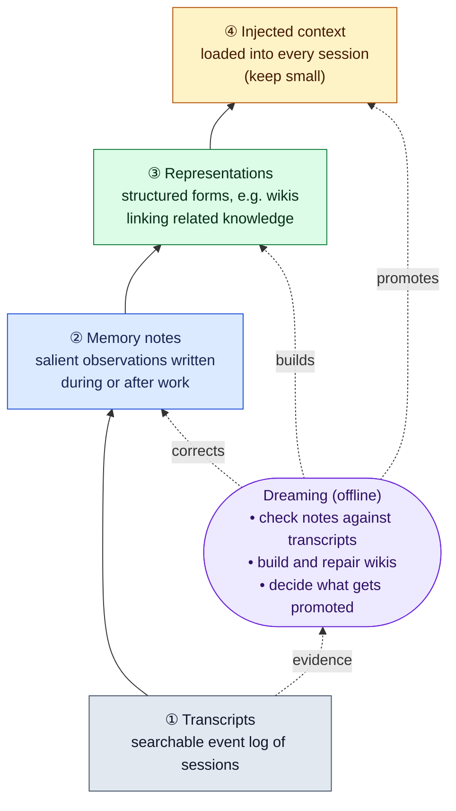
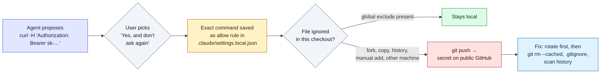

# LLM Updates — 2026-Nov-09

Compiled Mon Nov 9 2026, early morning Los Angeles time, covering **Nov 8 → Nov 9**, plus Nov 5–6 items the last
two briefs did not cover. Another quiet weekend for releases: **no new frontier or major open-weight model** shipped,
and the trackers we could reach list nothing newer than Nov 5. The useful news was a **technique write-up from
Anthropic on agent memory**, a **coding-agent security finding**, and more pressure on the **Anthropic IPO**.

**The item most worth your time is Anthropic's "The components of agent memory" (§1).** It is the most detailed public
account so far of how a frontier lab builds memory for agents. It measures how much a plain memory folder helps each
Claude generation, and it describes an offline "dreaming" pass that corrects and reorganises what the agent wrote down.

- **Anthropic: "The components of agent memory" (Nov 6; read directly).** A four-layer memory stack, from transcripts
  up to injected context, plus offline "dreaming". On the CL-Bench 1.0 database task, a memory directory lifts Opus 5
  from **0.564 to 0.828**, while Sonnet 4.6 barely moves (**0.330 → 0.364**). A dreamed wiki plus search beat search
  alone on a 420M-token corpus (**61% vs 53%**) and on Harvey legal-merger questions (**87% vs 73%**) (§1).
- **Apiiro: Claude Code's "Yes, and don't ask again" leaks secrets to GitHub (Nov 5; on HN Nov 8).** Approving a
  command stores it, secrets included, in `.claude/settings.local.json`. A scan of **104,185** public copies found
  real secrets in **1,122** files. The Claude Code lead says secret scanning is being prototyped (§2).
- **Anthropic IPO (Nov 7–8).** The WSJ says three large prospective buyers think the **$1.5T** target must come down,
  one to about **$1T**; the raise could shrink from up to **$100B** to about **$80B**. Still no price range on file (§3).
- **Microsoft Research's AI Frontiers group is over (Nov 6).** John Langford says the ~50-person group, home of AutoGen
  and the Fara computer-use agent, did not survive its September move into Microsoft AI, and that he has left (§4).
- **Also (§5).** OpenAI's testing partnership with Hacktron (Nov 6). Claude Desktop's Nov 10 change is due tomorrow;
  Google AI Plus loses Pro models Nov 13; Copilot drops older models Nov 16. Qwen4 still absent.

---

## 1. Anthropic: "The components of agent memory" (Nov 6)

Read directly from [anthropic.com](https://www.anthropic.com/research/components-of-agent-memory). Author: Lance Martin
(Engineering). Scope: knowledge Claude gains from experience and keeps **across sessions**. It excludes weight
updates, in-context learning within one conversation, and compaction.

### The framework

The post borrows from neuroscience: the hippocampus records experience quickly, and during sleep some of it is
replayed and consolidated. Anthropic calls the agent version **dreaming**, an offline pass that builds on Letta and UC
Berkeley's "sleep-time compute". It frames every memory write as a **prediction** that the note will be useful later.

### Results

| Experiment | Setup | Result |
|---|---|---|
| **CL-Bench 1.0 database task** | Fresh session per question; only a memory directory persists | Opus 5.5 0.655 → **0.838**; Sonnet 5.5 0.644 → **0.833**; Opus 5 0.564 → **0.828**; Opus 4.7 0.383 → **0.700**; Sonnet 5 0.306 → **0.610**; Sonnet 4.6 0.330 → **0.364** |
| **Who "closes the loop"** | Qualitative read of what each model wrote | Sonnet 4.6 wrote untested theories. Opus 4.7 kept one reference doc with facts marked checked or unconfirmed. **Opus 5 was the first** to record rules, how it verified them, past answers and traps; Opus 5.5 and Sonnet 5.5 do the same |
| **Steering writes** | Instruction variants | Just saying a memory folder exists helped Opus 4.7 and Opus 5. "Record only failures" *cut* the gain (Opus 5 −0.234, Opus 4.7 −0.150). Sonnet 4.6 rose to **0.641** when told to read memory first and test its theories. Sonnet 5 read memory first 9 times in 10 unprompted; Sonnet 4.6 under half the time |
| **Pokémon Red, salience** | Long-horizon play with a memory folder | Sonnet 3.7: 413 files, ~978K characters, 1 badge; once spent 17 steps reorganising and took no game action. Claude Fable 5: 10 files, ~43K characters, 4 badges. Opus 5.5 kept a small goals file and **beat the game** |
| **Dreaming fixes a wrong note** | Mt. Moon: false note that it had passed the mountain | Corrected note: reached Cerulean City at action **1,935**. Uncorrected: fell off a ledge three times and never arrived in ~3,000 actions, same as no memory |
| **Dreaming builds a wiki** | Stainless corpus, ~350K files / ~420M tokens, 25 questions, Opus 5, 128 sessions | Wiki only 13% → **48%** of graded criteria. Wiki + search 54% → **61%** vs **53%** search alone, and ~20K fewer tokens per question. Wiki grew to 222 pages and 12,893 links |
| **Harvey LAB merger questions** | 24 questions | Wiki + search **87%** vs **73%** search alone on multi-document, judgment-heavy items. No clear gain where answers sit in one document; on one task the wiki grew to 1.77× the corpus and abstracted little |
| **Goal-focused dreaming** | Several agents writing one shared contract-terms table | Agents overwrote each other: **41 of 57** facts survived (72%). After a reflect-and-revise loop gave each contract its own page with verbatim terms: **57 of 57** |

**Practical guidance the post gives.** Keep injected context small, because a wrong injected note spreads into every
session; Claude Code's auto memory loads only the first 200 lines or 25 KB of `MEMORY.md` as an index. Give frontier
models simple guidance and let them judge what is worth saving. Treat transcript search as the base, and add a wiki
only where questions span many documents, since wikis need upkeep or they accumulate errors. Open questions the post
names: when to write (in the moment versus in a background pass) and how to keep memories fresh at reasonable cost.

**Interpretation.** Two findings stand out. First, the gain from memory is mostly a property of the model, not the
scaffold: the same folder adds about 0.03 for Sonnet 4.6 and about 0.26 for Opus 5. Teams that tried memory on older
models and saw little benefit should retest. Second, "dreaming" is a cheap, testable pattern for any agent stack: a
scheduled job that re-reads transcripts, corrects notes and rebuilds an index. All results are Anthropic's own, on
Claude models only, and several experiments (Pokémon, Mt. Moon) are single illustrative runs rather than averages.

---

## 2. Apiiro: Claude Code "Yes, and don't ask again" leaks secrets to public GitHub (Nov 5; HN Nov 8)

From coverage of Apiiro's report: Security Boulevard, RuntimeWire, Cybersecurity News, i10x, SecurityOnline,
braindetox and DEV posts, plus the HN digest. **We could not open apiiro.com directly.** The thread reached the Hacker
News front page on Nov 8 (186 points, 129 comments).

| | Detail |
|---|---|
| **Mechanism** | Choosing **"Yes, and don't ask again"** for a Bash command saves the exact command string as an allow rule in `.claude/settings.local.json`. If the command had a password, token or key inline, the secret is saved too |
| **Scan** | Public GitHub, **Nov 1–3**: **104,185** copies of `settings.local.json` across 103,617 repos. **1,122** (~1.1%) held at least one real secret: **1,379** distinct credentials |
| **Wider count** | Adding git history, the team-shared `.claude/settings.json` and saved agent transcripts: **2,539** secrets in **1,994** repos. This is a different scope from the 1,122 figure; some outlets mix them up |
| **Why it got committed** | Anthropic's docs say Claude Code adds the file to the user's global git excludes when it first writes it. That does not travel with forks, history, copies or other machines, and the Claude Code lead said on HN that some files were created and committed by hand |
| **Still live** | At least one notified company confirmed its exposed key still worked |
| **Anthropic** | Boris Cherny (Claude Code lead) on HN: the team is looking into it; Claude Code has not scrubbed secrets historically; auto mode and built-in secret scanning are being prototyped and may not fully solve it. Apiiro says four earlier related reports were auto-closed by a bot with no reply |

**What to do.** Search your repositories, including history, for `.claude/settings.local.json` and
`.claude/settings.json`. **Rotate anything they have ever contained before** removing the files, because deleting a
file does not remove it from git history or from forks. Add `.claude/settings.local.json` to the project
`.gitignore` so the protection travels with the repo. Pass secrets through environment variables rather than inline
in commands, so an approved command never contains one.

**Interpretation.** This is a design issue rather than a bug: a permission system that remembers commands
word-for-word will remember whatever is in them. The same pattern can appear in any agent tool that stores approved
commands, so it is worth checking Codex, Cursor and others' allowlist files too. Apiiro's report covers Claude Code
only.

---

## 3. Anthropic IPO: buyers push lower, raise may shrink (Nov 7–8)

From WSJ coverage via Decrypt, Benzinga, Yahoo Finance, Pasquale Pillitteri, Trending Topics and Tech Insider, plus
prediction-market coverage. The Nov-08 brief covered Bloomberg's **$1.2–1.3T** talk; this adds the WSJ's reporting.

| | Detail |
|---|---|
| **WSJ, three large investors** | The expected **$1.5T** valuation will likely need to come down; one suggested **about $1T**. Another raised the possibility of a delay |
| **Earlier WSJ guidance** | Large institutions had pointed advisers to **$1.5–1.6T**, against about $2T floated in early October |
| **Raise** | Aim had been **up to $100B**; one investor said **about $80B** is possible. The FT earlier reported $80–100B at $1.25–1.75T |
| **Timing** | Target was the week before Thanksgiving (Nov 26). Roadshow reportedly from the week of Nov 9; Reuters reports doubts. One Yahoo piece mentions early 2027; other coverage does not, so treat that as unconfirmed |
| **Markets** | Kalshi's pre-December *announcement* contract fell to about **57–61%** during the week; Polymarket's listing-by-Nov-20 contract was about **43%** on Friday. One aggregator says pre-December odds were back above 80% on Sunday. Contracts differ, so these are not directly comparable |
| **Filing** | Still no price range in an amended S-1, as far as we could find. That amendment is the first hard number |

**Interpretation.** The range of talk is now roughly **$1T to $1.6T**, all from unnamed buyers. Nothing has come from
the company. For readers who care about the models rather than the stock, the relevance is indirect: the S-1 is the
main window into Anthropic's compute commitments and safety governance, and a delay would push back the next
disclosure of both.

---

## 4. Microsoft Research's AI Frontiers group is over (Nov 6)

From coverage of John Langford's blog post "The End of AI Frontiers" (hunch.net, Nov 6): Digg, DEV posts, Business
Examiner, daily.dev, kenashe.ai and others. **We could not open hunch.net directly.** The HN thread reached 389 points.

- **What happened.** The roughly **50-person** group moved from Microsoft Research into **Microsoft AI** in early
  September. Langford, who co-led it, says the two organisations' philosophies were incompatible, the new leadership
  did not really want the group, and its work was not seriously considered. He has left Microsoft. There is no
  Microsoft statement in the coverage we found.
- **What it built.** **AutoGen**, the widely used multi-agent framework, and **Fara**, a computer-use agent.
- **Practical effect.** No internships from the team next year. A DEV post notes AutoGen's README already rules out
  security fixes; the code stays on GitHub.

**Interpretation.** For builders, the concrete point is AutoGen's maintenance status: if you run it in production,
plan for no upstream security fixes. More broadly, this fits the pattern of labs folding open-ended research groups
into product-focused scaling organisations.

---

## 5. Smaller items

- **OpenAI × Hacktron testing partnership (Nov 6; secondary sources only).** OpenAI and Hacktron, the small firm whose
  researchers reached OpenAI employee accounts and its GitHub monorepo in July (disclosed Jul 25, $6,500 bounty), will
  run joint testing exercises focused on how OpenAI's systems interact with third-party services. Hacktron gets wider
  access to OpenAI's Daybreak Red program. We could not find OpenAI's own post.
- **Claude Desktop change due Nov 10 (tomorrow).** Claude Code v2.1.319 warns gateway admins whose policies have no
  `desktopHome` but rely on `coworkTabEnabled: false` or `chatSessionRetentionDays`. Claude Code is still at
  **v2.1.319**.
- **OpenAI Codex CLI.** 0.169.0-alpha.2 and alpha.3 (Nov 6–7) have no release notes; 0.167.0 is still the latest stable.
- **Google AI Plus loses Pro models on Nov 13.** Pro selection in the Gemini app and AI Mode moves to AI Pro ($20/month,
  four times AI Plus). Flash and Flash-Lite stay. Google says dates are set per account.
- **Reminder: GitHub Copilot drops Claude Opus 4.8, Opus 5 and GPT-5.6 Terra on Nov 16.**
- **Qwen4.** Still no weights, API or model card as of Nov 9.
- **arXiv.** Listings could not be read from this session. One paper surfaced in search: **RPEG** (arXiv 2611.09207,
  Nov 6; Besta et al.), a framework and cost model for scaling RL training of reasoning models more cheaply. We read
  only the abstract-level summary.

**Excluded (not new or could not verify).**
- **"Anthropic launches proactive AI agent"** in a Nov 8 agents brief: this is **Claude Duet**, announced **Oct 21**.
- **deepseek-v4-flash-0731** again listed as a Nov 5 release on one tracker: shipped Jul 31.
- **"Nvidia H200 chip approvals for Chinese firms"** in a Nov 8 digest: we found only the March 2026 reports and
  conflicting accounts since, nothing new.
- **"Muse Wonder for everyone"** in a Nov 8 digest: Muse Wonder launched Oct 12; we found no new access change.
- **Fog Security's Gemini image-filter bypass (Nov 5)**: Fog's own Oct 22 retest could not reproduce it, so we leave it out.
- **A Nov 9 headline about Nvidia's CEO** in a news roundup: not about LLMs, and we found no reliable source.

---

## Watch-items into the next brief

| # | Item | Status after Nov 8–9 |
|---|---|---|
| 135 | Anthropic IPO | Still no price range. WSJ: buyers see ~$1T–$1.5T; raise may drop to ~$80B |
| 169 | Tencent Hy4 weights and system card | Nothing new |
| 174 | Inkling 2 Small weights | Not yet released |
| 178 | Claude Desktop Nov 10 change | Due tomorrow |
| 182 | Qwen4 | Still absent |

Items 71, 88–134, 136–168, 170–173, 175–177 and 179–181 carry over unchanged; nothing new was found on them.

New items:

183. **Dreaming in products.** Whether Anthropic ships an offline memory-consolidation ("dreaming") feature in Claude
     Code, the apps or the API, and whether other labs publish comparable cross-session memory numbers.
184. **Claude Code secret handling.** Whether "don't ask again" starts redacting secrets, writes a project-level
     `.gitignore` entry, or ships the secret scanning the team says it is prototyping.
185. **AutoGen after AI Frontiers.** Whether Microsoft names new maintainers, archives the repo, or points users to
     another framework.

---

### Method & caveats

- **Compiled** Mon Nov 9 2026, ~05:00–06:30 Los Angeles time, covering **Nov 8 → Nov 9**. The Anthropic memory post
  (Nov 6), Apiiro report (Nov 5), Langford post (Nov 6) and Hacktron partnership (Nov 6) are catch-up items that
  surfaced on Nov 8.
- **What is measured, claimed, or reported.**
  - **Read directly from primary source:** Anthropic's agent-memory post (anthropic.com); Claude Code changelog
    (raw.githubusercontent.com); Codex releases (github.com); the agents-radar HN digest (github.com).
  - **Research results, company's own:** all §1 numbers are Anthropic's, on Claude models, not independently replicated.
  - **Security research, via coverage:** Apiiro's counts and mechanism (§2); Anthropic's reply is an HN comment, not
    an official statement.
  - **Reported by press from unnamed sources:** IPO valuation, raise size and timing (§3).
  - **Personal account, via coverage:** Langford's description of AI Frontiers' end (§4).
  - **Derived by us:** the "~0.03 vs ~0.26" memory gains in §1 (0.364 − 0.330 and 0.828 − 0.564).
- **Interpretation, labelled as such:** the lead and the interpretation paragraphs in §1–§4.
- **Scraping resilience.** Direct fetches failed (DNS) for `aiweekly.co`, `llm-stats.com`, `decrypt.co`,
  `apiiro.com`, `hunch.net`, `planned-obsolescence.org`, `aiagentsdirectory.com`, `news.poweryourprocess.ai`,
  `benzinga.com` and `finance.yahoo.com`. Everything not listed as primary comes from the search index.

### Sources (by section)

- **Agent memory.** [Anthropic, The components of agent memory](https://www.anthropic.com/research/components-of-agent-memory) · [HN discussion](https://news.ycombinator.com/item?id=50402212) · [Claude Code memory docs](https://code.claude.com/docs/en/memory)
- **Apiiro / Claude Code.** [Apiiro report](https://apiiro.com/blog/coding-agents-leaking-secrets-github-dont-ask-again) · [HN discussion](https://news.ycombinator.com/item?id=50407882) · [Security Boulevard](https://securityboulevard.com/2026/11/claude-code-settings-local-json-secrets-github-docker-hub/) · [RuntimeWire](https://runtimewire.com/article/claude-code-dont-ask-again-secrets-public-github-settings-files) · [Cybersecurity News](https://cybersecuritynews.com/claude-codes-yes-and-dont-ask-again/) · [SecurityOnline](https://securityonline.info/claude-code-leaking-secrets-github/) · [i10x](https://i10x.ai/news/claude-code-settings-local-json-secrets-leak) · [braindetox](https://braindetox.kr/en/posts/claude_code_dont_ask_again_secrets_github_leak.html) · [DEV, 2,539 secrets](https://dev.to/fathomnews/apiiro-finds-2539-secrets-leaked-by-claude-code-users-on-github-1fb2) · [agents-radar HN digest, Nov 8](https://github.com/yaojiejia/agents-radar/issues/437)
- **Anthropic IPO.** [Decrypt (WSJ)](https://decrypt.co/382716/anthropic-ipo-valuation-could-fall-to-1-trillion-after-ai-stock-rout-report) · [Benzinga](https://www.benzinga.com/markets/ipos/26/11/62965664/anthropic-ipo-valuation-1-trillion-delay-stock-market-selloff) · [Yahoo Finance, investors see $1.5T](https://finance.yahoo.com/markets/stocks/articles/anthropic-investors-now-see-1-122407498.html) · [Yahoo Finance, big investors doubt](https://finance.yahoo.com/markets/stocks/articles/big-investors-now-doubt-anthropic-133505249.html) · [Pasquale Pillitteri](https://pasqualepillitteri.it/en/news/30742/anthropic-ipo-valuation-investors-doubt-1-5-trillion) · [Trending Topics](https://www.trendingtopics.eu/anthropic-ipo-valuation-1-trillion-rumors/) · [Tech Insider, $1.5–1.6T](https://tech-insider.org/anthropic-ipo-investors-lower-valuation-1-5-1-6-trillion-ai-backlash-2026/) · [Forbes, $1.3T talk](https://www.forbes.com/sites/jonmarkman/2026/11/07/anthropic-ipo-valuation-talk-falls-to-13-trillion-after-the-ai-stock-rout/) · [Crypto Briefing, Kalshi 57%](https://cryptobriefing.com/kalshi-odds-anthropic-ipo-announcement-drop/) · [Prediction News](https://predictionnews.com/story/kalshi-traders-cut-anthropic-ipo-odds-below-60) · [TradingView / Seeking Alpha](https://www.tradingview.com/news/seekingalpha:780a6c7c1094b:0-predictions-markets-see-virtually-no-anthropic-ipo-before-the-end-of-november/) · [Reuters via Let's Data Science](https://letsdatascience.com/news/investors-doubt-anthropic-can-hold-november-ipo-roadshow-reu-a69a034f)
- **AI Frontiers.** [John Langford, hunch.net](https://hunch.net/?p=13764006) · [HN discussion](https://news.ycombinator.com/item?id=50406563) · [Digg](https://digg.com/ai/knmglebe) · [Business Examiner](https://businessexaminer.ca/victoria-articles/item/microsoft-researcher-john-langford-exits-as-ai-frontiers-group-is-declared/) · [DEV, AutoGen security fixes](https://dev.to/gabrielanhaia/the-microsoft-lab-that-worked-on-autogen-is-over-autogen-already-gets-no-security-fixes-281) · [kenashe.ai](https://kenashe.ai/blog/2026-11-08-what-microsoft-shutting-down-ai-frontiers-says-about-industrial-research)
- **Smaller items.** [Hacktron partnership, explainx.ai](https://explainx.ai/blog/openai-hacktron-partnership-daybreak-red-third-party-testing-2026) · [winzheng](https://www.winzheng.com/article/openai-hacktron-security-partnership-daybreak-red-2026) · [Let's Data Science, Hacktron July breach](https://letsdatascience.com/news/hacktron-finds-openai-account-takeover-flaw-using-claude-0cd939d8) · [Claude Code CHANGELOG](https://github.com/anthropics/claude-code/blob/main/CHANGELOG.md) · [openai/codex releases](https://github.com/openai/codex/releases) · [9to5Google, AI Plus](https://9to5google.com/2026/10/14/gemini-ai-plus-loses-pro-november/) · [Android Central, AI Plus](https://www.androidcentral.com/apps-software/google-wants-you-to-pay-more-for-using-gemini-pro-in-gemini-app-and-google-search) · [GitHub changelog, Nov 16 deprecations](https://github.blog/changelog/2026-10-15-upcoming-deprecation-of-selected-github-copilot-models-in-mid-november) · [Tech Insider, Qwen4](https://tech-insider.org/qwen4-four-variants-no-confirmed-open-weights-alibaba-2026/) · [arXiv 2611.09207, RPEG](https://arxiv.org/abs/2611.09207)
- **Exclusions.** [heise, Claude Duet (Oct)](https://www.heise.de/en/news/Anthropic-launches-proactive-AI-agent-for-the-workplace-11498601.html) · [LLM Gateway timeline](https://llmgateway.io/timeline) · [Barchart, H200 status](https://www.barchart.com/story/news/1947036/nvidias-china-ai-chip-sales-remain-frozen-despite-u-s-approval-for-alibaba-and-tencent) · [Let's Data Science, Muse Wonder (Oct 12)](https://letsdatascience.com/news/meta-launches-muse-wonder-and-muse-wonder-full-for-agentic-t-41113cca) · [Cybersecurity News, Gemini filter bypass](https://cybersecuritynews.com/google-gemini-safety-bypass-ai-generated-images)
