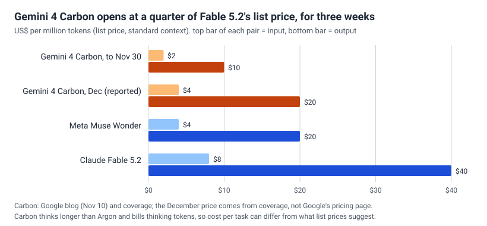
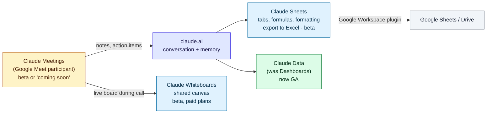
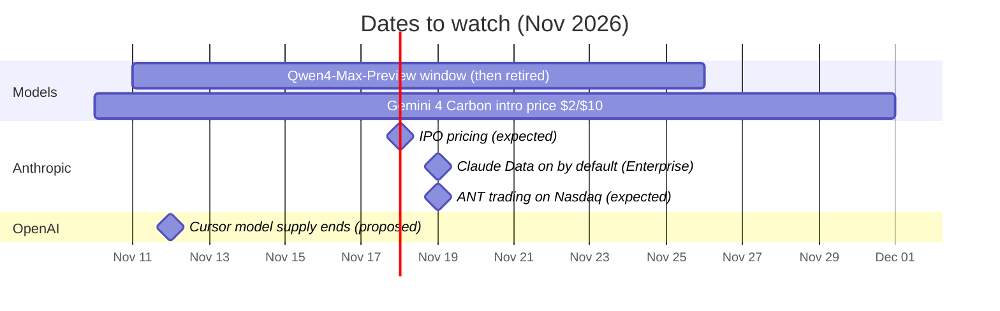

# LLM Updates — 2026-Nov-12

Compiled Thu Nov 12 2026, early morning Los Angeles time, covering **Nov 11 → Nov 12**, plus Nov 10 items the last
two briefs missed or wrongly excluded. Today's themes are **frontier models reaching paying users** and **chat
assistants turning into office suites**.

**The item most worth your time is Gemini 4 Carbon's general release (§1).** Google's strongest model left its
cyber-defender gate on Nov 10. Paid API users and AI Ultra subscribers can now use it, at an introductory price that
coverage says doubles in December. **Correction:** the Nov-11 brief excluded "Gemini 4 Carbon generally available" as
unverified. Google's own post, "Gemini 4 Carbon is now available", is dated Nov 10. The claim was right.

- **Gemini 4 Carbon opens up (Nov 10).** Paid Gemini API (AI Studio, Android Studio), Gemini for business, and AI
  Ultra ($99.99+/month) in the Gemini app, AI Mode and Antigravity. **$2 / $10** per million tokens until Nov 30;
  coverage says **$4 / $20** after. Antigravity previews **/swarm**, a multi-agent mode. No published rate limits (§1).
- **Qwen4-Max-Preview (Nov 11).** The first Qwen4 model anyone can use, after months of teasers. It runs on Alibaba's
  Token Plan subscription only, for **15 days** (to Nov 25), and is then retired. 1M context, up to 393K output
  tokens. **No benchmarks, parameter count, licence or weights** (§2).
- **Claude becomes an office suite (Nov 10).** Anthropic shipped **Claude Sheets** and **Claude Whiteboards** in beta
  on paid plans, renamed Dashboards to **Claude Data** (now GA), and announced **Claude Meetings**, a Google Meet
  participant, for Team and Enterprise. OpenAI the same day put **Business Agents** into ChatGPT (§3).
- **Also (§4).** Anthropic's IPO is reported to be several times oversubscribed; pricing is expected Nov 18. Anthropic
  says Claude Mythos ported one Claude model to AMD MI355X GPUs in about three days. A new Supported Regions Policy
  brings identity checks and suspensions. AWS released an emulator it says agents wrote with no human review.
  OpenAI's model supply to Cursor is due to end today. MiniMax H3-Image open weights are confirmed (correction).

---

## 1. Gemini 4 Carbon reaches paying users (Nov 10)

From Google's post [Gemini 4 Carbon is now available](https://blog.google/innovation-and-ai/models-and-research/gemini-models/gemini-4-carbon-now-available/),
as quoted in search results, plus coverage
([Mixed](https://mixed-news.com/en/google-gemini-4-carbon-ai-ultra-antigravity-swarm/),
[PPC Land](https://ppc.land/gemini-4-carbon-reaches-ai-mode-for-99-99-ultra-subscribers-only/),
[Xenospectrum](https://xenospectrum.com/en/gemini-carbon-api-swarm-cost/),
[Technology.org](https://www.technology.org/2026/11/11/gemini-4-carbon-available-developers-ai-ultra-pricing/)).
**We could not open blog.google directly.** For Carbon's benchmarks at launch, see the Oct-29 brief.

| | Detail |
|---|---|
| **Before** | Since Oct 28, Carbon was limited to selected cyber defenders and trusted partners |
| **Developers** | **Paid tier** of the Gemini API, in Google AI Studio and Android Studio. Free-tier API users do not get it |
| **Business** | Gemini for business (Gemini Enterprise) |
| **Consumers** | Rolling out to all **Google AI Ultra** subscribers ($99.99 or $199.99/month) in the Gemini app, AI Mode in Search and Antigravity. **AI Pro** ($19.99) keeps Gemini 4 Argon and does not get Carbon |
| **API price / MTok** | **$2 in / $10 out**, described by Google as an "introductory price" matching Argon. Coverage says it rises to **$4 / $20** after Nov 30 (one source says from Dec 1). We could not confirm the later price on Google's pricing page |
| **/swarm (preview)** | In Antigravity, one prompt starts a coordinated team of agents that you can watch in real time. Reported to work in the Antigravity app and CLI only, not the IDE extension |
| **Limits** | Google has not published usage allowances for Ultra, for /swarm, or how Ultra allowances map to API prices. Coverage says swarms use quota much faster than chat |
| **Science access** | Scientists can apply for six months of free access to Argon and Carbon at Antigravity's highest tier, subject to selection |

**Interpretation.** Two points.

1. **The gate lasted 13 days.** Carbon is the second frontier model this autumn to launch first to cyber defenders
   (after GPT-6 Cyber, which remains restricted). Google moved to paid general access within two weeks. The paid-tier
   requirement and the lack of a free tier are now the main controls. We saw no new safety documentation tied to the
   wider release.
2. **The introductory price is a three-week window.** At $2 / $10 Carbon lists at a quarter of Fable 5.2's price. But
   Carbon is built to think longer than Argon, and thinking tokens are billed, so the cost per finished task will be
   higher than the list price suggests. Wait for Artificial Analysis cost-per-task numbers before planning around
   it. If you run large evaluation jobs, run them before December.

---

## 2. Qwen4-Max-Preview: a 15-day look at Qwen4 (Nov 11)

From Alibaba Cloud's [Model Studio page for qwen4-max-preview](https://www.alibabacloud.com/help/en/model-studio/qwen4-max-preview),
as quoted in search results, and coverage
([Xenospectrum](https://xenospectrum.com/en/qwen4-max-preview-specs-limitations/),
[Gadget Pilipinas](https://www.gadgetpilipinas.net/2026/11/qwen4-max-preview-1m-context/),
[DataStudios](https://www.datastudios.org/post/alibaba-qwen4-max-preview-token-plan-1m-context-until-november-25),
[ai-tldr](https://ai-tldr.dev/releases/qwen-qwen4-max-preview/)). **We could not open alibabacloud.com directly.**

| | Detail |
|---|---|
| **Model ID** | `qwen4-max-preview` |
| **Positioning** | "Next-generation flagship multimodal model" for coding, office work, front-end design and complex agent tasks |
| **Context / output** | **1M** tokens context; up to **393,216** output tokens, shared between thinking and the answer |
| **Inputs** | Text, image, video; tool calling; thinking **on by default** |
| **Window** | 10:00 Nov 11 to 24:00 Nov 25, 2026 (UTC+8). The model is **frozen** during the preview and **retired** afterwards |
| **Access** | **Token Plan subscription only** (plus QwenWork, Qoder, the Qwen app and QwenStudio, per coverage). **No pay-as-you-go API** |
| **Price** | Token Plan from **$6/month** for 20,000 credits ($3 introductory for new users). Qwen4-Max uses credits at **20%** of the standard rate during the preview |
| **Terms (reported)** | One source says the plan does not allow use in automation scripts or application back ends |
| **Not disclosed** | Parameter count, benchmarks, model card, licence, weights, GA date |

**Interpretation.** This answers watch-item 182 only in part. It is a closed, time-limited preview of the largest tier,
not the open-weight Qwen4 family Alibaba described at Apsara. The terms (subscription only, no API, no automation) make
it hard to benchmark, and no benchmark claims came with it. The useful signal is the 1M context and 393K output budget,
which suggest long-horizon agent work. Community parameter estimates in circulation (176B total, 6B active) belong to
**Qwen3.8-Flash-Next**, not Qwen4-Max. Do not reuse them.

---

## 3. Chat assistants become office suites (Nov 10)

### Anthropic: Sheets, Whiteboards, Data and Meetings

From coverage of Anthropic's announcement
([TechCrunch](https://techcrunch.com/2026/11/10/anthropic-launches-claude-meetings-to-turn-workplace-discussions-into-plans-and-tasks/),
[Engadget](https://www.engadget.com/2312177/anthropic-takes-on-google-and-microsoft-with-claude-sheets/),
[BetaNews](https://betanews.com/article/claude-meetings-whiteboards-sheets-anthropic/),
[iClarified](https://www.iclarified.com/103419/anthropic-launches-claude-sheets-and-whiteboards-previews-meetings)).
**We did not see Anthropic's own post.**

| Product | Status | Notes |
|---|---|---|
| **Claude Sheets** | Beta, paid plans, web/desktop/mobile | Multiple tabs, formulas, formatting, Excel export, Google Workspace plugin. Anthropic: "simple spreadsheet functionality" for now |
| **Claude Whiteboards** | Beta, paid plans | Shared canvas; turns a spoken or messy plan into a board with timelines, owners and dates that teammates edit live. Works inside Meetings |
| **Claude Data** | **GA** | The renamed Claude Dashboards (beta since October) |
| **Claude Meetings** | Beta for Team and Enterprise per TechCrunch; **"coming soon"** per sources quoting Anthropic's post | Claude joins as a visible participant, posts a notice in chat, and saves notes and action items to claude.ai. **Google Meet only**; other platforms promised but not named |
| **Admin defaults** | — | Team: all on by default. Enterprise: Sheets and Whiteboards start **off**; Claude Data turns **on by default Nov 19** |
| **Price** | — | None announced for after the betas |

### OpenAI: Businesses in ChatGPT and Business Agents

From coverage ([The Next Web](https://thenextweb.com/news/openai-businesses-in-chatgpt-business-agents),
[Unite.AI](https://www.unite.ai/openai-launches-business-hub-and-business-agents-in-chatgpt/),
[eesel.ai](https://www.eesel.ai/blog/chatgpt-business-agents)). Businesses can **claim a profile** and see a
**Business Hub** of how often ChatGPT mentions them. Eligible **US** e-commerce and online-service businesses can also
run a **Business Agent**. When a user opens the business's profile from a ChatGPT answer, they can chat with the
business's agent. The chat is labelled and kept separate from ChatGPT's own answers. Businesses can **sponsor** their
agent as a destination for ChatGPT Ads. One outlet (Emergent) describes a different, enterprise-focused launch on
Nov 11; we treat that as unreliable.

**Interpretation.** On the same day, Anthropic moved into the documents people work in, and OpenAI moved into how
businesses reach buyers. Both put the assistant between the user and an existing product: Excel and Meet in one case,
search and shopping in the other. For Enterprise admins, the date to note is **Nov 19**, when Claude Data turns on by
default. For marketers, ChatGPT's mention counts are a new metric that only OpenAI can measure.

---

## 4. Smaller items

- **Anthropic IPO: oversubscribed (watch-item 188).** Bloomberg reports that orders already cover the **825M**
  shares at **$70–$78** several times over, much of it in anchor-size orders. The FT reports that bankers may raise the
  range, which could take the valuation to about **$1.5T** or more. No amended filing yet. Pricing is expected
  **Nov 18** and trading on Nasdaq as **ANT** on **Nov 19**. Up to **$90.4B** could be raised, including a private
  placement ([Bloomberg](https://bloomberg.com/news/articles/2026-11-11/what-s-next-for-anthropic-s-mega-ipo-five-things-to-watch),
  [Yahoo Finance](https://finance.yahoo.com/technology/ai/articles/anthropic-seeking-raise-over-90-153907895.html),
  [CNBC](https://www.cnbc.com/2026/11/10/anthropic-sets-price-range-of-70-to-78-in-upcoming-ipo.html)). A $1.9T
  figure in one outlet is not supported.
- **Claude Mythos ported a Claude model to AMD in about three days (company claim).** A roadshow slide says Mythos
  did most of the porting and tuning to run Claude on AMD **MI355X** GPUs with little human help, against a usual
  **6–12 months**. The slide's footnote is much narrower: *prompt processing* for *one* Anthropic model, at a "useful
  level of performance". No independent check. This relates to the July AMD deal (up to **2 GW** of MI450 from H1 2027)
  ([The Decoder](https://the-decoder.com/anthropic-says-ai-is-eroding-nvidias-cuda-lead-cutting-an-amd-chip-switch-from-months-to-three-days/),
  [Crypto Briefing](https://cryptobriefing.com/claude-mythos-amd-mi355x-three-days/)).
- **Anthropic Supported Regions Policy (Nov 12).** Coverage says an updated policy takes effect today. It restricts
  people and businesses in unsupported regions, and companies they control abroad. Users report identity checks
  through **Persona**, followed in some cases by suspension even after passing the check. A GitHub issue reports a
  **US** paid account suspended under the policy, with the appeal denied. Anthropic has given no numbers. The sources
  are mostly crypto-news sites and user reports
  ([KuCoin News](https://www.kucoin.com/news/flash/anthropic-s-new-policy-triggers-mass-kyc-checks-and-account-closures-for-claude-users),
  [PBX Science](https://pbxscience.com/anthropic-quietly-rolls-out-identity-verification-for-claude-users/),
  [GitHub #99102](https://github.com/anthropics/claude-code/issues/99102)).
- **AWS Emulator: "built entirely by agents" (Nov 11).** A free local emulator of **438** AWS API models across
  **200+** services, running without an AWS account. AWS says autonomous agents (three teams, starting from a Kiro
  weekend experiment) wrote and now maintain it, with **no code written or reviewed by engineers**. About 29,700
  commits in roughly three weeks. Released under **CC0** because AWS was unsure agent-written code can be copyrighted.
  It skips IAM checks and cross-Region behaviour
  ([About Amazon](https://www.aboutamazon.com/news/aws/how-autonomous-ai-agents-built-aws-emulator),
  [The New Stack](https://thenewstack.io/aws-emulator-ai-agents/),
  [Help Net Security](https://www.helpnetsecurity.com/2026/11/12/aws-ai-agents-built-emulator/)). The licence choice
  is the most interesting detail.
- **OpenAI models leave Cursor today (Nov 12).** This is the proposed end date OpenAI gave on Aug 28 after SpaceX bought
  Cursor (see the Nov-06 brief). We found no confirmation yet that the cutoff happened. Bring-your-own-key use is
  reported to continue, but sources disagree; one gives Nov 30
  ([Digital Applied](https://www.digitalapplied.com/blog/openai-ends-cursor-model-access-november-cutoff),
  [TokenPost](https://www.tokenpost.com/news/business/54432)).
- **Correction: MiniMax H3-Image is real (Nov 10).** The Nov-11 brief excluded it as single-source. MiniMax's blog and
  GitHub confirm a **33.1B** open-weight **image** model (4K generation and editing; 68.65 GB BF16 checkpoint). The
  licence **excludes the US, EU, UK and South Korea**, so the weights are not usable there. ComfyUI, SGLang and
  vLLM-Omni support it ([MiniMax](https://www.minimax.io/blog/minimax-h3-image),
  [GitHub](https://github.com/MiniMax-AI/MiniMax-H3-Image),
  [Tech Times](https://www.techtimes.com/articles/330529/20261112/minimax-releases-open-weight-image-model-h3-image-only-pricier-highspeed-tier-nears-10-second-4k.htm)).
- **Research: RecSA, recursive sparse attention (arXiv 2611.07232).** Wang, Yang, Zhang and Zhang. Starting from
  Qwen3-4B and about **0.62B** tokens of 32K-length training, the authors report extrapolation to **2M** tokens at
  logarithmic attention cost, with RULER **60.5** at 1M tokens against **40.0** for the best baseline. From a secondary
  summary only; arXiv is blocked here ([AI Weekly](https://aiweekly.co/alerts/recsa-stretches-qwen3-4b-to-2m-tokens-at-logarithmic-cost)).
- **US policy: the Sanders "Ban Artificial Superintelligence Act" (S.5493).** Introduced Sep 23 and not in earlier
  briefs. It would require a federal permit, from a new Department of Artificial Intelligence, to develop or release
  qualifying models, with prison terms of up to 20 years. Nov 11 coverage says it is gaining House supporters. It has
  no realistic path in this Congress
  ([Congress.gov](https://www.congress.gov/bill/119th-congress/senate-bill/5493/text),
  [Futurism](https://futurism.com/artificial-intelligence/democrats-federal-permit-train-ai-model)).

**Excluded (could not verify).**
- **"OpenAI acquires Odessia" (Neuron digest):** no other source. Odessia appears as an independent Sequoia-backed
  startup.
- **"Gemini Robotics 2.5" (newsletter):** no such release found. The latest is Gemini Robotics 2 (July 30).
- **"AlphaGenome 2" (digest):** no source found.
- **"Advanced and Standard Voice retired Dec 11":** no OpenAI source found.
- **"Australia announces new AI regulator":** we found only the July Office of AI announcement.

---

## Upcoming dates

## Watch-items into the next brief

| # | Item | Status after Nov 11–12 |
|---|---|---|
| 182 | Qwen4 | **Partly answered:** Qwen4-Max-Preview on Token Plan, Nov 11–25. Still no weights, benchmarks or open models |
| 186 | Fable 5.2 system card | Still not opened directly |
| 187 | Independent Fable 5.2 evaluations | No new numbers beyond the Vals figures in the Nov-11 brief |
| 188 | IPO pricing | Reported several times oversubscribed; pricing expected Nov 18, trading Nov 19; possible range increase |
| 190 | Muse Ember in practice | No new independent results found |
| 191 | Paris Call follow-through | Nothing new found |
| 192 | Gemini for healthcare | No pricing or BAA update found |

Items 71, 88–135, 136–181, 183–185 and 189 carry over unchanged; nothing new was found on them.

New items:

193. **Gemini 4 Carbon pricing and limits.** Whether Google confirms the December price, publishes Ultra and /swarm
     allowances, and whether Artificial Analysis posts cost-per-task figures.
194. **Qwen4-Max after Nov 25.** Benchmarks, a model card, a GA date and price, and whether any Qwen4 weights follow.
195. **Claude office suite.** Post-beta pricing; when Meetings is actually available; support beyond Google Meet.
196. **Supported Regions Policy.** Whether Anthropic publishes the policy text, numbers of suspended accounts, or a fix
     for false positives in supported countries.

---

### Method & caveats

- **Compiled** Thu Nov 12 2026, ~05:00–06:30 Los Angeles time, covering **Nov 11 → Nov 12**. Gemini 4 Carbon,
  Anthropic's office products, Businesses in ChatGPT and MiniMax H3-Image (all Nov 10) are catch-up items. Two of them
  correct exclusions in the Nov-11 brief.
- **What is measured, claimed, or reported.**
  - **Read directly from primary source:** the Claude Code changelog only (raw.githubusercontent.com). There is no new
    version since v2.1.322, so there is no Claude Code section today.
  - **Primary sources seen only through search-result quotes:** Google's Carbon post, Alibaba Cloud's Qwen4-Max page,
    MiniMax's blog and GitHub, About Amazon, Congress.gov.
  - **Company claims, not independently checked:** the AMD three-day port (§4); AWS's "no human review" (§4).
  - **Reported by press:** IPO demand and timing (Bloomberg, FT, CNBC); the December Carbon price; Meetings
    availability; Supported Regions suspensions.
- **No benchmark charts today.** Qwen4-Max has no published numbers, and Carbon's were covered on Oct 29. The figure
  compares list prices only.
- **Interpretation, labelled as such:** the lead, and the interpretation paragraphs in §1–§3.
- **Scraping resilience.** Direct fetches failed (DNS blocked) for `dev.to`, `theneuron.ai`, `samonai.substack.com`
  and `alibabacloud.com`. Everything except the Claude Code changelog comes from the search index.

### Sources (by section)

- **Gemini 4 Carbon.** [Google, "Gemini 4 Carbon is now available"](https://blog.google/innovation-and-ai/models-and-research/gemini-models/gemini-4-carbon-now-available/) · [Google, Carbon introduction (Oct 28)](https://blog.google/innovation-and-ai/models-and-research/gemini-models/introducing-gemini-4-carbon/) · [Mixed](https://mixed-news.com/en/google-gemini-4-carbon-ai-ultra-antigravity-swarm/) · [PPC Land](https://ppc.land/gemini-4-carbon-reaches-ai-mode-for-99-99-ultra-subscribers-only/) · [Xenospectrum](https://xenospectrum.com/en/gemini-carbon-api-swarm-cost/) · [Technology.org](https://www.technology.org/2026/11/11/gemini-4-carbon-available-developers-ai-ultra-pricing/) · [madrobot](https://madrobot.blog/2026/11/10/google-gemini-4-carbon-available-ai-ultra-api-swarm/) · [OrcaRouter](https://www.orcarouter.ai/blog/gemini-4-carbon-now-available) · [BigGo Finance](https://finance.biggo.com/news/b37d79eb-e748-4fab-a969-11a66070fda5) · [TechCity](https://www.techcityng.com/gemini-4-carbon-price-who-needs-it/)
- **Qwen4-Max-Preview.** [Alibaba Cloud Model Studio](https://www.alibabacloud.com/help/en/model-studio/qwen4-max-preview) · [Xenospectrum](https://xenospectrum.com/en/qwen4-max-preview-specs-limitations/) · [Gadget Pilipinas](https://www.gadgetpilipinas.net/2026/11/qwen4-max-preview-1m-context/) · [DataStudios](https://www.datastudios.org/post/alibaba-qwen4-max-preview-token-plan-1m-context-until-november-25) · [ai-tldr](https://ai-tldr.dev/releases/qwen-qwen4-max-preview/) · [tech360](https://www.tech360.tv/alibaba-opens-a-preview-of-qwen4-max-with-a-million-token-window) · [modelfit](https://modelfit.io/blog/qwen4-max-preview-cloud-only-no-weights/) · [eesel.ai](https://www.eesel.ai/blog/qwen-4-max) · [DEV, open questions](https://dev.to/paullovelace/qwen4-max-is-in-preview-heres-what-alibaba-hasnt-told-you-yet-4kei)
- **Office suites.** [TechCrunch, Claude Meetings](https://techcrunch.com/2026/11/10/anthropic-launches-claude-meetings-to-turn-workplace-discussions-into-plans-and-tasks/) · [Engadget, Claude Sheets](https://www.engadget.com/2312177/anthropic-takes-on-google-and-microsoft-with-claude-sheets/) · [BetaNews](https://betanews.com/article/claude-meetings-whiteboards-sheets-anthropic/) · [iClarified](https://www.iclarified.com/103419/anthropic-launches-claude-sheets-and-whiteboards-previews-meetings) · [UC Today](https://uctoday.com/what-anthropic-claude-meetings-means-for-enterprises) · [madrobot](https://madrobot.blog/2026/11/10/anthropic-claude-meetings-office-suite/) · [The Next Web, Businesses in ChatGPT](https://thenextweb.com/news/openai-businesses-in-chatgpt-business-agents) · [Unite.AI](https://www.unite.ai/openai-launches-business-hub-and-business-agents-in-chatgpt/) · [eesel.ai, Business Agents](https://www.eesel.ai/blog/chatgpt-business-agents) · [Emergent (treated as unreliable)](https://emergent.sh/news/chatgpt-business-agents-launch-company-badge)
- **Smaller items.** [Bloomberg, IPO](https://bloomberg.com/news/articles/2026-11-11/what-s-next-for-anthropic-s-mega-ipo-five-things-to-watch) · [Yahoo Finance](https://finance.yahoo.com/technology/ai/articles/anthropic-seeking-raise-over-90-153907895.html) · [CNBC](https://www.cnbc.com/2026/11/10/anthropic-sets-price-range-of-70-to-78-in-upcoming-ipo.html) · [Runtime Wire](https://runtimewire.com/article/anthropic-ipo-multiple-times-oversubscribed-70-78) · [The Decoder, AMD port](https://the-decoder.com/anthropic-says-ai-is-eroding-nvidias-cuda-lead-cutting-an-amd-chip-switch-from-months-to-three-days/) · [Crypto Briefing, AMD port](https://cryptobriefing.com/claude-mythos-amd-mi355x-three-days/) · [TokenPost, AMD port](https://www.tokenpost.com/news/technology/54508) · [KuCoin News, regions policy](https://www.kucoin.com/news/flash/anthropic-s-new-policy-triggers-mass-kyc-checks-and-account-closures-for-claude-users) · [PBX Science](https://pbxscience.com/anthropic-quietly-rolls-out-identity-verification-for-claude-users/) · [GitHub issue #99102](https://github.com/anthropics/claude-code/issues/99102) · [About Amazon, AWS Emulator](https://www.aboutamazon.com/news/aws/how-autonomous-ai-agents-built-aws-emulator) · [The New Stack](https://thenewstack.io/aws-emulator-ai-agents/) · [Help Net Security](https://www.helpnetsecurity.com/2026/11/12/aws-ai-agents-built-emulator/) · [ByteIota](https://byteiota.com/aws-emulator-local-development/) · [Digital Applied, Cursor](https://www.digitalapplied.com/blog/openai-ends-cursor-model-access-november-cutoff) · [TokenPost, Cursor](https://www.tokenpost.com/news/business/54432) · [MiniMax, H3-Image](https://www.minimax.io/blog/minimax-h3-image) · [GitHub, H3-Image](https://github.com/MiniMax-AI/MiniMax-H3-Image) · [Tech Times](https://www.techtimes.com/articles/330529/20261112/minimax-releases-open-weight-image-model-h3-image-only-pricier-highspeed-tier-nears-10-second-4k.htm) · [byteiota, H3 licence](https://byteiota.com/minimax-h3-image-4k-open-weights-license/) · [AI Weekly, RecSA](https://aiweekly.co/alerts/recsa-stretches-qwen3-4b-to-2m-tokens-at-logarithmic-cost) · [Congress.gov, S.5493](https://www.congress.gov/bill/119th-congress/senate-bill/5493/text) · [Futurism](https://futurism.com/artificial-intelligence/democrats-federal-permit-train-ai-model) · [Claude Code CHANGELOG](https://github.com/anthropics/claude-code/blob/main/CHANGELOG.md)
- **Exclusions.** [The Neuron, Nov 11 digest](https://www.theneuron.ai/digest/everything-that-happened-in-ai-today-wednesday-november-11-2026/) · [Sequoia, Odessia](https://sequoiacap.com/companies/odessia) · [The Decoder, Gemini Robotics 2](https://the-decoder.com/google-deepmind-unveils-gemini-robotics-2-to-power-robots-of-all-shapes-from-tabletop-arms-to-humanoids/) · [Clear Intelligence, Nov 12](https://clearintelligence.substack.com/p/daily-circuit-november-12-2026-3f1) · [Computer Weekly, Australia Office of AI](https://www.computerweekly.com/news/366645686/Australia-launches-Office-of-AI-to-drive-world-first-national-framework)
