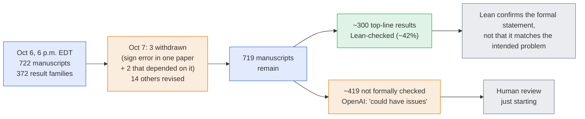

# LLM Updates — 2026-Oct-08

Compiled Thu Oct 8 2026, early morning Los Angeles time, covering **Oct 6 (evening) → Oct 8**. Items already in the
Oct-01 to Oct-07 briefs (Mistral Large 4, DeepSeek's round, Nano Banana 2.1, the Linear Hadwiger proof, Beam, DevDay
products) are not repeated except as context.

**The day's story is price. Anthropic shipped Claude Haiku 5.5 at a tenth of Haiku 4.5's per-token price, and
independent testers rank it top of the small-model class. OpenAI, on the same day, put GPT-6 in front of every ChatGPT
user, including the free tier, and added "Intelligent UI": answers that can include charts, forms and buttons. Separately,
a batch of 372 AI-generated math result families that OpenAI posted on Oct 6 is now under scrutiny. Three manuscripts
were withdrawn within a day, and about 42% have machine-checked proofs.**

- **Claude Haiku 5.5 (Anthropic, Oct 7).** **$0.10 / $0.50** per million input/output tokens for prompts up to 100K
  (Haiku 4.5: $1 / $5). 1M context. Artificial Analysis Intelligence Index **43** at max effort: top small model, ahead
  of GLM-5.3-Flash (42), Gemini 3.8 Flash (41) and GPT-6 Luna (38). Anthropic also **halved Sonnet 5.5 cache reads** and
  added **monthly API credits** for Max and Team plans (§1).
- **GPT-6 for all ChatGPT users (OpenAI, Oct 7–8).** Paid tiers get **GPT-6 Sol** in Chat from Oct 7. **Free and Go**
  get **GPT-6 Luna** from Oct 8. **Intelligent UI** lets replies include interactive elements. Work and Codex are
  unchanged (§2).
- **OpenAI's 372 math results (Oct 6–7).** **722** manuscripts from an unreleased model, including claimed proofs of
  the **Unique Games Conjecture** and **L = BPL**. **3 withdrawn** over a sign error the next day. About **300 of 719**
  top-line results are Lean-checked. Mathematicians want the model and prompts (§3).
- **Anthropic and SpaceXAI (§4).** **Claude for Google Workspace** public beta (Oct 6). The **Cyber Verification
  Program** is now three tiers (Oct 6). Musk says **Grok Bot** will route tasks to **Claude Opus 5.5** (Oct 7).
- **Regulation and security (§5).** The UK **ICO** says **ten** foundation-model developers changed or committed to
  change products, and it opened a **call for evidence on agentic AI** until **Nov 20** (Oct 8). **Pwn2Own Ireland**'s
  new AI-infrastructure category saw **OpenAI Codex** and **LiteLLM** exploited (Oct 6).
- **Business, open models and research (§6–§7).** OpenAI seeks **$30B+ at ~$1.4T** and pushes any IPO to 2027 at the
  earliest. SpaceX seeks **~$40B** of debt for Nvidia chips. Google released **EmbeddingGemma 2**, an Apache-2.0 model
  that embeds text, images, video and audio into one vector space.

![Figure: Horizontal bar charts titled "Claude Haiku 5.5: top of the small-model class at a tenth of the price", on a common 0 to 80 scale. Panel 1, Artificial Analysis Intelligence Index v4.3, independent: Claude Sonnet 5.5 (max) 56 as a reference, Kimi K3 44, Claude Haiku 5.5 (max) 43, GLM-5.3-Flash 42, Gemini 3.8 Flash 41, GPT-6 Luna (max) 38. Panel 2, Terminal-Bench 4.0 percent of tasks solved, from Anthropic's launch table: Claude Sonnet 5.5 70.6, Claude Haiku 5.5 39.2, GPT-6 Luna 16.4, Claude Haiku 4.5 0. Footer: Haiku 5.5 costs $0.10 input and $0.50 output per million tokens for prompts up to 100K tokens (Haiku 4.5 was $1 and $5; above 100K, $0.50 and $2.50). Index score by effort: low 29, medium 34, high 38, xhigh 41, max 43. At max effort it uses about 162K output tokens per Index task, about three times GPT-6 Luna's 50K, roughly $0.21 per task.](haiku55_small_models.svg)

---

## 1. Claude Haiku 5.5: small-model price war, Anthropic's turn (Oct 7)

**What shipped.** Claude Haiku 5.5, API ID `claude-haiku-5-5`, on the Claude API, Amazon Bedrock, Google Cloud and
Microsoft Foundry. Haiku 5.5 was the last missing piece of the 5.5 family after Opus 5.5 (Sep 22) and Sonnet 5.5
(Sep 28).

| | Claude Haiku 5.5 | Claude Haiku 4.5 (previous) |
|---|---|---|
| Input / output, prompts ≤100K tokens (per 1M) | **$0.10 / $0.50** | $1 / $5 |
| Input / output, prompts >100K tokens (per 1M) | **$0.50 / $2.50** | — |
| Cache read (≤100K / >100K) | **$0.01 / $0.05** | — |
| 5-minute cache write (≤100K / >100K) | **$0.125 / $0.625** | — |
| Context / max output | **1M / 128K** tokens | — |
| Terminal-Bench 4.0 (Anthropic table) | **39.2%** | 0% |

**Why "90%" and "75%" both appear.** The per-token cut is 90% below the 100K threshold and 50% above it. Anthropic
estimates real workloads get **~75%** cheaper on average. About 90% of earlier Haiku requests were under 100K, but the
new tokenizer uses slightly more tokens for the same text.

**Independent scores (Artificial Analysis, see chart).** Index **43** at max effort, **41** xhigh, **38** high, **34**
medium, **29** low. That puts it first among small models and one point behind **Kimi K3** (44), a 2.8T-parameter open
model. It is 13 points behind Sonnet 5.5 (56). The catch is token use. At max effort it emits about **162K output tokens
per Index task**, about **3×** GPT-6 Luna's ~50K, which comes to about **$0.21 per task**. That is just below
Artificial Analysis's cost–intelligence Pareto frontier.

**Bundled changes.**

- **Sonnet 5.5 cache reads halved**, reported as **$0.20 → $0.10** per 1M tokens. Anthropic says this makes Sonnet 5.5
  about **20% cheaper** on most agentic work.
- **Monthly API credits for subscribers:** **$100** (Max 5x), **$200** (Max 20x), up to **$500** pooled per Team. They
  work on any model and do not roll over. You need to have been on the plan for **7+ days**. Pro and Free are excluded.
  One guide reports that runs started from the Claude Code GitHub Action, IDE extensions or desktop app count as Claude
  Code usage, not API usage, so the credits do not cover them.

Sources: [Anthropic, Introducing Claude Haiku 5.5](https://www.anthropic.com/claude-haiku-5-5);
[Artificial Analysis](https://artificialanalysis.ai/articles/claude-haiku-5-5);
[Artificial Analysis, model page](https://artificialanalysis.ai/models/claude-haiku-5-5);
[VentureBeat](https://venturebeat.com/technology/anthropic-launches-claude-haiku-5-5-with-90-api-price-reduction-matching-gpt-6-luna);
[MarkTechPost](https://www.marktechpost.com/2026/10/07/anthropic-releases-claude-haiku-5-5-a-small-model-with-1m-context-priced-at-0-10-per-million-input-tokens/);
[The New Stack](https://thenewstack.io/anthropic-claude-haiku-5-5/);
[The Decoder](https://the-decoder.com/claude-haiku-5-5-arrives-with-massive-price-cuts-proving-the-ai-pricing-arms-race-is-far-from-over/);
[Simon Willison](https://simonwillison.net/2026/Oct/7/claude-haiku-5-5/);
[Latent Space / AINews](https://www.latent.space/p/ainews-claude-haiku-55-better-than);
[PPC Land](https://ppc.land/anthropic-haiku-5-5-costs-90-less-than-4-5-for-prompts-to-100-000-tokens/);
[iClarified, API credits](https://www.iclarified.com/102645/anthropic-launches-claude-haiku-55-adds-monthly-api-credits-for-max-and-team-users);
[Developers Digest, credits](https://www.developersdigest.tech/blog/claude-max-team-monthly-api-credits-2026);
[madrobot, credit coverage](https://madrobot.blog/2026/10/08/claude-max-team-free-api-credits-how-to-claim/);
[Yahoo Finance](https://finance.yahoo.com/technology/article/anthropic-reveals-haiku-55-model-as-ai-pricing-war-intensifies-180000423.html).

*Interpretation.* Since September every frontier lab has competed on price at roughly flat capability (Sol and Luna on
Sep 22, then three models at $2/$10 on Sep 28–30). Haiku 5.5 continues that at the low end. It matches **GPT-6 Luna's
price** and scores **5 points higher**. The 100K-token price step is new. It charges long-context work at five times the
short-prompt rate, a direct incentive to keep prompts short or cached. The token-use figure matters for budgeting: at
max effort a "cheap" model can cost more per task than its list price suggests.

## 2. GPT-6 reaches every ChatGPT user, with "Intelligent UI" (Oct 7–8)

| | Detail |
|---|---|
| Who gets what | **Pro, Plus, Business, Enterprise**: GPT-6 **Sol** in Chat from **Oct 7**. **Free and Go**: GPT-6 **Luna** from **Oct 8** |
| Intelligent UI | Replies can include **charts, forms, tappable buttons and small tools**. OpenAI's examples are a savings calculator and a bill splitter. Falls back to plain text when that is clearer |
| Speed | On web-research prompts, GPT-6 Instant starts answering **44% sooner** on average than GPT-5.6 Instant when a search is needed |
| Scope | **Chat only**. The models behind **Work** and **Codex** are unchanged |
| Reach | Reported as reaching ChatGPT's **1.2B+ weekly users** |

Sources: [9to5Mac](https://9to5mac.com/2026/10/07/openai-brings-gpt-6-to-chatgpt-and-debuts-intelligent-ui/);
[Tom's Guide](https://www.tomsguide.com/ai/chatgpt/chatgpt-can-now-give-you-interactive-answers-and-free-users-get-it-starting-today);
[Business Today](https://www.businesstoday.in/technology/artificial-intelligence/story/openai-rolls-out-gpt-6-to-all-chatgpt-users-with-intelligent-ui-that-builds-interactive-elements-inside-chats-560320-2026-10-08);
[iClarified](https://www.iclarified.com/102657/openai-rolls-out-gpt-6-and-intelligent-ui-in-chatgpt);
[Resultsense](https://www.resultsense.com/news/2026-10-08-openai-gpt-6-free-chatgpt-intelligent-ui/);
[Inside AI News](https://insideai.news/news/generative-ai/openai-gpt-6-rollout/13824/);
[Implicator](https://www.implicator.ai/claude-haiku-cheaper-gpt-6-free-chatgpt/).

*Interpretation.* Sol and Luna have been in the API since Sep 22. This is the consumer switch-over, and it lands the
same day as Haiku 5.5. Intelligent UI is the part with product consequences. ChatGPT now returns small applications,
not just text. That fits the visual ad formats OpenAI announced on Oct 5 (Oct-06 brief) and the plugin panels shown at
DevDay. One secondary report mentions a regression on sensitive content in a GPT-6 safety report, but its wording is
garbled and we could not confirm it, so it is not counted here.

## 3. OpenAI's 372 math result families: posted, partly withdrawn, mostly unread (Oct 6–7)

**What was posted.** On **Oct 6 at 6 p.m. EDT**, after our Oct-07 cut-off, OpenAI posted **722 manuscripts** in **372
families** of results from an **unreleased internal model** in its GitHub math repository. The results span 16 areas.
The 40 theoretical computer science entries include claimed proofs of the **Unique Games Conjecture**, **L = RL =
BPL**, a **matrix-multiplication exponent ≤ 9/4** and **integer multiplication below n log n**. Other headline claims
include the **four-dimensional Kakeya conjecture** and progress toward the Riemann hypothesis. OpenAI says nearly every
result came from **one prompt to one agent**, using about **3 hours of ChatGPT Pro-level inference** per result on
average.

**What happened next.**

- **Oct 7: three withdrawals.** A sign error in *Algebraicity of Weil classes on split abelian eightfolds* broke a
  cancellation argument, and two dependent manuscripts fell with it. **14** others were revised.
- **Verification.** About **300 of 719** top-line results (~42%) have Lean proofs. Lean checks a proof against the
  statement as formalised. It does not show that the formal statement matches the intended problem.
- **Readability.** Scott Aaronson ("The Mathocalypse") called it one of the biggest days in mathematical history and
  said no human appears to have understood "just about any" of the proofs yet. He puts the success rate at about **5% of
  ~8,000** problems attempted. Dana Moshkovitz, who worked for years toward Unique Games, said the claimed proof was too
  badly written to read without AI help. A secondary summary says Aaronson also wrote that labs have begun checking
  whether such models can break **cryptographic primitives**. We could not read his post to confirm that.
- **Reproducibility.** MIT's Andrew Sutherland says single-agent claims are unverified until outsiders can rerun the
  work. An Institute for Advanced Study advisory group had asked on Sep 29 for the model, exact prompts and per-problem
  compute. OpenAI released averages only.

Sources: [Implicator, the release](https://www.implicator.ai/openai-372-math-results-mathematicians-race-to-read/);
[Implicator, withdrawals](https://www.implicator.ai/openai-posts-372-ai-math-results-then-withdraws-three-papers-over-a-sign-error/);
[Scientific American](https://www.scientificamerican.com/article/openai-unleashes-hundreds-more-math-results-upon-a-field-already-in-shock/);
[Scott Aaronson, "The Mathocalypse"](https://scottaaronson.blog/?p=10169);
[Computational Complexity blog, "Open No More"](https://blog.computationalcomplexity.org/2026/10/open-no-more.html);
[OfficeChai](https://officechai.com/ai/openai-releases-over-300-mathematical-results-produced-by-an-internal-model/);
[Startup Fortune](https://startupfortune.com/independent-mathematicians-are-now-lean-checking-openais-proof-claims-line-by-line/);
[DEV Community, Lean caveats](https://dev.to/slabb/700-manuscripts-48-hours-three-withdrawals-the-verifier-won-dhl);
[ETV Bharat](https://www.etvbharat.com/en/technology/openai-solves-372-maths-problem-navier-stokes-millennium-challenge-enn26100704973).

*Interpretation.* The Linear Hadwiger proof (Oct-06 §3) arrived with a human co-author and a full Lean
formalisation. This batch is the opposite: hundreds of claims at once, under half machine-checked, from a model nobody
outside OpenAI can run. The withdrawals show the process partly working, since an error was caught within a day. They
also show that the release outpaced the review. The cryptography point, if confirmed, is the security story to follow.
A model that can produce research-level proofs in complexity theory is a model whose output on cryptographic
assumptions people will want to see before it ships.

## 4. Anthropic products and SpaceXAI's model routing

| Item | Date | What's new |
|---|---|---|
| **Claude for Google Workspace** (public beta) | Oct 6 | A single Marketplace add-on puts Claude in a **sidebar in Docs, Sheets and Slides** for all paid plans (Pro, Max, Team, Enterprise). It reads the open file and selection and **edits in place**. Default mode asks before applying edits; an "Accept all edits" mode lets it run to completion. Sheets: formulas, pivot tables, charts, Python processing. Slides: new slides that keep the theme. Separate beta **connectors** let Claude create and edit Google files from the Claude app. Access follows Google sharing permissions. Reported limits: **6-minute cap per operation**, no third-party inference (Bedrock, Vertex, Foundry, gateways) ([Claude](https://claude.com/resources/articles/claude-now-works-in-google-docs-sheets-and-slides); [Reworked](https://www.reworked.co/digital-workplace/anthropic-opens-claude-for-google-workspace-in-beta/); [Android Headlines](https://www.androidheadlines.com/2026/10/claude-challenges-gemini-google-workspace-integration.html); [TestingCatalog](https://www.testingcatalog.com/claude-adds-editing-in-google-docs-sheets-and-slides/); [AICoder](https://aicoder.com/news/news-20261007-claude-for-google-workspace-docs-sheets-slides-beta)) |
| **Cyber Verification Program, three tiers** | Oct 6 | Merges the earlier CVP and **Project Glasswing**. **Defense Access**: SOC, incident response, malware reversing, vulnerability validation; open to companies, hospitals, utilities, open-source maintainers and individual researchers; review in days. **Red Team Access**: authorized pen-testing, **organizations only**, review in weeks, with Defense Access granted meanwhile. **Specialized Access**: safety-critical systems (grids, telecoms, flight and interbank systems), **reviewed with the US government**; Glasswing members move here. All tiers require **data retention** for misuse monitoring. Real-time blocks on ransomware deployment and attacks on physical systems stay in place. Models listed: Opus 5.5, Sonnet 5.5, **Mythos 5.1**. Available on Claude Platform, Vertex AI and Foundry; Bedrock limited to Enterprise Frontier Safeguards customers ([Anthropic](https://www.anthropic.com/news/cyber-verification-program); [ExecutiveBiz](https://www.executivebiz.com/articles/anthropic-expands-cyber-verification-program-claude-ai); [Cybersecurity News](https://cybersecuritynews.com/anthropic-cyber-verification-program/); [BERI](https://www.beri.net/article/anthropic-cyber-verification-program-tiers-defense-red-team-specialized-access-data-retention-claude-cyber-blocks)) |
| **Grok Bot routes to Claude Opus 5.5** | Oct 7 | Musk on X: SpaceX "will use the best back end model for any given task, including Claude Opus 5.5, MidJourney, Suno and other leading APIs". A SpaceXAI staff member wrote that "all bots will be powered by opus 5.5". No task split, terms or UI disclosure has been published. Grok Bot reported **418K weekly users** in mid-September ([Trending Topics](https://www.trendingtopics.eu/grok-bot-claude-opus-musk-rival-models/); [Android Headlines](https://www.androidheadlines.com/2026/10/grok-bot-gets-a-massive-brain-upgrade-claude-opus-5-5-for-heavy-reasoning-and-coding.html); [tbreak](https://tbreak.com/grok-bot-claude-opus-midjourney-suno/); [Dealroom](https://app.dealroom.co/news/note/musk-grok-will-route-tasks-to-the-best-model-including-claude-opus-5-5-midjourney-and-suno)) |

*Interpretation.* The Workspace add-on puts Claude inside Google's own apps, where Google has just added Gemini Skills
(Oct-06 §5), and it arrives a week after Meta and Microsoft cut internal Claude use. The Grok Bot decision is the
opposite signal: a rival lab choosing Anthropic's model for its own agent. The cyber tiers are Anthropic's version of a
pattern Mistral is selling with Large 4 (Oct-07 §1). Offensive-security capability goes to verified users, with logging
as the price of access.

## 5. Regulation and security

- **UK ICO (Oct 8).** The Information Commissioner's Office says **ten** foundation-model developers have made or
  committed to make data-protection changes after its review: **Amazon, Anthropic, Apple, Cohere, DeepSeek, Google,
  Meta, Microsoft, OpenAI and Stability AI**. The changes cover clearer transparency information, easier ways for people
  to exercise their rights, and tougher safeguard assessments. The ICO also opened a **six-week call for evidence on
  agentic AI**, closing **Nov 20, 2026**. It asks how organisations secure personal data, explain agents' actions,
  assign responsibility and apply safeguards for automated decisions. It will feed a statutory **code of practice on AI
  and automated decision-making**. The ICO says it has made **enquiries** with **OpenAI, Anthropic, Meta and the UK AI
  Security Institute** about recent agentic AI testing and deployment. It does not call them investigations
  ([ICO](https://ico.org.uk/about-the-ico/media-centre/news-and-blogs/2026/10/ico-secures-changes-from-leading-ai-developers-as-scrutiny-extends-to-ai-agents);
  [ICO call for evidence](https://ico.org.uk/about-the-ico/ico-and-stakeholder-consultations/2026/10/agentic-ai-call-for-evidence);
  [MLex](https://www.mlex.com/mlex/artificial-intelligence/articles/2535544);
  [MLex, agentic call](https://www.mlex.com/mlex/artificial-intelligence/articles/2535556)).
- **Pwn2Own Ireland, day one (Oct 6, Cork).** **$388,500** for **32** unique zero-days. In the new **AI
  Infrastructure** category, Ikotas Labs exploited **OpenAI Codex** with one argument-injection bug (**$40,000**).
  Taisic Yun (Xint) got a reverse shell on **LiteLLM** via input validation plus code injection (**$40,000**), and a
  second team also broke LiteLLM ($15,000). Oracle's Autonomous AI Database also fell. Vendors have 90 days to patch
  ([ZDI](https://www.zerodayinitiative.com/blog/2026/10/6/pwn2own-ireland-2026-day-one-results);
  [Infosecurity Magazine](https://www.infosecurity-magazine.com/news/pwn2own-hackers-32-zeroday/);
  [Cybersecurity Pulse](https://www.cybersecuritypulse.net/p/tcp-148-codex-exploited-at-pwn2own)).
- **Google pauses its open-source bug bounty (effective Oct 1; widely reported Oct 4–7).** New reports to the OSS VRP
  are paused until an update in **Q1 2027**. Google cites "a significant rise in automated submissions, the vast majority
  of which are not valid": invented exploit paths and unreachable "vulnerable" functions. Supply-chain reports and the
  Patch Rewards Program stay open ([TechCrunch](https://techcrunch.com/2026/10/04/google-froze-its-open-source-bug-bounty-program-due-to-a-significant-rise-in-ai-submissions/);
  [BleepingComputer](https://www.bleepingcomputer.com/news/google/google-halts-open-source-bug-bounty-program-amid-ai-spam-surge/);
  [Malwarebytes](https://www.malwarebytes.com/blog/news/2026/10/google-pauses-open-source-bug-bounty-program-after-rise-in-ai-submissions)).

*Interpretation.* Agentic AI now has a formal UK consultation with a deadline, which is a different track from the US
hearings and lawsuits covered all month. On security, the same week produced verified access for defenders (§4), a
coding agent exploited in a public contest, and a bug bounty closed because AI-generated reports swamped it. AI is
adding attack surface and adding noise to defence at the same time.

## 6. Business, compute and products

| Item | Date | What's new |
|---|---|---|
| **OpenAI raise** | Oct 5–6 | Seeking **at least $30B** at a pre-money valuation of about **$1.4T**, presented as non-negotiable. **MGX** leads a UAE group of up to **$10B**; **BlackRock** is in talks. IPO pushed to **2027 at the earliest**, citing safety work. The March round was $122B at $852B post-money (Bloomberg via [Reuters/TradingView](https://www.tradingview.com/news/reuters.com,2026-10-06:newsml_Zaw9MDWp6:0-openai-in-30bln-round-talks-with-uae-funds-blackrock-report/); [Citybiz](https://www.citybiz.co/article/914406/openai-seeks-30-billion-at-1-4-trillion-valuation-as-blackrock-uae-funds-weigh-investments/); [Gulf News](https://gulfnews.com/business/markets/1-trillion-valuation-openai-ipo-could-smash-records-ai-giant-set-to-shake-up-wall-street-1.500328237)) |
| **SpaceX chip financing** | Oct 6–7 | About **$40B** to buy Nvidia chips: ~$10B bank loans and ~$30B investment-grade debt, Apollo expected to lead, closing in 2027 (Bloomberg/FT via [Tech Startups](https://techstartups.com/2026/10/07/top-tech-news-today-october-7-2026-anthropic-elevenlabs-google-meta-mistral-nvidia-spacex-more/)) |
| **Meta Muse on Windows** | Oct 7 | Meta's Muse agent is coming to Windows as a native app. Muse is officially available only in the US and Canada ([iPhone in Canada](https://iphoneincanada.ca/2026/10/07/meta-muse-windows-app)) |
| **Open-source "dots" clones** | Oct 7–8 | Users report task failures, connection problems and agents disappearing in OpenAI's dots. Open alternatives appeared: CopilotKit's **OpenDots** (self-hosted template) and **Open Dot** (runs on a Mac with Kimi, DeepSeek or Qwen via OpenRouter). One comparison blog says four repos took the name within 26 hours, two have no licence file, and OpenDots needs CopilotKit's hosted service. *Unverified against the repos* ([The Register](https://www.theregister.com/ai-and-ml/2026/10/07/openai-dots-inspire-open-source-imitators-amid-technical-difficulties/5301734); [MausBot](https://mausbot.com/blog/open-dots-vs-mausbot)) |

*Interpretation.* A $1.4T private price with the IPO pushed back is the counterpart to Anthropic preparing a November
listing (Oct-02, Oct-05). OpenAI is choosing to stay private while it is under the most scrutiny it has faced. The ask
also comes the same week its consumer models went free (§2) and its biggest rival cut small-model prices 90% (§1).

## 7. Open models and research

- **EmbeddingGemma 2 (Google DeepMind, Oct 6).** An open embedding model that maps **text, code, images, video and
  audio** into one 768-dimension vector space. Matryoshka truncation to 512, 256 or 128 dimensions. Built on **Gemma 4**.
  It is modular: a **270M** text core plus optional **170M vision** and **300M audio** encoders, **740M** in total. Load
  only what you need (270M text-only, 440M with vision, 570M with audio). **8K** context. **Apache 2.0**. Google reports
  **MTEB Code 68.76 → 78.68** against v1. Secondary reports give ~191MB RAM for text-only use on a Pixel 11 Pro and ~567MB
  for all modalities, and note that there was no safety tuning
  ([Google blog](https://blog.google/innovation-and-ai/technology/developers-tools/embeddinggemma-2/);
  [Hugging Face](https://huggingface.co/google/embeddinggemma-2);
  [Google AI docs](https://ai.google.dev/gemma/docs/embeddinggemma/multimodal-embeddinggemma-with-sentence-transformers);
  [MarkTechPost](https://www.marktechpost.com/2026/10/06/google-deepmind-releases-embeddinggemma-2-a-740m-open-multimodal-embedding-model-built-on-gemma-4/);
  [The Next Web](https://thenextweb.com/news/embeddinggemma-2-on-device-europe)).
- **Hugging Face Daily Papers, Oct 7** (23 papers; descriptions are from titles only, not full reads):
  - *Towards Looped Models Done Right, Part II: Rethinking at Fixed Points*. Continues the looped-model thread from
    Oct-07 §5 (CoT monitorability of looped LLMs).
  - *What Matters for Latent Reasoning with Flow Matching*. Reasoning in a continuous latent space instead of in text,
    which makes it harder to monitor.
  - *Representation-Space MMD for Diffusion Language Models*. Training objectives for non-autoregressive LMs.
  - *Optimizing the Optimizer: Language Models Discover Faster Molecular Relaxation*. LLM-driven algorithm discovery
    in computational chemistry.
  - *RealtimeWAM: One-Step Asynchronous World Action Models*. World models for real-time control.

  Listing source: [daily-huggingface digest, Oct 7](https://github.com/hyeonseo2/daily-huggingface/issues/257);
  [Daily-HuggingFace-AI-Papers tracker](https://github.com/AtharvaDomale/Daily-HuggingFace-AI-Papers).

*Interpretation.* Two of the five papers are about reasoning that happens in loops or in latent space, not in visible
text. Taken together with the CoT-faithfulness papers in yesterday's brief, research is moving toward architectures whose
reasoning is harder to read, while labs' safety cases still lean on reading it.

## Watch-items into the next brief

| # | Item | Status after Oct 7–8 |
|---|---|---|
| 49 | Astra's math | **Widened.** The 372-family batch (§3) now dwarfs the Hadwiger paper; still no independent review of Unique Games |
| 50 | Beam weights | **Pending** |
| 51 | Large 4 licence and weights | **Pending.** Hugging Face page reportedly lists **Oct 31** |
| 52 | DeepSeek close | **Pending** |
| 53 | Inference valuations | **Pending** |

Items 1–48 carry over unchanged.

New items:

54. **Unique Games and L = BPL.** Does any complexity theorist publicly confirm or refute either claimed proof? How many
    more withdrawals follow? Does OpenAI release prompts or per-problem compute?
55. **Haiku 5.5 in practice.** Does the 100K price step change how agent frameworks manage context? Do OpenAI or Google
    answer on small-model price within the week?
56. **ICO agentic enquiries.** Do the enquiries to OpenAI, Anthropic, Meta and AISI become formal action before the
    Nov 20 deadline?
57. **Grok Bot on Claude.** Does SpaceXAI publish which tasks go to Opus 5.5, and do users see which model ran?

---

### Method & caveats

- **Compiled** Thu Oct 8 2026, ~06:20 Los Angeles time, covering **Oct 6 (evening) → Oct 8**. Some items dated Oct 6
  (OpenAI's math release at 6 p.m. EDT, Claude for Workspace, the CVP tiers, EmbeddingGemma 2, Pwn2Own day one) were
  published after or missed by the Oct-07 brief and are included here for the first time.
- **What is measured, claimed, or reported.**
  - **Independent:** Artificial Analysis Intelligence Index scores, token use and cost per task for Haiku 5.5. Pwn2Own
    results (ZDI).
  - **Company claims:** Anthropic's Terminal-Bench 4.0 table and "~75% cheaper" estimate. OpenAI's math results and its
    "single prompt" and compute averages. Google's MTEB figures for EmbeddingGemma 2. OpenAI's 44% speed figure.
  - **Second-hand / single-source:** the math withdrawals and Lean count (mainly Implicator); the cryptography remark
    attributed to Aaronson (one aggregator); Grok Bot details (Musk and staff posts on X); the open-source dots clones'
    licence status (one blog); SpaceX's financing (Bloomberg/FT via an aggregator); the Sonnet 5.5 cache-read figures
    (sources disagree on the old price).
- **Interpretation, labelled as such:** in §1–§7.
- **Scraping resilience.** Direct fetches failed (DNS or egress policy) for `aiweekly.co`, `samonai.substack.com`,
  `artificialanalysis.ai`, `ico.org.uk`, `latent.space`, `theregister.com` and `arxiv.org`, and the GitHub API was not
  available for the DailyArXiv repository. All items come from the **search index**, cross-checked across outlets
  where possible. Because arXiv listings could not be read, §7 uses the Hugging Face Daily Papers digest instead.
  An aggregator claim of a "GLM-5.3 Fast" release on Oct 7 could not be matched to any Z.ai source (the closest is
  GLM-5.3-FlashX, Sep 18) and is omitted.

### Sources (by section)

- **Haiku 5.5.** [Anthropic](https://www.anthropic.com/claude-haiku-5-5) · [Artificial Analysis](https://artificialanalysis.ai/articles/claude-haiku-5-5) · [VentureBeat](https://venturebeat.com/technology/anthropic-launches-claude-haiku-5-5-with-90-api-price-reduction-matching-gpt-6-luna) · [MarkTechPost](https://www.marktechpost.com/2026/10/07/anthropic-releases-claude-haiku-5-5-a-small-model-with-1m-context-priced-at-0-10-per-million-input-tokens/) · [The New Stack](https://thenewstack.io/anthropic-claude-haiku-5-5/) · [The Decoder](https://the-decoder.com/claude-haiku-5-5-arrives-with-massive-price-cuts-proving-the-ai-pricing-arms-race-is-far-from-over/) · [Simon Willison](https://simonwillison.net/2026/Oct/7/claude-haiku-5-5/) · [Latent Space](https://www.latent.space/p/ainews-claude-haiku-55-better-than) · [PPC Land](https://ppc.land/anthropic-haiku-5-5-costs-90-less-than-4-5-for-prompts-to-100-000-tokens/) · [iClarified](https://www.iclarified.com/102645/anthropic-launches-claude-haiku-55-adds-monthly-api-credits-for-max-and-team-users) · [Developers Digest](https://www.developersdigest.tech/blog/claude-max-team-monthly-api-credits-2026) · [Yahoo Finance](https://finance.yahoo.com/technology/article/anthropic-reveals-haiku-55-model-as-ai-pricing-war-intensifies-180000423.html)
- **GPT-6 in ChatGPT.** [9to5Mac](https://9to5mac.com/2026/10/07/openai-brings-gpt-6-to-chatgpt-and-debuts-intelligent-ui/) · [Tom's Guide](https://www.tomsguide.com/ai/chatgpt/chatgpt-can-now-give-you-interactive-answers-and-free-users-get-it-starting-today) · [Business Today](https://www.businesstoday.in/technology/artificial-intelligence/story/openai-rolls-out-gpt-6-to-all-chatgpt-users-with-intelligent-ui-that-builds-interactive-elements-inside-chats-560320-2026-10-08) · [iClarified](https://www.iclarified.com/102657/openai-rolls-out-gpt-6-and-intelligent-ui-in-chatgpt) · [Resultsense](https://www.resultsense.com/news/2026-10-08-openai-gpt-6-free-chatgpt-intelligent-ui/) · [Inside AI News](https://insideai.news/news/generative-ai/openai-gpt-6-rollout/13824/)
- **Math results.** [Implicator](https://www.implicator.ai/openai-372-math-results-mathematicians-race-to-read/) · [Implicator, withdrawals](https://www.implicator.ai/openai-posts-372-ai-math-results-then-withdraws-three-papers-over-a-sign-error/) · [Scientific American](https://www.scientificamerican.com/article/openai-unleashes-hundreds-more-math-results-upon-a-field-already-in-shock/) · [Shtetl-Optimized](https://scottaaronson.blog/?p=10169) · [Computational Complexity](https://blog.computationalcomplexity.org/2026/10/open-no-more.html) · [Startup Fortune](https://startupfortune.com/independent-mathematicians-are-now-lean-checking-openais-proof-claims-line-by-line/) · [DEV Community](https://dev.to/slabb/700-manuscripts-48-hours-three-withdrawals-the-verifier-won-dhl)
- **Anthropic and SpaceXAI.** [Claude, Workspace](https://claude.com/resources/articles/claude-now-works-in-google-docs-sheets-and-slides) · [Reworked](https://www.reworked.co/digital-workplace/anthropic-opens-claude-for-google-workspace-in-beta/) · [Android Headlines, Workspace](https://www.androidheadlines.com/2026/10/claude-challenges-gemini-google-workspace-integration.html) · [Anthropic, CVP](https://www.anthropic.com/news/cyber-verification-program) · [ExecutiveBiz](https://www.executivebiz.com/articles/anthropic-expands-cyber-verification-program-claude-ai) · [BERI](https://www.beri.net/article/anthropic-cyber-verification-program-tiers-defense-red-team-specialized-access-data-retention-claude-cyber-blocks) · [Trending Topics, Grok Bot](https://www.trendingtopics.eu/grok-bot-claude-opus-musk-rival-models/) · [Android Headlines, Grok Bot](https://www.androidheadlines.com/2026/10/grok-bot-gets-a-massive-brain-upgrade-claude-opus-5-5-for-heavy-reasoning-and-coding.html)
- **Regulation and security.** [ICO](https://ico.org.uk/about-the-ico/media-centre/news-and-blogs/2026/10/ico-secures-changes-from-leading-ai-developers-as-scrutiny-extends-to-ai-agents) · [ICO call for evidence](https://ico.org.uk/about-the-ico/ico-and-stakeholder-consultations/2026/10/agentic-ai-call-for-evidence) · [MLex](https://www.mlex.com/mlex/artificial-intelligence/articles/2535544) · [ZDI](https://www.zerodayinitiative.com/blog/2026/10/6/pwn2own-ireland-2026-day-one-results) · [Infosecurity Magazine](https://www.infosecurity-magazine.com/news/pwn2own-hackers-32-zeroday/) · [TechCrunch](https://techcrunch.com/2026/10/04/google-froze-its-open-source-bug-bounty-program-due-to-a-significant-rise-in-ai-submissions/) · [BleepingComputer](https://www.bleepingcomputer.com/news/google/google-halts-open-source-bug-bounty-program-amid-ai-spam-surge/)
- **Business.** [Reuters/TradingView](https://www.tradingview.com/news/reuters.com,2026-10-06:newsml_Zaw9MDWp6:0-openai-in-30bln-round-talks-with-uae-funds-blackrock-report/) · [Citybiz](https://www.citybiz.co/article/914406/openai-seeks-30-billion-at-1-4-trillion-valuation-as-blackrock-uae-funds-weigh-investments/) · [Tech Startups](https://techstartups.com/2026/10/07/top-tech-news-today-october-7-2026-anthropic-elevenlabs-google-meta-mistral-nvidia-spacex-more/) · [iPhone in Canada](https://iphoneincanada.ca/2026/10/07/meta-muse-windows-app) · [The Register](https://www.theregister.com/ai-and-ml/2026/10/07/openai-dots-inspire-open-source-imitators-amid-technical-difficulties/5301734)
- **Open models and research.** [Google blog](https://blog.google/innovation-and-ai/technology/developers-tools/embeddinggemma-2/) · [Hugging Face](https://huggingface.co/google/embeddinggemma-2) · [MarkTechPost](https://www.marktechpost.com/2026/10/06/google-deepmind-releases-embeddinggemma-2-a-740m-open-multimodal-embedding-model-built-on-gemma-4/) · [daily-huggingface, Oct 7](https://github.com/hyeonseo2/daily-huggingface/issues/257)
