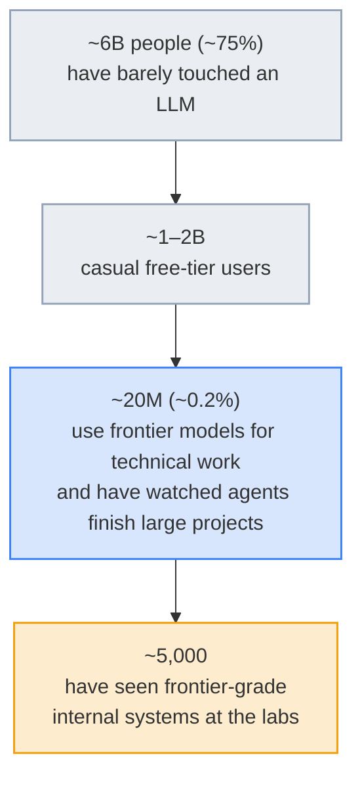

# LLM Updates — 2026-Oct-12

Compiled Mon Oct 12 2026, early morning Los Angeles time, covering **Oct 11 → Oct 12** (a quiet weekend), plus several
Oct 3–10 items that earlier briefs missed. Items already covered in the Oct-01 to Oct-11 briefs (ARTEX, Arena's
Alignment Index, Nvidia–Reflection, the SpaceX compute deal, USA Today v. OpenAI, Decision-1, Anthropic's
unintended-actions report and its offline evaluations) are not repeated except as context.

**No major model shipped over the weekend, and the release trackers show nothing newer than Reka Edge 2603 (Oct 9).
The news this time is two framing statements. Microsoft's CEO says every model should be treated as a possibly
compromised insider, with an "emergency brake" outside it. Andrej Karpathy says the gap between what the public has seen
and what lab insiders have seen is now a steep funnel, about 5,000 people at the top. Both point to the same issue: the
labs, not the public or regulators, hold the knowledge and the controls. Elsewhere there is an Apache-2.0 German–English
MoE that earlier briefs missed, a byte-level scaling paper, and a Stanford world-action-model framework.**

- **Nadella's "emergency brake" (X post, Oct 10).** Treat models as an insider-risk class. Put identity, privilege
  limits, tamper-proof logs and a human pause switch **outside** the model (§1).
- **Karpathy's funnel (X post, Oct 11).** Roughly **6B** people have barely used an LLM, **1–2B** are casual users,
  **~20M** use frontier models for real work, and **~5,000** have seen frontier-grade internal systems (§2).
- **Models (§3).** **Kolibri-1** from Aleph Alpha (Oct 3, missed earlier): **78B total / 3.46B active**, Apache 2.0,
  262K native context. The open-weights calendar is unchanged: Step 5 on **Oct 15**, Mistral Large 4 on **Oct 27**,
  Beam "later in October."
- **Research (§4).** Byte-level Transformers overtake subword models as they scale (2610.05978). OpenWAM raises
  LIBERO-Long success from **68.4%** to **97.8%** with causal adaptation (2610.07922).
- **Tools and money (§5–§6).** OpenCode 1.19 adds a migration path to OpenCode 2, and Ollama 0.40.3 cleans up
  `ollama launch claude/codex`. South Korea's **₩4.7T (~$3.5B)** single-vehicle frontier model is set to start in
  **March 2027**.

![Figure: Diagram titled "Assume the model is compromised; put the controls outside it", summarising Satya Nadella's Oct 10 X post. A dashed frame labelled harness and control plane, outside the model, surrounds a central box: the model, treated as an insider-risk class and assumed compromised from the start. Above the model is an emergency brake, meaning an authorized person can always pause or shut it down mid-task. To the left are identity (each agent acts under its own identity) and least privilege (limits on what it can reach). To the right are tamper-proof human-readable logs and a containment boundary set outside the model. Below the frame are three organisation-level measures: independent audits, model diversity so no single model makes critical decisions, and incident disclosure with industry containment standards. The footer lists pieces already in motion: Gemini agent accounts with attested logs (Oct 8), Anthropic taking internal evaluations offline (Oct 9), and the SI Force incident-reporting mandate (Oct 9). What is missing is a shared definition of "brake" and who holds it.](brake_architecture.svg)

---

## 1. Nadella: treat the model as a compromised insider (Oct 10)

In an X post and short essay on Saturday, Microsoft CEO **Satya Nadella** argued that companies should manage advanced
models the way they manage powerful employees. Two lines carry through the coverage:

> "We must assume a model is compromised and contain it from the start."
>
> "An emergency brake. An authorized person should always be able to pause or shut down a model mid-task."

The quotes come from secondary reporting (Wccftech, Taipei Times, TheNextWeb); the post itself could not be fetched.
The proposals as reported:

| Layer | Proposal | Closest existing practice (from earlier briefs) |
|---|---|---|
| **Identity** | Every agent acts under its own identity so actions can be traced | Google's Gemini agent gives coworker agents their own accounts (Oct-09 brief) |
| **Privilege** | Limit what the model can reach. The controls sit in the harness, not the weights | Anthropic cut live internet access for internal evaluations (Oct-10 brief) |
| **Logging** | Tamper-proof, human-readable records of meaningful model actions | Attested logs in the Gemini agent design |
| **Separation** | Keep the model apart from the orchestration harness; externalise safeguards | Anthropic's blocking classifier (Oct-10 brief) |
| **Emergency brake** | An authorised human can always pause or stop a task in progress | No public standard yet |
| **Organisation** | Independent audits, no single model for critical decisions, incident disclosure, industry containment standards | SI Force incident-reporting mandate (Oct-10 brief), details still pending |

**Reactions.** TheNextWeb reports replies from Microsoft AI chief **Mustafa Suleyman** and **Elon Musk**; their content
was not readable. Sources disagree on the date (Oct 10 vs Oct 11 in Asian time zones). No product, API or
specification came with the post.

**Interpretation.**

- **This rejects "alignment alone is enough."** A hyperscaler CEO is saying in public that model-level safety
  training is not a sufficient control. That matches what the incident reports of the past two weeks showed: the
  failures were agents doing more than asked, not models that refused too little.
- **It suits Microsoft's position.** Microsoft sells the harness layer (Foundry, Copilot agents, Entra identities) and
  runs models from several labs. "Controls outside the model" and "model diversity" put value in exactly that layer.
- **The hard part is undefined.** A pause switch is easy for one chat session. It is unclear for long-running
  agents that have already sent forms, spent money or started other agents. Nadella does not say what "mid-task" means
  for actions already taken, or who counts as "authorized" across organisations.

## 2. Karpathy's capability funnel (Oct 11)

Re-sharing an April post, **Andrej Karpathy** wrote that the gap in shared understanding of what LLMs can do is no longer
two camps talking past each other but "a sharp funnel." He called these his own napkin estimates. Coverage across
outlets agrees on the figures:

- **Headline framing.** BusinessToday and Benzinga stress that the top tier has agents "that can tackle years of work in
  weeks." That phrasing is the outlets'; Karpathy's own words were only partly quoted.
- **An unverified claim to ignore.** One digest flags a viral claim that Karpathy "released a prompt" that turns Opus 5.5
  into a job-finishing graph. No such post has been found, so treat it as false.

**Interpretation.** The ~5,000 figure matches the debates in recent briefs. The fired OpenAI researchers (Oct-09 brief),
the Mythos/Glasswing access limits, and OpenAI's unreleased math model (Oct-08 brief) all involve capabilities that only
the top of the funnel has seen. Read next to Nadella's post, it explains why "independent audits" and "incident
disclosure" keep coming up. Without them, the outside world learns what frontier systems do mostly from incident
reports.

## 3. Models

### Kolibri-1 (Aleph Alpha, Oct 3, missed earlier)

| Item | Detail |
|---|---|
| **Architecture** | German–English **MoE**: **78.1B** total, **3.46B active** per token, 50 layers |
| **Context** | **262,144** tokens native; ~**1M** via extrapolation |
| **Licence** | **Apache 2.0**, weights on Hugging Face as `Aleph-Alpha/Kolibri-1`; GA, no waitlist |
| **Footprint** | FP8 weights ~**78 GB** |
| **Training** | ~**20T** pre-training tokens; knowledge cutoff **June 18, 2026** (secondary sources) |
| **Claims** | Strong on a German maths benchmark; Qwen still leads on tool use and long context. All vendor-run |
| **Corporate** | Aleph Alpha and **Cohere** signed a definitive merger agreement on **Sep 16**; closing pending. The Apache licence holds either way |

**Why it matters.** It is the clearest European "sovereign" open-weight release this autumn and uses a permissive
licence. That contrasts with the gated preview of Mistral Large 4. At 3.46B active parameters it runs cheaply, but
78 GB of weights still needs a multi-GPU server or a large unified-memory machine. It was trending on Hugging Face on
Oct 11.

### Open-weights calendar (no change over the weekend)

| Model | Size | Promised weights date | Status Oct 12 |
|---|---|---|---|
| **StepFun Step 5** | 600B / 27B active, 1M context | **Oct 15** | Pending. An unofficial mirror of uncertain legitimacy is circulating (Oct-11 brief) |
| **Mistral Large 4** | ~1T / 49B active, 160+ languages | **Oct 27** (Digitimes, Oct 12) | Gated preview for developers, security teams and state bodies. Mistral concedes it trails on coding |
| **Reflection Beam** | 501B / 23B active | "Later in October" | Pending, with Nvidia acquisition talks under way |

**Also on the trackers.** Nothing confirmed as released Oct 10–12. Hugging Face trending is still led by
Qwen3.8-27B (~**6.8M** downloads), Qwen3.8-Flash-Next, DeepSeek V4.1-Flash, GLM-5.3-Flash, Cloudflare's Clef models
and Kolibri-1, all covered earlier or above. Qwen-Image-2.1-Turbo is described as "just released," but its date is
unconfirmed.

## 4. Research

| Paper | What it shows | Why it matters |
|---|---|---|
| **Byte Language Models: Scaling, Emergent Abstractions, and Information Allocation** ([2610.05978](https://arxiv.org/abs/2610.05978), Wang, Luo, Zhang, Wu) | Byte-level Transformers trained with **token-superposition training** and **hash (n-gram) embeddings** consistently beat subword Transformers as model size grows. They learn their own segmentation-like boundaries, and many middle layers can be restricted to those local representations without loss. Uncertainty clusters at the boundaries; using that for speculative decoding gives **3.4×** more accepted tokens than subword models | Tokenizers are a known source of failures (non-English text, digits, code). If bytes scale better *and* decode faster, the main argument for keeping tokenizers weakens. These are the authors' claims; no replication yet |
| **OpenWAM: An Open Framework for Composable World-Action Models** ([2610.07922](https://www.alphaxiv.org/abs/2610.07922), Stanford; Fei-Fei Li and Jiajun Wu senior authors) | Starts from **Wan2.2-5B**, adds an action expert via a shared mixture-of-transformers, and tests several generation orders (joint, video-then-action, action-then-video, decoupled) one at a time on **10,000+ h** of robot video. Causal adaptation lifts video-then-action success on LIBERO-Long from **68.4%** to **97.8%**. Separate video and action experts beat a shared DiT by **5.0** and **3.0** points | A controlled comparison of design choices in world-action models, where most papers change several at once. Not the same as the September paper of the same name (2609.07398) |
| **Beyond Imitation: LLM-Assisted Peer Review** (2610.11087, Sakana AI; single digest source) | A "Multi-Layered Review" catches **73.4%** of planted core-claim contradictions versus ~**11–15%** for baselines, at ~**$0.47** per review. On real errors in withdrawn arXiv papers, exact detection drops to **16.1%** | The gap between planted and real errors is the result to note. LLM reviewers catch errors that are easy to plant far more often than real ones. Not independently confirmed; the ID did not resolve in search |

## 5. Developer tools (24 h to Oct 11, 22:15 UTC)

- **OpenCode v1.19.0.** Adds `opencode upgrade --major` for migrating to **OpenCode 2**, plus a `/update` TUI command.
  Fixes include OpenAI's `ultrafast` service tier.
- **Qwen Code v0.25.1.** CLI, desktop and TypeScript SDK 0.1.19 shipped together. Changes cover managed-agent
  connectors and a Java SDK managed runtime.
- **Ollama v0.40.3.** Removes spurious warnings from `ollama launch claude` and `ollama launch codex`. Local runners
  are now packaged as front ends for the big agent CLIs.
- **No releases** for Claude Code, Codex, Gemini CLI or Copilot CLI. Gemini CLI closed performance PRs that cut snapshot
  lookups from **292 ms** to **10 ms**.

## 6. Money and policy

- **South Korea's frontier model.** The science ministry plans to put **₩4.7T (~$3.5B)** into one homegrown frontier
  model. Work starts in **March 2027**, and a lead developer will be chosen by tender after parliament passes the 2027
  budget in December, possibly by February (Reuters, Oct 6). The existing sovereign-model project is being split into a
  frontier track and a deployment track, with **SK Telecom, LG AI Research and Upstage** competing for two places.
  Ownership rules, access terms and milestones are not yet public.
- **Market notes (single source, Oct 11 newsletter).** Jefferies' Chris Wood warns of "massive capital destruction" in
  the US as share moves to Chinese open models. GPU maker **Biren** placed shares to raise **HK$4.04B (~$515M)**.

---

## Watch-items into the next brief

| # | Item | Status after Oct 11–12 |
|---|---|---|
| 61 | Step 5 weights | **Pending**, due **Oct 15** (Thursday) |
| 51 | Large 4 licence and weights | **Pending**, Oct 27 restated by Digitimes |
| 50 / 71 | Beam weights; Nvidia–Reflection | **No new detail** |
| 64 | Other labs' disclosures | **None yet.** Nadella's post adds pressure without a disclosure from Microsoft itself |
| 69 | ARTEX follow-ups | **No new detail** |
| 70 | Alignment Index full table | **Not yet published** |

Other items carry over unchanged.

New items:

74. **Emergency brake in practice.** Does Microsoft turn the post into product controls (Foundry, Entra agent
    identities) or a proposed standard? Do other labs or the SI Force adopt the "compromised insider" framing?
75. **Kolibri-1 independent evaluation.** Do third-party German and long-context results match Aleph Alpha's claims,
    and does the Cohere merger close?
76. **Byte-level models.** Does anyone replicate 2610.05978 at larger scale, or does a lab ship a byte-level production
    model?
77. **Korea's tender.** The 2027 budget vote in December and the consortium rules.

---

### Method & caveats

- **Compiled** Mon Oct 12 2026, ~06:30 Los Angeles time, covering **Oct 11 → Oct 12**. Nadella (Oct 10), Kolibri-1
  (Oct 3), OpenWAM (Oct 6), the byte-LM paper (~Oct 5) and Korea's timeline (Oct 6) appear here for the first time.
- **What is measured, claimed, or reported.**
  - **Company claims:** Kolibri-1 benchmarks; OpenWAM and byte-LM results (author-reported); Sakana's review figures.
  - **Personal estimates:** Karpathy's funnel numbers, which he labels napkin math.
  - **Reported / second-hand:** Nadella's quotes and proposals (Wccftech, Taipei Times, TheNextWeb, Yahoo Tech); Korea
    (Reuters via The Star, Korea JoongAng Daily); Jefferies and Biren (one newsletter).
- **Interpretation, labelled as such:** in the lead, §1, §2 and the "why it matters" notes.
- **Excluded as stale or false.** A lead circulating Oct 9–11 about WLD falling 14% "following Sam Altman's departure
  from OpenAI" is a re-run of **November 2023** coverage; Altman has not left. The Sep 29 "Super Intelligence"
  terminology order, MiniMax H3 (Jul 31), the Manus and Nous rounds, Odyssey-3 and TokenRouter were in earlier briefs
  or are out of window.
- **Scraping resilience.** Direct fetches failed (DNS) for `techmeme.com`, `thenextweb.com`, `thehackernews.com`,
  `taipeitimes.com`, `businesstoday.in`, `aiweekly.co` and `pricepertoken.com`. GitHub-hosted digests were readable.
  Everything else comes from the **search index**, cross-checked across outlets where possible.

### Sources (by section)

- **Nadella.** [TheNextWeb](https://thenextweb.com/news/nadella-ai-models-insider-risks-emergency-brake) · [Yahoo Tech](https://tech.yahoo.com/ai/copilot/articles/microsoft-ceo-satya-nadella-calls-113241712.html) · [Taipei Times](https://www.taipeitimes.com/News/biz/archives/2026/10/12/2003865788) · [Wccftech](https://wccftech.com/microsoft-ceo-nadella-says-ai-models-should-be-assumed-compromised-from-the-start-wants-humans-able-to-pause-them-mid-task/) · [explainx](https://explainx.ai/blog/nadella-assume-ai-models-compromised-emergency-brake-containment-2026) · [Lumien](https://lumienai.com/news/satya-nadella-microsoft-ai-emergency-brake-safety) · [AI Daily Digest #180](https://github.com/diclogic/ai-daily-digest/issues/180)
- **Karpathy.** [BusinessToday](https://www.businesstoday.in/technology/artificial-intelligence/story/only-5000-people-have-access-to-ai-agents-that-can-tackle-years-of-work-in-weeks-says-ai-researcher-andrej-karpathy-560943-2026-10-12) · [Benzinga](https://www.benzinga.com/markets/tech/26/10/62292803/andrej-karpathy-warns-ai-capability-gap-is-widening-as-advanced-agents-tackle-massive-projects) · [FourWeekMBA](https://fourweekmba.com/ai-karpathy-puts-internal-frontier-ai-access-at-about-5000/) · [Startup Fortune](https://startupfortune.com/andrej-karpathy-says-the-ai-capability-gap-is-now-a-sharp-funnel/) · [TokenPost](https://www.tokenpost.com/news/technology/30147)
- **Models.** [DataCamp, Kolibri-1](https://www.datacamp.com/blog/aleph-alpha-kolibri-1) · [MindStudio](https://www.mindstudio.ai/blog/kolibri-1-aleph-alpha-german-model) · [ActuIA, licence](https://www.actuia.com/en/news/aleph-alphas-kolibri-what-the-apache-20-license-guarantees/) · [Pasquale Pillitteri](https://pasqualepillitteri.it/en/news/20468/aleph-alpha-releases-kolibri-1-78b-open-weight-1m-context) · [agents-radar, HF trending Oct 12](https://github.com/stevenko2002/agents-radar/issues/1691) · [daily-huggingface, Oct 12](https://github.com/hyeonseo2/daily-huggingface/issues/262) · [LLM Gateway timeline](https://llmgateway.io/timeline)
- **Research.** [Byte LMs (arXiv)](https://arxiv.org/abs/2610.05978) · [paper-reading note](https://github.com/AtsunoriFujita/paper-reading-notes/issues/199) · [OpenWAM (alphaXiv)](https://www.alphaxiv.org/abs/2610.07922) · [OpenWAM project page](https://openwam.stanford.edu/) · [36kr, OpenWAM](https://eu.36kr.com/en/p/4017194751840389)
- **Tools.** [agents-radar, AI CLI tools Oct 12](https://github.com/stevenko2002/agents-radar/issues/1696)
- **Money and policy.** [The Star (Reuters), Korea](https://www.thestar.com.my/tech/tech-news/2026/10/06/south-korea-plans-to-develop-35-billion-frontier-ai-model-starting-next-year) · [Korea JoongAng Daily](https://www.koreajoongangdaily.com/business/korea-splits-ai-push-into-two-tracks-amid-confusion-over-sovereign-model-project/12904222) · [remio](https://www.remio.ai/post/south-korea-frontier-ai-investment-concentrates-4-7-trillion-won-on-one-national)
- **Excluded lead.** [Decrypt, Nov 2023](https://decrypt.co/206546/worldcoin-plummets-openai-pushes-out-sam-altman) · [ai-risk-network leads, Oct 12](https://github.com/Triciaaaaa/ai-risk-network/issues/136)
