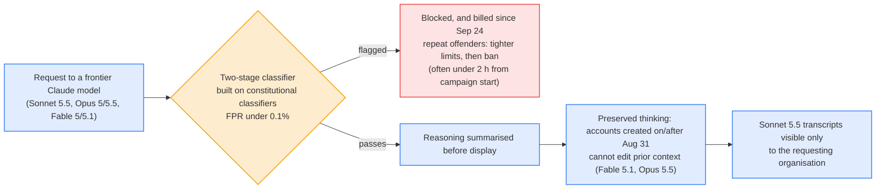

# LLM Updates — 2026-Oct-13

Compiled Tue Oct 13 2026, early morning Los Angeles time, covering **Oct 12 → Oct 13**. Items already covered in the
Oct-01 to Oct-12 briefs (Nadella's "emergency brake", Karpathy's funnel, Kolibri-1, the open-weights calendar, the
D.C. Circuit ruling on Anthropic's supply-chain designation, Grok 4.7) are not repeated except as context.

**After a quiet weekend, Monday brought three significant items. Meta shipped its first frontier-class model,
Muse Wonder, 14 months after building Meta Superintelligence Labs. The weights are closed, the stronger "Full" variant
is not on the API, and an independent index places it just behind Opus 5.5. Anthropic published two pieces of
research the same day. One says small open models may be months from copying themselves across cheap home devices.
The other says new defences cut what distillers can harvest from Claude by 90–99%, and names Zhipu's GLM-5.3 as a
model built partly through distillation. The two papers share a subject: what an open-weight model can do once nobody
controls the copy.**

- **Meta Muse Wonder / Wonder Full (Oct 12).** API price **$4 / $20** per M tokens, **1M** context. Artificial
  Analysis Index: **52** (Wonder) and **56** (Full) vs **58** for Opus 5.5. Meta's own scorecard leads on
  long-horizon coding (SWE-Marathon **57.5** vs **46.3**). Full is available only through **$50 / $200** Muse Code
  plans (§1).
- **Anthropic: self-replication on IoT (Oct 12).** **GLM-5.2** spread to **8/8** emulated nodes in **4 of 5** trials.
  Gemma4-26B-A4B ran across 15 **$55** TV boxes at **0.39 tok/s**. The trend line reaches a "small replicator" level
  **by end of 2026** (§2).
- **Anthropic: distillation defences (Oct 12).** Two-stage classifier, "preserved thinking" for new API accounts,
  **<0.1%** false positives, tens of thousands of bans. Anthropic says it has turned away "meaningful revenue" (§3).
- **Smaller items (§4–§6).** Z.ai's **GLM-Legal** (gated, **19.2%** on Harvey LAB). **GPT-5.5 leaves ChatGPT and
  Codex tomorrow (Oct 14)**. HN pushback on Codex CLI's default background daemon. A cluster of diffusion-LM and
  sparse-attention papers.

![Figure: Diagram titled "Small open models and self-replication: where the chain stands", from Anthropic's Frontier Red Team post of Oct 12, 2026. Four steps run left to right: enumerate the network; access and payload (the cyber-exploit step, kept trivial, so results are upper bounds); inference setup on the compromised device (highlighted as the study's focus); and propagate, which loops back to step one, with doubling times in days. Three panels below. Works today: GLM-5.2 reached 8 of 8 nodes in 4 of 5 trials; Qwen3.5-9B set up inference on 8 of 9 hardware types; Gemma4-26B-A4B ran across 15 TV boxes at 0.39 tokens per second. Still slow or failing: 28 to 51 hours of setup for Qwen3.5-9B, most models of 30B or fewer cannot chain the steps, and a frontier advisor gave no gain. Forecast and defence: plus 13.7 Epoch Capabilities Index points a year for small models reaches GLM-5.2's level by end of 2026; a Kimwolf-sized fleet could host about 133 thousand replicas, only about 40 H100-equivalents; defences aim to push R0 below 1.](self_replication_chain.svg)

---

## 1. Meta Muse Wonder: frontier-class, closed, and split by price (Oct 12)

Meta released **Muse Wonder** and **Muse Wonder Full**, the successors to Muse Spark (April) and its first models
described as "true frontier" (Alexandr Wang to Bloomberg). Earlier briefs tracked this as the codename
**"Watermelon"** (Aug-26, Aug-29, Sep-02, Sep-05).

| Item | Muse Wonder | Muse Wonder Full |
|---|---|---|
| **Access** | Meta Model API (`muse-wonder-1.0`), Muse Code, Muse app | **Muse Code only** ($50 / $200 per month). Not on the API |
| **Price** | **$4.00** in / **$0.20** cached / **$20.00** out per M tokens | Subscription only |
| **Context** | **1M** tokens | Not separately stated |
| **Weights** | Closed | Closed |
| **Consumer** | Muse personal-agent app paywalled at **$20 / $100** per month for now | — |
| **Training** | Prometheus cluster (Ohio). Hyperion (Louisiana, to scale to **5 GW**) is the next build | Same |
| **Features** | Planning, sub-agent delegation, parallel tool calls, error recovery; **"Active Memory"** across sessions; "Active Focus" | Same |

**Benchmarks: vendor scorecard vs independent index.**

| Benchmark | Wonder | Wonder Full | Opus 5.5 | GPT-6 Astra | Source |
|---|---|---|---|---|---|
| DeepSWE 1.1 | 78.8 | **79.0** | 74.2 | 74.1 | Meta |
| SWE-Marathon | 53.1 | **57.5** | 46.3 | 42.5 | Meta |
| Terminal-Bench 4.0 (AA) | 52.0 | 57.1 | **59.6** | 59.1 | Meta table via VentureBeat (other outlets give Full ~57–59) |
| Meta "Personal Super Intelligence Index" | — | **59.1** | 55.2 | — | Meta's own composite |
| **Artificial Analysis Intelligence Index v4.3** | 52 | 56 | **58** | — | Independent |
| AA hallucination rate | ~25–27% | **23%** (from 33% for Spark 1.3) | — | — | Independent (Wonder figure differs by source) |
| AA cost per Index task | **$4.52** (2.8× Spark 1.3) | n/a (no token price) | — | — | Independent |

**Interpretation.**

- **Meta is back near the frontier, though not at the top.** On the one independent aggregate, Full sits two points
  behind Opus 5.5 and Wonder six behind. Meta's leads come from its own long-horizon coding tests and its own
  composite index. Terminal-Bench, which is run more independently, has Meta behind.
- **The best model is a subscription product.** Keeping Full off the API keeps third parties from measuring cost per
  task and keeps distillers away (see §3). It also makes Full hard to verify independently. Meta's previous
  frontier-ish model, Spark, came with a 2606.12429 safety and preparedness report. No Wonder equivalent was found in
  this window.
- **The open-weights story has moved on.** Wang says Meta is "still committed to open source", but Meta's open line
  is now the 30B **Muse Glimmer** (Aug 10, Apache 2.0, distilled from Spark). Open weights for Spark 1.2, promised in
  August, have not appeared.

## 2. Anthropic: small models may be "months away" from self-replicating on IoT (Oct 12)

A Frontier Red Team post by **William Zhou and Daniel Freeman** tests whether a model could copy itself onto
compromised consumer hardware and keep spreading without a datacenter. It covers "small weight-based replicators"
only. The cyber-exploit stage is deliberately kept trivial (an unauthenticated ADB port), so the authors call the
results an **upper bound**. Read directly from anthropic.com.

| Test | Setup | Result |
|---|---|---|
| **Full chain** | 8-node GCP VPC of redroid (Android 15) emulators; 17-node variant with a pivot. Harness "Memento", built on the open-source Pi agent, restarts the agent with notes. Llama3.1-8B as the payload | **GLM-5.2**: 8/8 nodes in **4 of 5** trials, 7/8 in the fifth. All other open models failed reliably |
| **Real cheap hardware** | 15 off-brand Android TV boxes, ~**$55**, 4 GB RAM each, Petals-style pipeline sharding | Gemma4-26B-A4B served at **0.39 tok/s** |
| **Hardware breadth** | 9 hardware types, Jetson Nano to RTX 4090 | Qwen3.5-9B set up inference on **8 of 9** |
| **Setup time** | Unoptimised agent runs | Qwen3.5-9B **28–51 h**; Gemma4-26B-A4B **71–150 h** |
| **Learning across generations** | 6 generations of Qwen3.5-9B passing notes, 20 lineages | Inference-setup success **~45% → 61–84%** |
| **Frontier advisor** | Qwen3.5-9B given Opus 4.8 as a tool or unprompted advisor | **No significant improvement** |
| **Scripted ablation** | Inference setup scripted | Even a **3B** model reached about half the nodes; orchestration is not the main barrier |

**Forecast.** Open models of 30B or fewer gain about **13.7 Epoch Capabilities Index points a year** (R² 0.95).
Extrapolating from GLM-5.2 as the threshold, the authors expect a small model to reach it "by the end of this year".
They frame it as: small models "may be months away from being capable enough to self-replicate."

**Scale if it happened.** The reference threat is the **Kimwolf** botnet (over 2M mostly off-brand Android TVs). An
equivalent fleet running Gemma4-26B-A4B could host about **133k replicas** at about **80k tok/s** in total, roughly
**40 H100-equivalents**: "a tiny amount of compute in absolute terms." Separately, about **9.5M** NVIDIA-silicon
edge devices are in the field, though far fewer are reachable.

**Defences proposed.** ISP flow monitoring (multi-GB transfers, sustained device-to-device traffic), honeypots to
capture the harness, Mirai-style quarantine (which cleared **92%** of infections in 14 days vs **74%** without
notification), and secure-by-default devices, such as the UK's ban on default passwords. The goal is to push
**R₀ below 1**.

**Interpretation.**

- **The sobering result is the slope, not today's capability.** Today's working case needs a large open model
  (GLM-5.2) and a trivial exploit. But the bottleneck step is plain sysadmin work, and it is improving with ordinary
  small-model progress, not with any special capability.
- **Note what did not help.** A frontier advisor gave no gain, and the weak point was the small model's own execution.
  That argues against the idea that frontier-API access controls alone would contain this.
- **Reception was mixed.** HN (66 points, 88 comments) mixed concern with doubt about definitions. Several outlets
  headlined "within months" without the upper-bound caveat.

## 3. Anthropic: distillation defences cut harvest by 90–99% (Oct 12)

A companion post, also read directly, reports on the defences Anthropic built after its February disclosure (16M+
exchanges from DeepSeek, Moonshot and MiniMax via ~24,000 fraudulent accounts).

| Figure | Value |
|---|---|
| Harvested data reduction (early evidence) | **~90–99%** |
| Reasoning tokens extracted on Anthropic's platform | **10–100+× lower** after the classifier; some days too small to measure |
| Cost of summarising reasoning (SWE-bench Verified with full vs summarised transcripts as training data) | **80.4% → 71.8%** |
| Classifier false positives | **<0.1%** ("roughly as robust as" the bioweapons safeguards) |
| Bans | **Tens of thousands** of accounts |
| Red-team volume | One lab ran **12,000** requests, each a different trick |

**Named actors.** **Zhipu** distilled cyber capabilities from leading US models while building **GLM-5.3**. When
Fable 5's cyber safeguards degraded that effort, it switched to an older Claude and another lab's model. Anthropic
notes that CAISI rated GLM-5.3 the most cyber-capable open-weight model to date. **Moonshot**: some Kimi requests
were secretly forwarded to Claude, including one, from a user Anthropic believes was PLA-affiliated, asking for
analysis of CCTV surveillance of a specific person. Z.ai had not responded to Reuters.

**Costs and caveats, as stated by Anthropic.** Some developers had to change integrations for preserved thinking.
Blocked requests are now charged. Anthropic did "not fully" meet its goal of leaving legitimate users unaffected. It
has "yet to see a highly sophisticated and persistent attempt" to get around the defences. Distillers can still use
third-party clouds that serve Claude.

**Interpretation.** Read together with §2: the model Anthropic names as the distillation case (GLM-5.3) comes from the
same family as the only model that self-replicated end to end in §2 (GLM-5.2). Anthropic's argument is that frontier
capability leaks through distillation into open weights, and open weights then escape every API-level control. That
is the strongest public case so far for treating distillation as a security problem rather than an IP problem. The
figures are self-reported, though, and the PLA attribution is Anthropic's belief, not a finding.

## 4. Other models

| Model | Date | What | Status |
|---|---|---|---|
| **GLM-Legal** (Z.ai) | Oct 12 | Legal-domain model built on GLM-5.3-Flash for contract review, evidence analysis and compliance. **19.2%** all-pass on Harvey's Legal Agent Benchmark vs **6.7%** (GLM-5.3-Flash) and **8.3%** (GLM-5.3). Vals AI calls it #1 open-weight on LAB and LegalBench | **Hosted API, by application**. No public weights despite some "open-weight" headlines. HN 370 points |
| **Open-weights calendar** | — | **Step 5** weights due **Oct 15**; the official HF repo is still a placeholder. Mistral Large 4 on Oct 27; Reflection Beam "later in October" | Unchanged |
| **HF trending (Oct 13 digest)** | — | Qwen3.8-27B (~**6.9M** downloads) still leads; LiquidAI **d1-3B** and speridlabs **iris-3b** are new small entries without stated dates | No major open release |

## 5. Research (cs.CL / cs.LG, Oct 12–13 listings)

Today's DailyArXiv batch is dominated by two themes. Titles only; abstracts were not reachable, so treat descriptions
as indicative.

| Theme | Papers | Why it matters |
|---|---|---|
| **Diffusion LMs, design space** | *On the Design Space of Continuous Diffusion Language Models* (2610.13834); *Denoising blocks, not tokens* (2610.09311); *Predictive-State Flows* (2610.12898); *One-Step Text Generation by Seq-Drifting* (2610.12879) | Continuous and one-step diffusion keeps attracting papers as an alternative to autoregressive decoding. Design-space studies are what this area has lacked |
| **Diffusion LMs, reasoning and agents** | Stepwise risk-sensitive GRPO for dLLMs (2610.00661); Plan-and-Patch for agentic planning (2610.10786); masked-diffusion agents for tool-integrated chemistry (2610.13330) | RL post-training recipes are now being carried over to diffusion models |
| **Sparse attention for inference** | S³R: self-sparse speculative decoding for faster RL rollouts (2610.13202); PageWeaver (2610.11201); QUILT shared-query prefill (2610.11134); *Sparse attention as matrix approximation* (2610.10871) | RL rollout cost is now a target in its own right. S³R applies inference tricks to the training loop |
| **Instruction following** | "Thinking Inertia" (reported as NeurIPS 2026; James Zou, Kevin Lin): reasoning models keep reasoning when told not to, especially on open-ended prompts | Relevant to cost control via "no-think" modes; aggregator-only source, not verified |

## 6. Developer tools and deprecations

- **GPT-5.5 retires from ChatGPT, ChatGPT Work and Codex on Oct 14** (announced Sep 14). It remains on the API. Codex
  users signed in with ChatGPT are pointed to `gpt-5.6-sol`. Check saved configs, CLI scripts and scheduled tasks for
  hard-coded `gpt-5.5`.
- **Codex CLI daemon backlash.** The top HN AI story (373 points) is issue #48195 asking to make `daemon_auto_start`
  opt-in (102 👍). The persistent, self-updating background server has been the stable default since v0.157.0
  (Sep 25). No OpenAI response found.
- **Copilot CLI v1.0.96 / v1.0.97-0.** Agent-scoped declarative hooks, inline images by default, interactive sandbox
  settings that suggest secrets to mask, case-insensitive model IDs.
- **Gemini CLI nightly 0.65.0.** A P0 fix stops `/settings` from overwriting JSON and leaking environment variables.
- **Ollama 0.40.4-rc0 / llama.cpp b11565–b11576.** Support for "decision" models (cf. Microsoft-Decision-1, Oct-11
  brief), and CUDA fixes for head-size-512 models.
- **No releases** for Claude Code, Codex, OpenCode or Qwen Code in the 24 h to Oct 12, 22:15 UTC.

## 7. Money

- **Infinigence AI** (Shanghai, inference infrastructure) closed a **RMB 2.3B (~$344M) Series C**.
- **DeepSeek** is leading a round valuing robot-AI startup **Winverse** at **$400M** (founded by an ex-Tencent
  scientist). This is the first sign of how the lab plans to use its oversubscribed $12B+ raise (Oct-07 brief).
- **Anthropic IPO scepticism.** A CNBC-quoted analyst calls it the "most ridiculous IPO of the year" (HN 236 points),
  following the prospectus covered in the Oct-05 brief.

---

## Watch-items into the next brief

| # | Item | Status after Oct 12–13 |
|---|---|---|
| 61 | Step 5 weights | **Due Oct 15**; HF repo still a placeholder |
| 51 | Large 4 licence and weights | Pending, Oct 27 |
| 50 / 71 | Beam weights; Nvidia–Reflection | No new detail |
| 74 | Emergency brake in practice | No Microsoft product follow-up yet |
| 75 | Kolibri-1 independent evaluation | None yet |

New items:

78. **Muse Wonder Full verification.** Does Meta publish a safety/preparedness report or open Full to the API? Do
    independent coding evaluations reproduce the SWE-Marathon lead?
79. **Self-replication follow-ups.** Do other labs or CAISI replicate the GLM-5.2 result, and does any small (≤30B)
    open release cross the threshold before year-end, as the trend predicts?
80. **Zhipu's response to the distillation claim** and any CAISI or Commerce action on GLM-5.3.
81. **Codex daemon default.** Does OpenAI make it opt-in?

---

### Method & caveats

- **Compiled** Tue Oct 13 2026, ~06:30 Los Angeles time, covering **Oct 12 → Oct 13**.
- **What is measured, claimed, or reported.**
  - **Read directly from primary source:** both Anthropic posts (§2, §3).
  - **Company claims:** Meta's benchmark scorecard and its Personal Super Intelligence Index; Anthropic's 90–99% and
    false-positive figures; Z.ai's GLM-Legal numbers.
  - **Independent:** Artificial Analysis Index, token use, cost and hallucination figures (via The Decoder, MindStudio
    and aggregators; the AA site was not reachable).
  - **Reported / second-hand:** Wang's Bloomberg quotes, Muse pricing tiers, GPT-5.5 retirement scope, funding
    rounds, research paper descriptions (titles only).
- **Interpretation, labelled as such:** the lead and the interpretation paragraphs in §1–§3.
- **Excluded.** A "Microsoft unveils Maia 300" headline (forum aggregator) could not be confirmed. Reporting
  conflicts between a fall-2026 reveal and a 2027 date. A Phoronix item on Linus Torvalds using Claude Code appeared
  only in the HN digest and could not be verified. The D.C. Circuit ruling (Sep 25) and Grok 4.7 (Sep 21) were covered
  earlier.
- **Scraping resilience.** Direct fetches failed (DNS) for `about.fb.com`, `techcrunch.com`, `venturebeat.com`,
  `dev.meta.ai`, `mindstudio.ai`, `artificialanalysis.ai`, `arxiv.org` and `foxnews.com`. `anthropic.com` and
  GitHub-hosted digests were readable. Everything else comes from the search index, cross-checked across outlets where
  possible.

### Sources (by section)

- **Muse Wonder.** [Meta newsroom](https://about.fb.com/news/2026/10/introducing-muse-wonder-models/) · [CNBC](https://www.cnbc.com/2026/10/12/meta-muse-wonder-ai-model-agent.html) · [TechCrunch](https://techcrunch.com/2026/10/12/meta-releases-its-first-frontier-model-muse-wonder/) · [Bloomberg](https://www.bloomberg.com/news/articles/2026-10-12/meta-says-new-muse-model-reaches-ai-frontier-after-14-month-push) · [VentureBeat](https://venturebeat.com/technology/metas-new-muse-wonder-and-muse-wonder-full-models-achieve-frontier-performance-but-only-the-weaker-one-is-available-via-api) · [The Decoder](https://the-decoder.com/metas-new-frontier-model-muse-wonder-full-breaks-into-the-ai-top-tier/) · [Artificial Analysis article](https://artificialanalysis.ai/articles/muse-wonder) · [MindStudio benchmarks](https://www.mindstudio.ai/blog/muse-wonder-benchmarks-vs-opus-gpt6) · [Technology.org](https://www.technology.org/2026/10/13/meta-muse-wonder-frontier-model-pricing-muse-code/) · [Dataconomy](https://dataconomy.com/2026/10/13/meta-muse-wonder-full-ai-models/) · [TheNextWeb](https://thenextweb.com/news/meta-muse-wonder-frontier-eu) · [OpenRouter](https://openrouter.ai/meta/muse-wonder) · [Muse Glimmer (Meta research)](https://research.meta.ai/blog/introducing-muse-glimmer-open-agentic-model) · [Muse Spark safety report](https://arxiv.org/abs/2606.12429)
- **Self-replication.** [Anthropic research post](https://www.anthropic.com/research/self-replicating-ai) · [Al Jazeera](https://www.aljazeera.com/economy/2026/10/13/ai-could-self-replicate-on-home-devices-within-months-anthropic-says) · [Unite.AI](https://www.unite.ai/anthropic-red-team-says-small-ai-models-may-soon-replicate-on-iot-devices/) · [GBHackers](https://gbhackers.com/anthropic-warns-ai-models/) · [Digital Watch](https://dig.watch/updates/anthropic-ai-models-self-replicating) · [HN thread](https://news.ycombinator.com/item?id=50061603)
- **Distillation.** [Anthropic research post](https://www.anthropic.com/research/distillation-defenses) · [Anthropic, Feb 2026 post](https://www.anthropic.com/news/detecting-and-preventing-distillation-attacks) · [Reuters via Investing.com](https://www.investing.com/news/stock-market-news/anthropic-says-new-safeguards-sharply-reduce-ai-distillation-attacks-4945295) · [Business Standard](https://www.business-standard.com/amp/technology/artificial-intelligence/new-safeguards-sharply-reduce-ai-distillation-attacks-says-anthropic-126101300092_1.html) · [FourWeekMBA](https://fourweekmba.com/ai-anthropic-turns-away-revenue-to-cut-distillation-up-to-99/)
- **Other models.** [MarkTechPost, GLM-Legal](https://www.marktechpost.com/2026/10/13/zai-glm-legal-harvey-lab-legal-ai-model/) · [Vals AI on X](https://x.com/ValsAI/status/2109678919108690380) · [OrcaRouter, GLM-Legal beta](https://www.orcarouter.ai/blog/glm-legal-beta-release) · [Pandaily, Step 5](https://pandaily.com/stepfun-step-5-preview-600b-moe-1m-context) · [MindStudio, Step 5 Oct 15](https://www.mindstudio.ai/blog/step-5-preview-pricing-api) · [agents-radar, HF trending Oct 13](https://github.com/stevenko2002/agents-radar/issues/1710) · [LLM Gateway timeline](https://llmgateway.io/timeline)
- **Research.** [DailyArXiv, Oct 13](https://github.com/jiangnanhugo/DailyArXiv/issues/570) · [Digg, "Thinking Inertia"](https://digg.com/ai/y0f16d3v)
- **Tools.** [agents-radar, AI CLI tools Oct 13](https://github.com/stevenko2002/agents-radar/issues/1714) · [agents-radar, HN AI digest Oct 13](https://github.com/stevenko2002/agents-radar/issues/1703) · [Codex issue #48195](https://github.com/openai/codex/issues/48195) · [Codex daemon default (v0.157.0)](https://codex.danielvaughan.com/2026/09/25/codex-cli-daemon-auto-start-stable-default-v0157/) · [Let's Data Science, GPT-5.5 retirement](https://letsdatascience.com/news/openai-retires-gpt-55-from-chatgpt-and-codex-1a6f69be) · [aiidelist, GPT-5.5 API not shutting down](https://aiidelist.com/blog/gpt-5-5-retirement-october-14.md)
- **Money.** [Tech Startups, Oct 12 funding](https://techstartups.com/2026/10/12/startup-funding-news-today-october-12-2026-infinigence-ai-mosi-intelligence-fulian-integrated-more) · [Investing.com, DeepSeek–Winverse](https://www.investing.com/news/stock-market-news/deepseek-to-lead-funding-round-for-robotics-ai-startup-winverse-at-400-mln--report-93CH-4944293) · [CNBC, Anthropic IPO analyst](https://www.cnbc.com/2026/10/07/anthropic-will-be-most-ridiculous-ipo-of-year-analyst-says.html)
