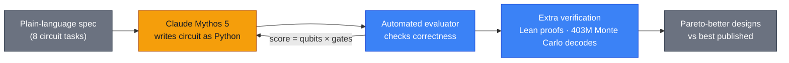

# LLM Updates — 2026-Oct-17

Compiled Sat Oct 17 2026, early morning Los Angeles time, covering **Oct 16 → Oct 17**. Items covered in the Oct-01 to
Oct-16 briefs (Muse Spark Open, the FTC demands, Anthropic's METR arrangement, Step 5, Nemotron 3.5, the ARTEX
campaign) are not repeated except as context or to close a watch-item.

**Oct 16 was a research day, not a launch day. Anthropic published five pieces at once. Two show Claude doing original
technical work. Claude Mythos 5 designed quantum circuits that beat the best published designs, with up to 17× fewer
gates on an elliptic-curve task. A Claude research model also solved a 27-year-old cryptography puzzle: where the NSA's
"random" seeds for the NIST P-curves came from. The answer is a 1990s C-library random number generator seeded with the
clock, not a backdoor. The other three are survey and workforce studies. Anthropic staff expect AI to do about 75% of
their own work by 2030; US workers expect 28%. Inside Anthropic, the junior share of technical hires has fallen from
27% to 9%. Politico reported that Anthropic is privately pitching lawmakers a federal frontier-AI safety bill. On
Oct 17, DeepSeek shipped an MIT-licensed V4.1-Flash-1017 checkpoint with large agentic-coding gains on its own
benchmarks.**

- **Quantum circuits (Oct 16).** Claude Mythos 5, working with Harvard and QuEra researchers, beat prior designs on
  eight circuit tasks. Best case: **17× fewer gates** at **12% more qubits**, from one **53-hour** run (§1).
- **NIST curve seeds (Oct 16).** All ten prime-curve seeds trace to `lrand48()` seeded with Unix timestamps from
  **May 1997 to April 1998**. Anthropic says this is "not a cryptographic break" (§2).
- **Expectations and employment (Oct 16).** Three Anthropic Institute reports, based on N = 10,980 US adults and
  N = 1,334 staff, plus internal workforce data. Agents logged **6×** the hours of their human handlers by August
  (§3).
- **Anthropic's draft bill (reported Oct 16).** Government could block a model only for an imminent risk above
  **$1B** in damages or **50+** deaths or serious injuries, and only via a federal judge in DC (§4).
- **DeepSeek V4.1-Flash-1017 (Oct 17).** Terminal-Bench 4.0 **31.2 → 42.3**, DeepSWE v1.1 **74.2 → 77.0**, at the
  same price. MIT weights (§5).
- **Also (§6).** Bank of America says Mythos-found flaws needed 1,000 extra contractors. Eight US states sue OpenAI.
  GPT-Live-1.1 voices. Claude Code v2.1.302 says standalone Claude Design closes Dec 14.

---

## 1. Claude Mythos 5 designs more efficient quantum circuits (Oct 16)

Anthropic's post "Designing more efficient quantum circuits with Claude" (read directly) describes a study led by
Andi Gu (Anthropic STEM Fellows), mentored by Anthropic physicist Alek Kemeny, with Susanne Yelin (Harvard) and Mikhail
Lukin (Harvard and QuEra). The preprint is arXiv **2610.22367**.

| Item | Detail |
|---|---|
| **Set-up** | Eight circuits across chemistry, optimisation, physics simulation, number theory and numerical computing. Claude got a plain-language spec and an evaluator, wrote circuits as Python, and was scored on **qubits × gates** (a runtime proxy). No human input between rounds |
| **Headline** | Anthropic's text says Claude's designs used fewer qubits and fewer gates than the best published algorithms on all eight tasks. Secondary coverage quoting the abstract says **seven of eight**. Per-task figures are only in a chart and table image |
| **Elliptic-curve point addition** | A new reversible "divsteps" modular inversion that decodes branch history from the numbers instead of storing it. One variant: **17× fewer gates** than the smallest prior design, at **12% more qubits**. A threshold parameter yields a family of qubit/gate trade-offs. The key identity was checked numerically and **formalised in Lean**. Single **53-hour** run |
| **Reed–Solomon decoder for DQI** | Claude switched from extended Euclid to Berlekamp–Massey and reconstructs most temporaries instead of storing them. It reserves **19** qubits where worst-case storage would need **665**. About **1 in 10,000** runs fail, within the allowed error rate (403M sample decodes). **12× fewer gates** than Google's construction (Khattar et al., 2025) |
| **Limitations named** | Claude was "conservative": it second-guessed real improvements and over-verified. The team had to require parallel, qualitatively different approaches. No hardware runs. Error correction and control are untouched |

**Context.** Circuit redesign, not hardware, delivered most of the ~**150,000×** drop in the FeMoco resource estimate
since 2017 (50 trillion → 340 million Toffolis). The post presents AI search as the next step in that line. The
elliptic-curve result also matters for estimates of when quantum computers could break ECC.

**Interpretation.** This is one of the clearest published cases of a frontier model producing a new, verifiable
algorithmic result against a well-studied human baseline. The scaffold is simple: an evaluator plus a long autonomous
run. The admitted failure mode (excess caution) is the opposite of the usual worry about models over-claiming.

## 2. Claude explains where the NIST P-curve seeds came from (Oct 16)

The ECDSA curves in FIPS 186-2 (2000) derive their coefficient *b* from 160-bit "seeds" that the NSA supplied without
explanation. That gap fed years of backdoor speculation and a public bounty. Anthropic's post (read directly; ten
authors including Nicholas Carlini and Steve Weis) says an unnamed internal research model, asked without hints, solved
it in **under half an hour**.

| Step | What the model did |
|---|---|
| **Hypothesis** | The seeds came from a weak 1990s C-library random number generator, not a hash |
| **Signal** | Four seeds had a zero top bit in all twenty 32-bit words (odds about **1 in 5,810**), matching `lrand48`, which returns 31 bits of a 48-bit state |
| **Recovery** | Brute-forced the 17 hidden bits (2¹⁷) for full-word seeds. For truncated seeds, solved state recovery as a lattice problem with **LLL**. Ten seeds matched `lrand48() >> 23` |
| **Timestamps** | Stepped the generator back to `srand48` form. Prime-curve seeds date from **1997-05-15 to 1998-04-03** (e.g. P-256: 1997-08-16 01:52:34). Four binary-curve seeds fit **1998-04-17** if the clock was halved |
| **Base points** | The P-192 and ANSI X9.62 base points came from the generator in Arjen Lenstra's **FreeLIP** library, with small integer seeds (20000, 20420 …) |
| **Still open** | The B-163 seed, and the base points for P-224, P-256, P-384, P-521 and the binary curves. Also why some valid candidates were skipped (P-256 used candidate 1842, though 876 also worked) |

Anthropic stresses this is "not a cryptographic break, new attack, or weakness" and that it makes a hidden backdoor
"much less plausible." Reproduction code is CC0. The **$36,864** bounty goes to ISRG (Let's Encrypt).

**Interpretation.** The method (spot a statistical fingerprint, then invert the generator with lattice reduction) is
standard cryptanalysis. What is new is that a model chose the hypothesis and finished the work unprompted. The same
skill could be pointed at weak randomness in live systems, which is part of why Anthropic gates its Mythos-class
models.

## 3. Anthropic's expectations and employment studies (Oct 16)

Three linked Anthropic Institute pieces were read directly.

**"The AI expectations gap"** compares a Morning Consult survey of **10,980** US adults (Aug 11–23, weighted) with an
internal poll of **1,334** staff (Aug 9–12, unweighted).

| Question (2030 unless noted) | US adults | Anthropic staff |
|---|---|---|
| Nobel-level discovery by AI | **39%** | **91%** |
| AI can design, run and publish studies by next year | 38% | 90% |
| Say AI will *never* do a given task | 19–40% | ≤2% |
| Share of AI-capable tasks actually using AI | 42% | 65% |
| Share of own current work hours done by AI | 28% (workers) | **75%** |
| Implied 2030 GDP growth (median) | **5.4%** | **17.1%** |
| AI-assisted tasks take as long or longer | 29% (AI users) | 5% |

Both groups link unemployment forecasts to their own exposure in the same way: each extra 10 points of exposed work
adds about **0.4** points to the forecast. Staff estimate AI already does a median **51%** of the work of building a
frontier model, rising to 80% by end-2027 and 95% by 2030. These are personal estimates, not measurements. A September
re-run (N = 7,613) barely moved the numbers.

**"How employment is changing at Anthropic"** uses internal data.

- **Juniors.** The junior share of technical staff fell from **21% to 14%**, and of technical hires from **27% to 9%**.
  Junior technical postings dropped sharply after December 2025.
- **Agents.** Agent hours passed human hours in **March 2026**. By August, agents logged **6×** their handlers'
  hours. Commits per engineer are about **5×** their level six months earlier. In a comparison of 192 adopting and 74
  non-adopting engineers, agent-written code was reverted no more often than human-written code.
- **Bottlenecks.** About **80%** of interactive session time is spent waiting on a human. Standing agent instructions
  grew from a few hundred to **8,500** in a year. "Meta-work" (building and monitoring agent tooling) rose from 10% to
  22% of sessions. Meetings are up **20%**.
- **Authors' caveats.** Adoption was not random. Growth confounds output. Anthropic is an unusual employer.

**Interpretation.** The junior-hiring numbers are the most concrete in-house evidence any lab has published on
AI-driven entry-level displacement. They come from the company with the strongest incentive to adopt early, so they are
better read as a leading indicator than as a forecast for the wider economy.

## 4. Anthropic's draft federal safety bill (reported Oct 16)

Politico reported, and Bloomberg and US News repeated, that Anthropic has been quietly showing lawmakers a confidential
draft frontier-AI bill. The text is not public.

| Provision (as reported) | Detail |
|---|---|
| **Blocking threshold** | Only for a foreseeable, imminent risk of **>$1B** in damages or **>50** people killed or seriously injured, arising from bioweapons, loss of control, or cyberattack |
| **Process** | Independent evaluators registered with **Commerce** periodically assess labs and models. Commerce must go to court, and a **federal judge in DC** orders any suspension |
| **Duties** | Safety frameworks, transparency reports for new models, whistleblower protection, critical-incident reporting to Commerce |
| **Pre-emption** | Would replace some state rules with a federal framework. Risk language mirrors California's **SB 53** |

**Context.** The leak lands a day after Anthropic described its METR access tiers (Oct-16 brief), which look like a
template for the "registered evaluator" idea, and amid the FTC and state actions in §6.

**Interpretation.** Critics will read the high threshold and court requirement as limits on government power. Backers
will point out that no federal mechanism to halt a model exists today. Either way, a lab drafting the statute that would
regulate it will draw scrutiny.

## 5. DeepSeek V4.1-Flash-1017 (Oct 17)

DeepSeek put an updated V4.1-Flash checkpoint into its API, briefly visible before the announcement, with weights on
Hugging Face and ModelScope under **MIT**. It is a snapshot of the 552B-total MoE launched Sep 10, not a new family.
Hugging Face and DeepSeek's site were blocked from this environment, so the figures are DeepSeek's table as quoted by
coverage.

| Benchmark | V4.1-Flash (Sep) | **1017** |
|---|---|---|
| Terminal-Bench 4.0 | 31.2 | **42.3** |
| ProgramBench | 20.3 | **29.1** |
| Apex Bench | 64.6 | **72.1** |
| DeepSWE v1.1 | 74.2 | **77.0** |
| HLE (no tools) | 36.8 | **42.6** |
| BabyVision (with tools) | 89.6 | **92.5** |

DeepSeek's table shows 1017 beating GPT-5.6 Sol and Claude Opus 5 on DeepSWE and Automation-Bench. Opus 5 still leads
on Terminal-Bench 4.0, ProgramBench, NL2Repo and HLE. DeepSeek also claims shorter outputs and faster completion, at an
unchanged API price (~$0.15/$0.60 per M tokens off-peak per third-party listings). MarkTechPost's headline says DeepSeek
also opened a search API; no detail was retrievable. No independent re-run yet.

**Context.** For comparison, Meta's Muse Spark Open (Oct-16 brief) scored **8.1** on Terminal-Bench 4.0 in one
third-party snapshot. V4.1-Flash was also ARTEX's main backend (Oct-11 brief), so a cheaper, stronger agentic coder
from the same line has a security angle too.

## 6. Smaller items

- **Muse Spark Open independent score (watch-item #88, partly resolved).** Artificial Analysis posted its own **39**,
  calling it the #1 US open-weights model. It ranks last of the top nine open models on AA's four agentic evals, fourth
  on the other six, and first on AA-Omniscience (**25**). One snapshot gives **38.9**. Unsloth has published GGUF
  quantisations.
- **Bank of America (Oct 14 CNBC interview, widely covered Oct 15–16).** CEO Brian Moynihan said the bank brought in
  about **1,000** contractors in Q2, on top of ~**3,000** staff, to fix weaknesses exposed by AI models including
  Anthropic's Mythos (accessed via Project Glasswing). Cost: "a couple hundred million dollars plus," which also covers
  anti-money-laundering fixes.
- **Eight states sue OpenAI (filed Oct 14).** Arkansas, Arizona, Idaho, Iowa, Kansas, Montana, Nebraska and West
  Virginia allege misleading safety claims and public nuisance. Among the remedies sought: a bar on developing
  self-improving models unless OpenAI can show they are aligned. Florida filed the first state suit in June.
- **GPT-Live-1.1 (Oct 15).** OpenAI's voice model update for ChatGPT Voice and Codex adds **13** voices (two each in
  French, German, Hindi, Japanese, Korean and Mexican Spanish, plus one English). API "coming soon." Single-outlet
  sourcing.
- **Korea bank breaches.** The FSC now counts **16** financial firms and about **100,000** exposed records (names,
  phone and resident registration numbers). Whether AI was used is still under investigation, though officials have
  named the ARTEX tool (Oct-11 brief).
- **Claude Code v2.1.302 (read directly).** Adds `CLAUDE_CODE_AUTO_MODE_MODEL` for the client-side auto-mode
  classifier and an idle-compaction toggle in `/config`. Fork subagents are now on by default in `claude -p`, the Agent
  SDK, desktop and VS Code. The release also adds a notice that **standalone Claude Design (claude.ai/design) closes by
  December 14, 2026**. No Anthropic announcement explains the closure.
- **Not found.** No new Qwen, Kimi, GLM or Mistral release for Oct 16–17. Mistral Large 4 weights are still pending.

---

## Watch-items into the next brief

| # | Item | Status after Oct 16–17 |
|---|---|---|
| 51 | Large 4 weights | Pending. Sources give Oct 27 or Oct 31 |
| 88 | Muse Spark Open independent scores | **AA confirms 39.** Third-party jailbreak and fine-tuning tests still pending |
| 89 | FTC CIDs | No Anthropic statement found |
| 90 | METR's first embedded report | Nothing yet |
| 91 | Nemotron 3.5 Bolt E4B (Oct 23); MAI-Base-2 | Pending |

New items:

92. **Quantum-circuit preprint.** Per-task numbers in arXiv 2610.22367 (seven of eight or all eight?), outside
    replication, and whether the elliptic-curve design moves published estimates for breaking ECC.
93. **Anthropic draft bill.** Whether the text is published, gets a sponsor, and how OpenAI, Google and state
    legislators respond to the pre-emption clause.
94. **DeepSeek 1017.** Independent scores (AA, Vals, Terminal-Bench) and details of the search API.
95. **Claude Design closure.** Anthropic's explanation and where its features move before Dec 14.

---

### Method & caveats

- **Compiled** Sat Oct 17 2026, ~06:30 Los Angeles time, covering **Oct 16 → Oct 17**.
- **What is measured, claimed, or reported.**
  - **Read directly from primary source:** Anthropic's research index and the quantum, ECDSA, expectations-gap,
    employment and "expectations for the future" posts (§1–§3); the Claude Code changelog (§6).
  - **Company claims:** All DeepSeek benchmarks; Anthropic's quantum and survey results (peer review pending).
  - **Reported / second-hand:** Anthropic's draft bill (Politico via Bloomberg, US News, Yahoo); Bank of America
    (CNBC via TechRadar, TNW, ITPro); state lawsuits (Al Jazeera, NBC); GPT-Live-1.1 (one outlet); Korea breaches
    (The Star, eSecurity Planet); Artificial Analysis score (AA's X post and model page, via search index).
- **Interpretation, labelled as such:** the lead and the interpretation paragraphs in §1–§4.
- **Excluded.** A reported FT story on Anthropic offering Blackstone >10% on a junior tranche of TPU-lease financing.
  Secondary sources conflict ($60B/$18B vs $35B structures), and it is financing rather than model news. Google's
  Universal Cart (commerce product). Items on "The Neuron" and other digests that could not be matched to a primary or
  second outlet.
- **Scraping resilience.** Direct fetches failed (DNS) for `theneuron.ai`, `aisdg.substack.com`, `aiweekly.co`,
  `thequantuminsider.com`, `the-decoder.com`, `marktechpost.com`, `openai.com` and `arxiv.org`. The Hugging Face API
  and `api-docs.deepseek.com` were refused by the egress proxy (403). `anthropic.com` and GitHub were readable.
  Everything else comes from the search index, cross-checked across outlets where possible.

### Sources (by section)

- **Quantum circuits.** [Anthropic, Designing more efficient quantum circuits with Claude](https://www.anthropic.com/research/designing-efficient-quantum-circuits) · [arXiv 2610.22367](https://arxiv.org/abs/2610.22367) · [The Quantum Insider](https://thequantuminsider.com/2026/10/17/anthropics-claude-designs-leaner-quantum-circuits-reducing-resources-needed-for-key-calculations/) · [Crypto Briefing](https://cryptobriefing.com/anthropic-claude-designs-quantum-circuits/) · [XenoSpectrum](https://xenospectrum.com/en/claude-quantum-circuit-history-recovery/) · [Blockchain.News](https://blockchain.news/news/claude-designs-more-efficient-quantum-circuits-anthropic-study) · [AlphaSignal](https://alphasignal.ai/news/anthropic-s-claude-mythos-5-cuts-quantum-circuit-gates-by-17x)
- **ECDSA seeds.** [Anthropic, Claude reveals ECDSA curve origins](https://www.anthropic.com/research/ecdsa-curve-origins) · [Koblitz & Menezes, A Riddle Wrapped in an Enigma](https://eprint.iacr.org/2015/1018.pdf) · [Filippo Valsorda, seeds bounty](https://words.filippo.io/seeds-bounty/) · [Steve Weis, NIST curve seed origins](https://saweis.net/posts/nist-curve-seed-origins.html)
- **Expectations and employment.** [Anthropic, The AI expectations gap](https://www.anthropic.com/research/ai-expectations-gap) · [Anthropic, How employment is changing at Anthropic](https://www.anthropic.com/research/employment-at-anthropic) · [Anthropic, Working at the frontier shapes expectations for the future](https://www.anthropic.com/research/expectations-for-the-future)
- **Draft bill.** [Bloomberg](https://www.bloomberg.com/news/articles/2026-10-16/anthropic-pitches-ai-safety-bill-to-lawmakers-politico-says) · [US News / Reuters](https://www.usnews.com/news/top-news/articles/2026-10-16/anthropic-quietly-pitches-its-own-ai-safety-bill-to-lawmakers-politico-reports) · [Yahoo / Politico](https://www.yahoo.com/news/politics/articles/anthropic-quietly-pitches-own-ai-214514987.html) · [Business Today](https://www.businesstoday.in/technology/artificial-intelligence/story/anthropic-ai-safety-bill-one-billion-risk-threshold-judicial-approval-562236-2026-10-17)
- **DeepSeek.** [The Decoder](https://the-decoder.com/deepseek-v4-1-flash-1017-beats-larger-rivals-in-agentic-tasks-while-once-again-massively-cutting-per-task-costs/) · [MarkTechPost](https://www.marktechpost.com/2026/10/17/deepseek-just-released-v4-1-flash-1017-scores-77-0-on-deepswe-opens-search-api/) · [Pasquale Pillitteri](https://pasqualepillitteri.it/en/news/24844/deepseek-releases-41-flash-1017-mit-weights-shorter-outputs) · [MindStudio](https://www.mindstudio.ai/blog/deepseek-v4-1-flash-1017-release) · [Developers Digest](https://www.developersdigest.tech/blog/deepseek-v4-1-flash-1017-release-guide-2026) · [OpenRouter, V4.1 Flash](https://openrouter.ai/deepseek/deepseek-v4.1-flash)
- **Smaller items.** [Artificial Analysis on X](https://x.com/ArtificialAnlys/status/2110893784422908225) · [Artificial Analysis, Muse Spark Open](https://artificialanalysis.ai/models/muse-spark-open) · [Unsloth GGUF](https://huggingface.co/unsloth/Muse-Spark-Open-816B-A42B-GGUF) · [TechRadar, Bank of America](https://techradar.com/pro/security/bank-of-america-had-to-hire-1-000-contractors-to-patch-software-flaws-spotted-by-anthropic-mythos) · [TNW, Bank of America](https://thenextweb.com/news/bank-of-america-1000-contractors-mythos-flaws) · [ITPro](https://www.itpro.com/technology/artificial-intelligence/bank-of-america-hired-1-000-security-consultants-to-address-mythos-spotted-flaws) · [Al Jazeera, state lawsuits](https://www.aljazeera.com/news/2026/10/15/why-are-eight-us-states-suing-openai) · [NBC, state lawsuits](https://www.nbcnewyork.com/news/tech/eight-states-sue-openai-chatgpt-alleged-harms-users/6559545/) · [Pasquale Pillitteri, GPT-Live-1.1](https://pasqualepillitteri.it/en/news/24383/gpt-live-1-1-chatgpt-13-new-voices) · [The Star, Korea breaches](https://www.thestar.com.my/tech/tech-news/2026/10/14/south-korea-finds-hacking-incidents-at-total-of-16-financial-firms) · [eSecurity Planet](https://www.esecurityplanet.com/threats/news-south-korea-financial-firms-data-breaches-apac/) · [Claude Code changelog](https://github.com/anthropics/claude-code/blob/main/CHANGELOG.md)
