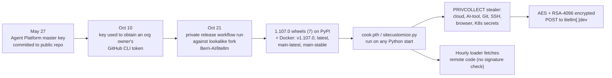
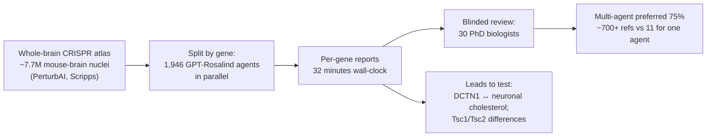

# LLM Updates — 2026-Oct-25

Compiled Sun Oct 25 2026, morning Los Angeles time, covering **Oct 24 → Oct 25**. It was a quiet weekend for launches,
so most of this brief catches up on three Oct 21–23 stories earlier briefs missed: the **LiteLLM 1.107.0** supply-chain
compromise, OpenAI's **~2,000-agent GPT-Rosalind** run on a mouse-brain atlas, and the EU Council's **Digital Omnibus**
position on AI training data. Items covered in the Oct-01 to Oct-24 briefs (the AISI/Mythos 5 assessment, OpenAI's
training containment, Kimi K3.1 Pro, PHP2Shell) are not repeated except as context.

**No major model launched on Oct 24–25. The most useful item for anyone building with LLMs is a catch-up: for about two
hours on Oct 21, the official LiteLLM package and Docker images (an LLM gateway used in many agent stacks) carried a
credential stealer that ran whenever Python started. The attacker got in with a key that had been sitting in a public
repository since May. Elsewhere, OpenAI showed what thousands of parallel science agents produce: leads in 32 minutes,
not validated findings. EU governments backed a text that would make AI training a presumed "legitimate interest" under
the GDPR, and Amazon said AWS capacity is largely sold out through 2027.**

- **LiteLLM 1.107.0 compromised (Oct 21, catch-up; Microsoft analysis Oct 23).** Malicious wheels on PyPI and four
  Docker tags for ~**1h41m**; ~**49,000** downloads per Wiz. Startup hooks steal cloud, AI-tool and Git credentials.
  Pin **1.106.2** and rotate secrets (§1).
- **OpenAI + PerturbAI + Scripps (Oct 21, catch-up).** **1,946** GPT-Rosalind agents, one per gene, analysed a
  ~7.7M-cell mouse-brain CRISPR atlas in **32 minutes**; blinded experts preferred the multi-agent reports **75%** of
  the time. All leads still need lab tests (§2).
- **EU Digital Omnibus (Coreper, Oct 21, catch-up).** Member states agreed a GDPR text presuming a "legitimate interest"
  for AI training and operation; noyb calls it "digital expropriation". A negotiating position, not law (§3).
- **AWS "largely sold out" through 2027 (Jassy, Oct 23).** Capacity limits are now about power and memory, he said (§4).
- **Also (§4).** NPR's Oct 24 PHP2Shell follow-up; Ollama v0.40.11 adds speech output; vLLM work on NVFP4 KV cache for
  MLA models; no new Claude Code release since v2.1.310.

---

## 1. LiteLLM 1.107.0: a poisoned LLM-gateway release (Oct 21, catch-up)

LiteLLM is a widely used open-source proxy and SDK that routes calls to many model APIs (~**23M** weekly downloads per
Datadog). That makes its host a good place to find API keys. LiteLLM's own posts could not be fetched here (DNS); the
details below come from Microsoft's and Datadog's write-ups, read directly, and from consistent vendor coverage.

| Item | Detail |
|---|---|
| **Window (UTC, Oct 21)** | Published **11:39**; PyPI quarantined **13:20**; Docker images removed **13:53** (Datadog) |
| **Scale** | ~**49,000** downloads of 1.107.0 (Wiz, ClickPy data); Docker pull counts not published |
| **Source on GitHub** | Clean. Only the built artifacts were malicious, and build provenance correctly recorded the fork as the source |
| **Payload** | `.pth` and `sitecustomize.py` hooks in `site-packages`, so it runs **even if LiteLLM is never imported**; on Windows, any routine `python` or `pip` call triggers it |
| **Targets** | AI-assistant, IDE, Copilot and MCP configs; AWS/Azure/GCP credentials and metadata endpoints; Kubernetes service accounts; `.env` files; SSH/GPG/TLS keys; browser credentials; up to 500 rows per query from the LiteLLM proxy database (Microsoft) |
| **Second stage** | Reads a GitHub-hosted `domain.txt` and executes code from it each hour; the file was empty when Microsoft looked, so no second stage was confirmed |
| **Root cause (per LiteLLM)** | Stolen GitHub tokens from engineers' accounts let the attacker run the release workflow and approve it; LiteLLM traces this to the unrevoked May 27 key. Microsoft says it has not determined the initial access |
| **Fix** | Pin **1.106.2** (or an earlier explicit release); delete the startup files; rebuild from clean artifacts; rotate **every** reachable secret and revoke sessions from a clean machine |

Coverage calls this LiteLLM's second compromise of 2026; the earlier incident's details were not confirmed here and no
actor has been named.

**Interpretation.** Agent and gateway layers now concentrate many credentials in one place: the cloud keys and the API
keys for several model providers. The attack also shows the limit of provenance checks: they recorded the true (malicious)
source, so they only help teams that check *which* repository built a package. Hash-pinned lockfiles and digest-pinned
images would have stopped the unpinned installs.

## 2. OpenAI runs ~2,000 GPT-Rosalind agents on a mouse-brain atlas (Oct 21, catch-up)

OpenAI's post and the main write-ups could not be fetched (DNS); details are from consistent coverage of the post and
the bioRxiv preprint ("Distributed AI agents enable comprehensive discovery of biological insights at scale").

- **Setup.** One agent per perturbed gene across the atlas; OpenAI's "months to a year" human-time comparison is an
  estimate built on assumed per-gene and per-paper times.
- **Evaluation.** **30** doctoral-level biologists rated reports blind; multi-agent reports beat single-agent ones
  **75%** of the time, and cited **700+** references vs **11** at the largest workload. Experts rated report quality,
  not whether a proposed mechanism is true.
- **Leads.** A link between **DCTN1** and neuronal cholesterol regulation (relevant to neurodegeneration), and
  differences between **Tsc1** and **Tsc2**, the genes behind tuberous sclerosis. None has been validated in the lab.
- **Next.** PerturbAI and OpenAI will apply the method to drug-target discovery using PerturbAI's in vivo data. This
  follows OpenAI's Orchestra Bio acquisition into its Rosalind unit (Oct-21 brief).

**Interpretation.** The method is "one agent per row of a giant table", which is easy to scale. Its value depends on how
many of these leads survive bench tests. Compare Anthropic's antivenom campaign (Oct-21 brief), which reported
lab-tested results (17 of 211 designs met binding criteria).

## 3. EU member states back presumed "legitimate interest" for AI training (Oct 21, catch-up)

- **What happened.** EU ambassadors (Coreper) agreed the Council's negotiating mandate on the **Digital Omnibus** on
  **Oct 21**. Per legal analyses, a revised **GDPR Article 88 bis** says processing personal data to develop and run an
  AI system or model *may* rely on the controller's legitimate interest (Art. 6(1)(f)), and drops safeguards and an
  unconditional right to object from the Commission's draft.
- **Critics.** noyb (Max Schrems) calls it "digital expropriation": the presumption would cover people who never used a
  service and data collected years ago.
- **Defenders.** The Commission says protection stays high, and some lawyers note the compromise keeps the balancing
  test, so it is not unlimited access.
- **Status.** A negotiating position, not law. Trilogue with Parliament comes next; current GDPR rules apply in full.

**Interpretation.** If this survives trilogue, EU training-data disputes would shift from "is there a legal basis?" to
"was the balancing test done?" — easier for labs training in or on Europe.

## 4. Smaller items

- **AWS capacity (Jassy, a16z podcast, Oct 23; Reuters).** 2026 capacity "sold out"; 2027 "largely sold out" in its big
  blocks (some is kept for on-demand use and Bedrock); "a good chunk" of 2028 committed. He said power and memory
  shortages won't end in 2027.
- **PHP2Shell follow-up (NPR, Oct 24).** "AI found the flaw. Hackers found the leak" narrates the race to patch; no new
  counts of confirmed compromises were found (watch-item #127).
- **Ollama v0.40.11.** Native speech generation on macOS with streaming audio at `/v1/audio/speech`.
- **vLLM PR #63203 (open).** NVFP4 KV cache for dense MLA models: reported **352** vs **576** bytes per token per layer
  for FP8, roughly 40% less KV memory. Not merged; no quality numbers yet.
- **"Every AI model has the same 'controversial' take on humans"** (HN, 645 points). An anecdotal post on how similar
  frontier models' answers have become. Worth noting as a theme; no study behind it.
- **No change.** No Anthropic news posts since Oct 22 and no Claude Code release after v2.1.310; no Kimi K3.1 Pro
  weights yet; Mistral Large 4 weights still expected Oct 27–31.

**Excluded.** "Kimi K3.1 Pro Highspeed" pricing (variant named on HN and a tracker, but no official specs found);
Apollo's "no AI payoff outside tech" note (trending on HN but dated Jun 30); PyTorch backward-pass malware PoC (no
date found); a "TypeSafe AI data leak" seen on one aggregator only.

---

## Watch-items into the next brief

| # | Item | Status after Oct 24–25 |
|---|---|---|
| 51 | Large 4 weights | Pending; Oct 27 vs Oct 31 |
| 125 | Kimi K3.1 Pro weights | Not yet; promised by Nov 4 |
| 127 | PHP2Shell | NPR follow-up; still no confirmed-compromise counts |

Items 71, 88–124 and 126, 128 carry over unchanged; nothing new was found on them.

New items:

129. **LiteLLM.** Full root-cause report, whether stolen credentials have been used, and the earlier 2026 incident's
     details.
130. **GPT-Rosalind atlas leads.** Wet-lab validation of the DCTN1 and Tsc1/Tsc2 hypotheses; peer review of the preprint.
131. **Digital Omnibus.** Parliament's position on Art. 88 bis and the trilogue timetable.

---

### Method & caveats

- **Compiled** Sun Oct 25 2026, ~06:30 Los Angeles time, covering **Oct 24 → Oct 25** plus the Oct 21–23 catch-ups
  noted at the top.
- **What is measured, claimed, or reported.**
  - **Read directly from primary source:** Microsoft's LiteLLM analysis and Datadog Security Labs' write-up (§1);
    Anthropic's news index; the Claude Code changelog.
  - **Company statements, via coverage:** LiteLLM's attack-chain account (§1); OpenAI/PerturbAI's agent run and expert
    ratings (§2); Jassy's remarks (§4).
  - **Reported / second-hand:** Wiz's download count (§1); Council text and noyb's reading (§3); Ollama/vLLM items via
    the agents-radar infrastructure digest (§4).
- **Interpretation, labelled as such:** the lead and the interpretation paragraphs in §1–§3.
- **Scraping resilience.** Direct fetches failed (DNS) for `openai.com`, `docs.litellm.ai`, `wiz.io`, `helpnetsecurity.com`,
  `rdworldonline.com`, `thenextweb.com`, `legal247.no`, `arxiv.org`, `news.ycombinator.com`, `techmeme.com`,
  `llm-stats.com`, `pricepertoken.com`, `aireleasetracker.com`, `aiweekly.co` and `fourweekmba.com`. `anthropic.com`,
  `microsoft.com`, `securitylabs.datadoghq.com`, `github.com` and `raw.githubusercontent.com` were readable. Everything
  else comes from the search index, cross-checked across outlets.

### Sources (by section)

- **LiteLLM.** [LiteLLM incident post](https://docs.litellm.ai/blog/security-incident-oct-21-2026) · [LiteLLM attack chain](https://docs.litellm.ai/blog/security-incident-oct-21-2026-attack-chain) · [Microsoft Security](https://www.microsoft.com/en-us/security/blog/2026/10/23/inside-the-litellm-1-107-0-supply-chain-compromise-credential-theft-through-python-startup-hooks/) · [Datadog Security Labs](https://securitylabs.datadoghq.com/articles/litellm-compromised-pypi-docker/) · [Wiz](https://www.wiz.io/blog/litellm-compromised-steals-credentials) · [Chainguard](https://www.chainguard.dev/unchained/litellm-attacked-again-malicious-1-107-0-wheels-on-pypi-and-docker-hub-october-2026) · [Socket](https://socket.dev/blog/litellm-compromise) · [OX Security](https://www.ox.security/blog/litellm-1-107-0-compromised-with-a-rat-infostealer/) · [Mend](https://www.mend.io/blog/litellm-1-107-0-compromised/) · [Help Net Security](https://www.helpnetsecurity.com/2026/10/22/litellm-compromised-supply-chain-attack-pypi-docker/) · [WebProNews](https://www.webpronews.com/litellm-1-107-0-attack-chain-unrevoked-master-key)
- **GPT-Rosalind agents.** [OpenAI](https://openai.com/index/scaling-ai-research-for-complex-biological-data/) · [R&D World](https://www.rdworldonline.com/openai-deploys-nearly-2000-gpt-rosalind-agents-to-generate-biological-research-leads-in-32-minutes/) · [TechRepublic](https://www.techrepublic.com/article/news-openai-ai-agents-brain-research/) · [The Next Web](https://thenextweb.com/news/openai-ai-agents-mouse-brain-crispr-atlas) · [GEN](https://www.genengnews.com/topics/artificial-intelligence/perturbai-and-openai-launch-ai-reasoning-agents-for-biomedical-discovery/) · [PerturbAI press release](https://www.morningstar.com/news/pr-newswire/20261021sf77380/perturbai-and-openai-unveil-first-of-its-kind-ai-reasoning-agents-to-scale-biomedical-discovery) · [Tom's Guide](https://www.tomsguide.com/ai/openai-unleashed-thousands-of-ai-agents-to-study-a-parkinson-like-disease-heres-what-they-found-in-32-minutes)
- **Digital Omnibus.** [noyb](https://noyb.eu/en/ai-eu-member-states-approve-digital-expropriation-europeans-ai-companies) · [Legal247, Council mandate](https://legal247.no/en/insights/digital-omnibus-gdpr/) · [Technobezz](https://www.technobezz.com/news/eu-states-back-broader-ai-data-use) · [GDPR Local](https://gdprlocal.com/digital-omnibus-what-leaked-documents-say-about-ai-and-personal-data/) · [PPC Land explainer](https://ppc.land/digital-omnibus/)
- **Smaller items.** [Reuters via Yahoo Finance, AWS capacity](https://finance.yahoo.com/technology/articles/amazon-cloud-capacity-sold-2027-230625002.html) · [The Information](https://www.theinformation.com/briefings/aws-sold-capacity-2028-jassy-says) · [Shattered.io, Jassy's wording](https://shattered.io/aws-capacity-largely-sold-out-2027-jassy-220b-2026/) · [NPR, PHP2Shell](https://npr.org/2026/10/24/nx-s1-6012327/ai-found-the-flaw-hackers-found-the-leak-the-race-to-save-php2shell) · [Ollama v0.40.11](https://github.com/ollama/ollama/releases/tag/v0.40.11) · [vLLM PR #63203](https://github.com/vllm-project/vllm/pull/63203) · [agents-radar infra digest](https://github.com/845421145-lang/agents-radar/issues/630) · [agents-radar HN digest](https://github.com/845421145-lang/agents-radar/issues/624) · [Anthropic news](https://www.anthropic.com/news) · [Claude Code changelog](https://github.com/anthropics/claude-code/blob/main/CHANGELOG.md)
- **Excluded-item checks.** [Apollo note](https://www.apollo.com/institutional/insights-news/insights/daily-spark/ai-the-roi-runway-could-be-long-outside-the-tech-sector) · [PyTorch backward-pass PoC](https://elonlit.com/scrivings/how-to-run-turing-complete-malware-in-pytorchs-backward-pass/)
