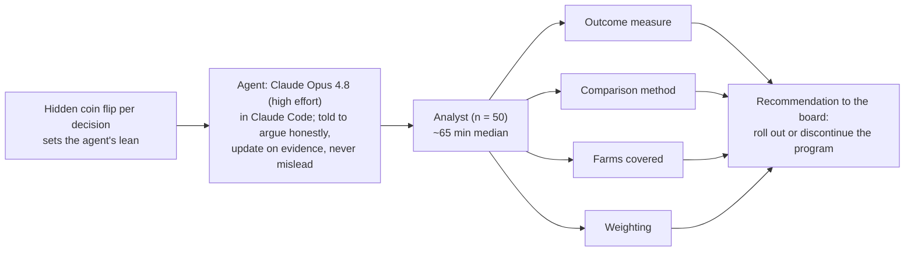
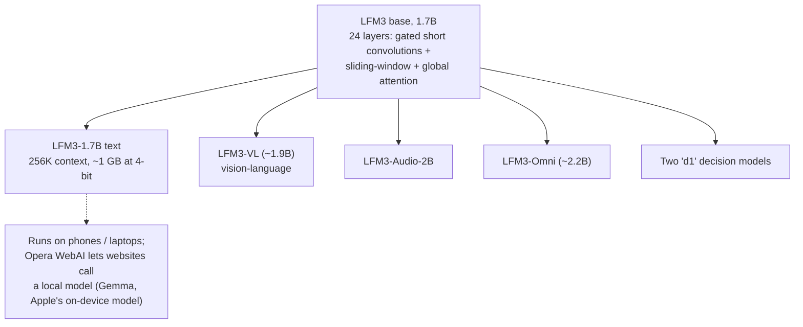

# LLM Updates — 2026-Oct-28

Compiled Wed Oct 28 2026, early morning Los Angeles time, covering **Oct 27 → Oct 28**. Tuesday was a busy day for
research and smaller releases but brought no new frontier model. Anthropic published a randomized trial showing that
experts quietly **adopt an AI agent's preferences** on judgment calls, plus an early report on **drug development with
Claude**. Google DeepMind previewed **Genie 4**, Liquid AI released the **LFM3** on-device family, and Opera proposed
**WebAI**, a web standard for running local models in the browser. Items from the Oct-27 brief (S-1, GPT-6.1 Terra, the
ETH manuscript, Cohere/Qwen) are mentioned only for status.

**The item most worth your time is Anthropic's deferral study. In 50 professional analysts working with Claude Code,
choices followed a coin-flipped agent "lean" 86% of the time, against 50% expected by chance, and analysts who already
held a view abandoned it 60% of the time when the agent disagreed. Only 15% credited the agent for arguments they
repeated. It is one task with deliberately strengthened leans, but it measures something every team using agents for
analysis should worry about: human review that is less independent than it looks.**

- **Experts defer to agents (Anthropic, Oct 27).** 61 analysts recruited, 50 used the agent (Claude Opus 4.8 in Claude
  Code). **86%** agreement with a random lean; switching **60%** vs **6%**; **77%** reused agent arguments, **15%**
  credited it; none of 10 traits predicted who deferred (§1).
- **Genie 4 (Google DeepMind, Oct 27).** Real-time world model with **native audio**, plain-language steering and about
  **2 minutes** of scene coherence (double Genie 3). Trusted testers now; AI Ultra (Project Genie) and Gemini API early
  access "in the coming weeks" (§2).
- **LFM3 and Opera WebAI (Oct 27).** Liquid AI's six open-weight ~2B models on one 1.7B backbone; the text model has a
  **256K** context and fits in about **1 GB** at 4-bit. Opera's WebAI preview lets websites call a local model, off by
  default (§3).
- **Claude in drug development (Anthropic, Oct 27).** Reports from six partners and Anthropic's own program, after
  acquiring one-person biotech **Mithril Medicine**. Results are preclinical and self-reported (§4).
- **Also (§5).** Meta's **$35B** stock offering with **$4B** from Nvidia and AMD; Anthropic's GSA deal at **40%** off
  for all levels of government; the Elvis Presley catalog suit (274 songs); Giotto's Swiss "sovereign" models answer
  that they are Kimi; Amazon's anti-"tokenmaxxing" memo; Altman on the end of patching; Claude Code v2.1.312; Mistral
  Large 4 weights miss Oct 27.

---

## 1. Experts adopt an agent's preferences without noticing (Anthropic, Oct 27)

Anthropic's post and the linked paper (both read directly) describe a randomized trial by Amaç Herdağdelen, Hailey Joren
and Alex Tamkin.

![Figure: Two panels titled "Analysts followed a coin-flipped agent lean on 86% of judgment calls (Anthropic, Oct 27)". Left: share of analyst choices matching the agent's randomly assigned lean: outcome measure 92%, weighting 90%, all four decisions 86%, comparison method 82%, farms covered 81%, against a dashed 50% chance line. Right: when analysts already had a preference (38 cases), 60% switched if the agent disagreed vs 6% if it agreed; 77% of analysts reused the agent's arguments but 15% credited it.](oct28_agent_deferral.svg)

### Design

The task was a realistic causal-inference job: advise a fictional farming co-operative whether to expand a paid advisory
programme, which the board would do only if productivity gains cleared about 3–4%. Each of the four analytic choices had
two defensible options, so there was no single right answer.

### Results

| Measure | Result |
|---|---|
| Choices matching the agent's lean | **86%** overall (outcome 92%, weighting 90%, comparison 82%, farms 81%); chance ≈ 50% |
| Effect on the final recommendation | Roll-out recommended **54%** when the agent leaned that way vs **36%** otherwise; the four leans alone predicted **82%** of recommendations (61% baseline) |
| Analysts with a prior preference (38 cases) | Switched **60%** of the time when the agent disagreed vs **6%** when it agreed (gap 54 points, 95% CI 24–82) |
| Attribution | **77%** repeated the agent's arguments, sometimes word for word; **15%** credited the agent |
| Awareness | 6 of 48 guessed the study was about AI influence; **none** suspected the leans were manipulated |
| Predictors | None of 10 traits (experience, expertise, education, trust in AI, need for cognition, etc.) survived multiple-comparison correction |
| Sense of ownership | 52% rated the recommendation as more their own, yet shifted about as much as the rest |
| Without AI (not comparable) | 6 of 11 made serious methodological errors vs 3 of 50 with AI; median 90 vs 65 min |
| Unprompted Claude | Made the same five choices in 112 of 123 runs |

**Caveats (Anthropic's).** The leans were deliberately strengthened; one task, one domain, one model, about an hour; the
no-AI group was less experienced and self-selected.

**Interpretation.** The quality gain is real (far fewer methodological errors), and so is the steering. Two
consequences follow. First, if many teams use similar models, their "independent" analyses will converge on the same
defaults (note Claude's 112-of-123 consistency). Second, human review as an independent check on AI work, including in
safety research, is weaker than assumed. Anthropic's suggested mitigations are agents that argue both sides, ask for the
expert's view first, or flag only the consequential decisions. A cheap practical step: record your choice before asking
the agent.

## 2. Genie 4 (Google DeepMind, Oct 27)

DeepMind's blog could not be fetched here (DNS); details are from DeepMind's X post and consistent coverage (TechCrunch,
MarkTechPost, The AI Insider).

| | Detail |
|---|---|
| **What** | Real-time interactive world model: text or image prompt → explorable world, steered by keyboard and plain-language edits |
| **New vs Genie 3** | **Native audio** (music, ambient sound, dialogue from the same generation); scene coherence up to **~2 minutes** (double); better physics and more lifelike characters |
| **Gemini in the loop** | Gemini Omni anchors appearance and behaviour; other Gemini models keep the simulation coherent and steer it between user inputs |
| **Robotics experiment** | A Gemini model broke tasks into steps that Genie 4 simulated in real time, as a way to rehearse robot scenarios. Coverage names the planner differently (Gemini 4 Argon vs Gemini 3.8 Flash) |
| **Limits (DeepMind)** | Detail and object permanence drift in long runs or after complex edits; audio accuracy, legible text, spatial accuracy unsolved. No resolution, frame rate or pricing published |
| **Access** | Trusted testers now; Google AI Ultra via Project Genie and Gemini API / AI Studio early-access partners "in the coming weeks" |

**Interpretation.** The architecture is the interesting part: a language model acting as planner and continuity checker
around a generative video model. That is the same pattern labs are using for agent and robot training environments, and
it means world-model quality now partly depends on the LLM's reasoning, not only the video model.

## 3. Small and local: LFM3 and Opera WebAI (Oct 27)

Liquid AI's and Opera's own pages could not be fetched; details are from coverage (Unite.AI, MarkTechPost, TechTimes,
TechCrunch, Android Headlines, CyberInsider).

- **LFM3 (Liquid AI).** Six open-weight models of roughly 2B parameters sharing one 1.7B base. Liquid reports the text
  model averages **49.37** across **29** benchmarks vs **47.24** for Qwen3.5-9B, a model five times larger;
  self-reported and not yet replicated. Weights on Hugging Face; the text model is under the **LFM Open License v1.0**
  (not Apache). Day-0 partners include AMD, Arm, Intel, NVIDIA, Qualcomm, OpenRouter and Vercel. Reported parameter
  counts for the VL model differ slightly between outlets.
- **Opera WebAI.** An opt-in early preview of a proposed standard that lets websites and extensions run models on the
  user's machine. Opera One first (64-bit Windows, Apple-silicon Macs); GX and Neon later. Models include Google's Gemma
  and, on Macs, Apple's on-device model. Off by default, no download until enabled, per-site permissions. Coverage
  disagrees on the API surface (eight APIs including Prompt, Summarizer and Translator, as in Chrome, vs three: Semantic
  Embeddings, Prompt, Decision). Opera says Google and Microsoft back the idea; Apple and Mozilla have opposed Chrome's
  version (single source).

**Interpretation.** Both point the same way: useful models at ~2B parameters are now good enough that the browser and
phone become a deployment target. The open question for WebAI is not technology but adoption: a web standard without
Safari and Firefox is a Chromium feature.

## 4. Early results from Claude in drug development (Anthropic, Oct 27)

Read directly from Anthropic's post; results are from Anthropic and partners, linked technical reports, no independent
review.

| Partner | Stage | Reported result |
|---|---|---|
| **Generate Biomedicines** | CAR-T design | A Claude-proposed genetic component **~70% shorter** gave about **10x** more receptors and better tumour killing in lab tests |
| **Divergence Labs** | Hit generation (food allergy) | ~**35,000** antibody designs in about a month, largely autonomous; 3 binders and 20 IgE-dislodging designs, 3 beating the standard drug. Combined drug not yet built |
| **BigHat Biosciences** | Lead optimisation | ~1,010 variants in ~10 weeks; Claude helped show standard stability metrics were misleading. Best variants bound **>10x** tighter; one clumped **>100x** more slowly |
| **Enveda** | Manufacturing paperwork | On 1,061 pages, caught all **11** issues humans found plus **7** more; review time **−89%** (25+ h → <3 h) |
| **BMS** | Clinical-trial planning | Single-prompt analyses that "would otherwise take days"; expansion planned for 2027 |
| **The Column Group / Pleiades** | New company | Target-assessment skill tested on 45 target–disease pairs |
| **Mithril Medicine (acquired)** | Rare muscular dystrophies | A one-person company that used Claude to coordinate 11 outside labs; idea to promising mouse data in <18 months; possible human trials from **late 2028** |

**Interpretation.** The notable new fact is that Anthropic now owns a drug program. Everything here is preclinical; the
strongest measured claim is the Enveda document review, which is the least glamorous and the most immediately
deployable. No model versions are named.

## 5. Smaller items

- **Meta raises $35B for AI (Oct 26–27).** About **$22.5B** of Class A stock plus **$12.5B** of mandatory convertible
  preferred, with a possible further **$60B** at-the-market programme once new non-voting Class C shares trade (expected
  Q1 2027), hence "$95B" headlines. Nvidia is investing **$3B** and AMD **$1B** in the offering (CNBC).
- **Anthropic–GSA expansion (Oct 27).** **40%** off Claude Enterprise, Claude for Government and the API for federal,
  state, local, tribal and territorial governments via GSA's schedule, no minimum spend; Anthropic estimates **$1B** in
  savings. Claude for Government is FedRAMP High (read directly). This follows OpenAI's 50% state-and-local discount from
  Oct 1.
- **Elvis Presley catalog sues Anthropic (filed Oct 23, reported Oct 26–27).** Authentic Brands' ABG EPE IP and music
  publishers allege Claude was trained on lyrics of **274** songs; counts under copyright, DMCA §1201 and §1202; up to
  ~$41M statutory damages sought plus destruction of copies "including in model weights". Allegations only; no Anthropic
  response found.
- **Giotto Alto and Solo (Oct 27).** Lausanne-based Giotto launched "sovereign European" reasoning models: Alto (eight
  B300 GPUs, free on web and apps) and Solo (single GPU, on-prem). Users showed Alto saying it is a **Kimi** model from
  Moonshot running as "giotto-model", and its math comparison uses Claude Sonnet 4 from May 2025. Self-identification
  proves little, but Giotto has not answered and has not released weights.
- **Amazon's anti-"tokenmaxxing" memo (public Oct 27).** An internal memo calls token usage and lines of AI-written code
  "deeply flawed" productivity metrics and tells engineers to judge AI by results; Amazon still wants broad adoption.
  Follows its May removal of an AI-usage leaderboard (CNBC).
- **Altman: "I no longer think we're going to be able to just patch all the bugs."** At Stanford GSB, he said
  AI-driven vulnerability discovery has outrun one-by-one patching and defenders must use AI themselves (Gizmodo,
  Computer Weekly).
- **WildAWM (UNC, Microsoft Research, Georgia Tech, Northeastern; arXiv 2610.26828).** Open models synthesize **341**
  long-horizon computer-use environments spanning GUI, MCP and CLI, with execution-based quality gates; GPT-6 Astra solves
  only **60%**, and Qwen models trained on them gain on 8 out-of-distribution benchmarks (via abstracts/aggregators).
- **Claude Code v2.1.312.** Write now refuses to overwrite a very large CLAUDE.md or rules file it has only partly read;
  `oidc.user_id_claim` for the apps gateway; hooks capped at 24 concurrent per session; the `claude_code.safety_event`
  OpenTelemetry event removed; WebFetch explains unresolvable hosts in cloud sessions (changelog, read directly).
- **Ant Group LingGuang 2.0 (beta, reported).** Small-scale test of a version with long-term memory that keeps working
  on tasks (e.g. rebooking delayed flights) after the user leaves; uses Skills and MCP. No official technical details.

**Excluded.** A digest claim that GPT-6.1 Terra came with a further 50% computer-use price cut (no OpenAI source; the
Terra launch was covered Oct 27); Fox News's "shocking stats" headline (it refers to the deferral study in §1).

---

## Watch-items into the next brief

| # | Item | Status after Oct 27–28 |
|---|---|---|
| 51 | Large 4 weights | **Missed** the Oct 27 date reported by Reuters; Hugging Face page counts down to Oct 31; licence file 404; Mistral says only "end of October" |
| 125 | Kimi K3.1 Pro weights | Not yet; promised by Nov 4 |
| 135 | Anthropic IPO | No price range or share count yet |
| 136 | ETH refutation | No review findings yet; `openai/math` unchanged since Oct 26 |
| 138 | Qwen3.8-Flash-Next egress | Still no Alibaba response found |

Items 71, 88–124, 126–134 and 137 carry over unchanged; nothing new was found on them.

New items:

139. **Agent deferral.** Replication outside Anthropic, field measurements of deferral, and whether agent products ship
     "both sides" or "ask first" modes.
140. **Genie 4.** Public access date, pricing, and any published resolution/frame-rate specs.
141. **LFM3.** Independent benchmark runs vs Qwen3.5-9B and other ~2B models.
142. **Giotto.** A response on the Kimi provenance question and whether weights or a model card are released.

---

### Method & caveats

- **Compiled** Wed Oct 28 2026, ~06:30 Los Angeles time, covering **Oct 27 → Oct 28**.
- **What is measured, claimed, or reported.**
  - **Read directly from primary source:** Anthropic's deferral post and paper link (§1), drug-development post (§4),
    GSA post (§5), news and research indexes; the Claude Code changelog; OpenAI's `openai/math` history (for status).
  - **Company statements, via coverage:** Genie 4 (§2); LFM3 and WebAI (§3); Giotto, Meta (§5).
  - **Self-reported, unreplicated:** LFM3 benchmark averages; all drug-development results (§4).
  - **Reported / second-hand:** WildAWM (abstract via aggregators); LingGuang 2.0; the Presley complaint's details;
    several §5 items came via the diclogic ai-daily-digest and were cross-checked against at least one other outlet.
- **Interpretation, labelled as such:** the lead and the interpretation paragraphs in §1–§4.
- **Scraping resilience.** Direct fetches failed (DNS) for `deepmind.google`, `techcrunch.com`, `unite.ai`,
  `marktechpost.com`, `arxiv.org`, `theneuron.ai` and `aiweekly.co`. `anthropic.com`, `github.com` and
  `raw.githubusercontent.com` were readable. Everything else comes from the search index.

### Sources (by section)

- **Agent deferral.** [Anthropic, How AI agents shape experts' judgment calls](https://www.anthropic.com/research/agents-judgment-calls) · [Paper (PDF)](https://www-cdn.anthropic.com/519c17a5d23a794e8b6d50a854048d0b61e0d73a.pdf) · [Unite.AI](https://www.unite.ai/anthropic-finds-analysts-defer-to-ai-agents-in-judgment-study/) · [Blockchain.News](https://blockchain.news/news/anthropic-study-ai-agents-steer-expert-judgment) · [Fox News live](https://www.foxnews.com/live-news/ai-news-anthropic-openai-october-28)
- **Genie 4.** [DeepMind blog](https://deepmind.google/blog/genie-4-a-new-generation-of-world-simulation/) · [DeepMind on X](https://x.com/GoogleDeepMind/status/2115114028338962672) · [TechCrunch](https://techcrunch.com/2026/10/27/googles-genie-4-world-model-adds-audio-more-realistic-worlds-and-real-time-steering/) · [MarkTechPost](https://www.marktechpost.com/2026/10/28/google-deepmind-genie-4-world-model/) · [The AI Insider](https://theaiinsider.tech/2026/10/28/google-deepmind-releases-genie-4-world-model-with-real-time-editing-and-audio/)
- **LFM3 / WebAI.** [MarkTechPost, LFM3](https://www.marktechpost.com/2026/10/27/liquid-ai-lfm3-open-weight-2b-multimodal-models/) · [Unite.AI, LFM3](https://www.unite.ai/liquid-ai-launches-lfm3-family-of-six-open-weight-2b-class-models/) · [TechTimes](https://www.techtimes.com/articles/329588/20261028/liquid-ai-releases-lfm3-six-open-weight-models-fuse-text-vision-audio-one-2b-backbone.htm) · [TechCrunch, WebAI](https://techcrunch.com/2026/10/27/opera-introduces-a-new-web-standard-to-let-users-deploy-ai-locally-in-their-browser/) · [Android Headlines](https://www.androidheadlines.com/2026/10/opera-webai-local-browser-ai-launch.html) · [CyberInsider](https://cyberinsider.com/opera-on-device-ai-websites-extensions/) · [DataNorth](https://datanorth.ai/news/opera-one-lets-websites-use-gemma-or-apples-ai-model-on-your-own-laptop-with-no-cloud-or-api-key)
- **Drug development.** [Anthropic, Early progress on accelerating drug development](https://www.anthropic.com/research/early-progress-drug-development)
- **Smaller items.** [CNBC, Meta offering](https://www.cnbc.com/2026/10/26/meta-stock-offering-ai.html) · [CNBC, Nvidia/AMD invest in Meta](https://www.cnbc.com/2026/10/27/nvidia-invest-meta.html) · [Anthropic, GSA expansion](https://www.anthropic.com/news/expanding-partnership-gsa) · [Smart Cities Dive, OpenAI–GSA](https://www.smartcitiesdive.com/news/openai-gsa-extend-discounted-ai-services-to-local-governments/830907/) · [Runtime Wire, Presley suit](https://runtimewire.com/article/anthropic-elvis-presley-songs-copyright-lawsuit) · [The Outpost](https://theoutpost.ai/news-story/elvis-presley-rightsholders-sue-anthropic-for-training-ai-model-claude-on-274-songs-without-permission-32618/) · [Giotto on X](https://x.com/giotto_ai/status/2115100162204856795) · [EQS, Giotto release](https://www.eqs-news.com/news/corporate/giotto-launches-sovereign-ai-family-to-make-ai-public-infrastructure/165f1e84-de97-428b-b77a-9e3c65dd5b57_en) · [Pasquale Pillitteri, Giotto](https://pasqualepillitteri.it/en/news/27761/giotto-ai-alto-solo-sovereign-european-ai-models) · [CNBC, Amazon memo](https://www.cnbc.com/2026/10/27/amazon-ai-coding-tokenmaxxing.html) · [Gizmodo, Altman](https://gizmodo.com/sam-altman-i-no-longer-think-were-gonna-be-able-to-just-patch-all-the-bugs-2000829947) · [Computer Weekly, Altman](https://www.computerweekly.com/news/366652912/OpenAIs-Altman-Only-way-out-of-patch-apocalypse-is-through) · [WildAWM, arXiv](https://arxiv.org/abs/2610.26828) · [OpenTrain, WildAWM](https://www.opentrain.ai/papers/agent-world-model-in-the-wild-computer-use-agent-environment-synthesis--arxiv-2610.26828/) · [Claude Code changelog](https://github.com/anthropics/claude-code/blob/main/CHANGELOG.md) · [The Standard, LingGuang](https://www.thestandard.com.hk/innovation/article/345126/) · [diclogic ai-daily-digest #196](https://github.com/diclogic/ai-daily-digest/issues/196)
- **Watch-items.** [Forkast, Large 4 weights](https://forkast.news/the-reported-date-arrived-and-the-weights-did-not/) · [openai/math history](https://github.com/openai/math/blob/main/history.md)
