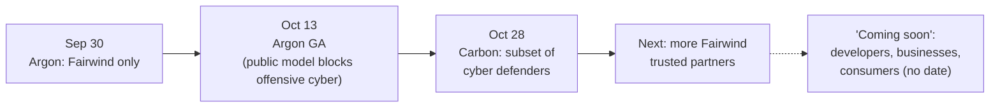
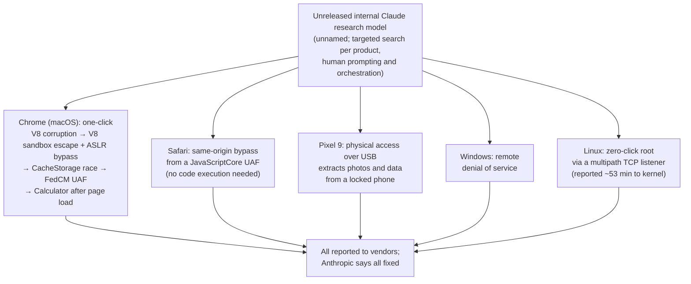

# LLM Updates — 2026-Oct-29

Compiled Thu Oct 29 2026, early morning Los Angeles time, covering **Oct 28 → Oct 29**, plus two Oct 27 items the
Oct-28 brief missed. The day's main event is **Gemini 4 Carbon**, Google's new frontier model. It arrived two weeks after
Argon and, like Argon, ships first only to vetted cyber defenders. It lands one day after Artificial Analysis rebuilt
its leaderboard as **Intelligence Index v5**, on which Carbon is now first by one point. Catch-up: Anthropic's Frontier
Red Team says an **unreleased Claude model built five working exploit chains** against Chrome, Safari, a Pixel 9,
Windows and Linux. Alphabet and Microsoft reported earnings, and Anthropic widened its AI for Science program.

**The item most worth your time is Carbon, but read it as a release pattern rather than a scoreboard. The second
frontier model in a row from Google goes to defenders first, with offensive-security scores (88.2% SEC-bench Pro, 54.8%
ExploitGym) as the headline. Anthropic's exploit-chain post the day before points the same way: the newest models are
being judged, and gated, mainly on what they can do to software. On general capability Carbon's lead is one point on a
new, mostly private index, and it trails Opus 5.5 on agentic coding.**

- **Gemini 4 Carbon (Google, Oct 28).** **59** on AA Index v5 vs Opus 5.5 **58**, GPT-6 Astra **57**; 1M context;
  $4/$20 standard ($2/$10 introductory). Defenders first via Fairwind; no public API date (§1).
- **Artificial Analysis Intelligence Index v5 (Oct 27).** **60%** private or held-out tests; HLE replaced by
  HLE-Diamond; the open-weights gap widens from **3** to **12** points (§2).
- **Unreleased Claude builds five exploit chains (Anthropic Frontier Red Team, Oct 27).** One-click Chrome, Safari
  cross-origin, locked Pixel 9 data extraction, Windows DoS, zero-click Linux root; **62** Chrome CVEs, all patched
  (§3).
- **Hyperscaler earnings (Oct 28).** Alphabet: Cloud **+103%** to **$30.7B**, Gemini app **1B** users, **~32B**
  tokens/minute, shares down ~10% on negative free cash flow. Microsoft: Azure **+48%**, shares up (§4).
- **Also (§5).** Anthropic AI for Science adds 20 partners, including NSF and the Model Hardware Standard with Janelia;
  OpenAI–ServiceNow; ChatGPT Pro allowance halves Oct 30; Oct 27 arXiv picks; no Claude Code release; Large 4 weights
  still pending.

---

## 1. Gemini 4 Carbon (Google, Oct 28)

Google's blog could not be fetched here (DNS). Details come from Logan Kilpatrick's and Artificial Analysis's X posts,
9to5Google, MarkTechPost, VentureBeat, WinBuzzer, BusinessToday and OfficeChai, all from search snippets. Numbers
agreed across at least two outlets.

![Figure: Two panels titled "Gemini 4 Carbon tops Artificial Analysis Index v5 by one point, but not everywhere (Oct 28)". Left: Artificial Analysis Intelligence Index v5: Gemini 4 Carbon (high) 59, Claude Opus 5.5 (max) 58, GPT-6 Astra (max) 57, GPT-6.1 Sol (max) 55, Gemini 4 Argon 50, Kimi K3.1 Pro 46 (weights pending), best released open weights (DeepSeek V4.1 Flash 1017 and GLM-5.3) 32. Right: where Carbon does not lead: Coding Agent Index, Opus 5.5 with Claude Code 62 vs Carbon with Antigravity CLI 59; FrontierSWE 2, GPT-6 Astra 65.5%, Opus 5.5 62.3%, Carbon 61.2%; AA-Omniscience hallucination rate, Argon 4% vs Carbon 11%.](oct29_carbon_index.svg)

| | Detail |
|---|---|
| **What** | Google's "strongest model", pitched at long-horizon agentic coding and cyber defence. Kilpatrick: "a big jump over Argon which we released just 2 weeks ago" |
| **Cyber (Google, no guardrails)** | SEC-bench Pro (vulnerability discovery) **88.2%**; ExploitGym (exploitation) **54.8%**; CWE-bench (patching) **71.0%**. No competitor numbers were published alongside these, so "firm lead" is Google's claim |
| **General (Google's table)** | Leads on 11 of 15 disclosed benchmarks (OfficeChai). Terminal-Bench 4.0 (AA) **65.2%** vs Opus 5.5 59.6%, Astra 59.1%, Argon 57.1%; Vals.ai measures Carbon at **63.1%**, and lists Kimi K3.1 Pro at 67.2%. SWE-sweep **9.6%** vs Astra 9.5%, Opus 5.5 3.6%. Trails on **FrontierSWE 2** (61.2% vs Astra 65.5%, Opus 62.3%) and **OSWorld** (81.5%, behind Opus 5.5) |
| **Independent (Artificial Analysis)** | Index v5 **59**, first; #1 on 4 of 9 evals including HLE-Diamond and Terminal-Bench-Science (64.8%). Coding Agent Index **59** (with Antigravity CLI) vs **62** for Opus 5.5 in Claude Code. ~**200M** tokens to run the index (Argon ~110M); ~**$7.76** per index task at standard prices (Argon $7.68). AA-Omniscience accuracy **58%**, but hallucination rate **11%**, up from Argon's **4%** |
| **Other** | Vals Index **70.36%**, #2 of 29 |
| **Specs and price** | 1M-token context; text, image, video and speech in, text out. **$4 / $20** per M tokens standard, **$2 / $10** introductory; cached input 95% off (same structure as Argon) |
| **Access** | A subset of cyber defenders first, then more trusted partners through the **Fairwind Program**. "Coming soon to developers, businesses, and consumers", with no date. The public version will carry cyber safeguards and may not match the no-guardrail scores |
| **Safety documentation** | No Carbon model card or Frontier Safety Framework report found in search. Argon's card said Google "cannot rule out" Argon reaching the cyber CCL |

**Interpretation.** This is a cyber launch first and a general model launch second. On general measures the result is a
three-way tie at the top (59/58/57 on a new index with no published error bars). Carbon is worse than Opus 5.5 at
agentic coding and hallucinates more than Argon, at about twice Argon's token use. The cyber numbers are the
distinctive part, and they come with no comparison and no model card. Two things to watch: whether Google publishes the
FSF assessment before general availability, and whether Argon's 15-day gap between Fairwind and GA repeats.

## 2. Artificial Analysis Intelligence Index v5 (Oct 27)

Read via coverage (OfficeChai, Cybernews, WinBuzzer, cellcog, explainx). AA's own pages could not be fetched (DNS).

| Change | Detail |
|---|---|
| **Private tests** | **60%** of the index from private test sets or held-out answers, to fight contamination |
| **Swaps** | HLE → **HLE-Diamond**; AA-Omniscience v1.1 drops saturated public questions; CritPt v2 becomes a private 40-question hard subset; new **FrontierCode 2.0** and **Terminal-Bench-Science**. Three evals upgraded, three removed |
| **Weighting** | Four equal categories (knowledge work, coding, science, general). Agentic tests carry ~55% of the weight and ~90% of output tokens |
| **Launch board (pre-Carbon)** | Opus 5.5 **58**, GPT-6 Astra **57**, GPT-6.1 Sol **55** |
| **Open weights** | Best open model is Kimi K3.1 Pro at **46**, but its weights are not released yet. Among released weights, DeepSeek V4.1 Flash 1017 and GLM-5.3 score **32**, below Claude Haiku 5.5 (**36**). Gap to the top: **12** points (was 3 on v4.3) |

**Interpretation.** Private tests fix contamination but move trust to one grader, and the new mix rewards long agentic
runs that open models are worse at. Part of the "open-weights collapse" comes from the measurement change, not from the
models. v5 scores are a new series; AA says they should not be compared with v4.x numbers in earlier briefs.

## 3. Unreleased Claude model builds five exploit chains (Anthropic Frontier Red Team, Oct 27)

Anthropic's red-team site could not be fetched (DNS). Details are from The Hacker News, Cybersecurity News, GBHackers,
Business Standard, Cyber Kendra and Mallory, via search snippets. Outlets disagree on some CVE details; those are
flagged below.

- **Scale.** Google assigned **62** CVEs to the Chrome findings, all critical or high and fixed by **Chrome 156**,
  including **13** sandbox escapes and **21** renderer compromises. Google's release notes credit Anthropic for
  specific fixes, but not visibly for all 62.
- **Discrepancies.** Outlets give the Windows bug as CVE-2026-33096 (CVSS 7.5) and the Linux one as CVE-2026-98432
  (CVSS 9.8). Mallory notes mismatches between Anthropic's descriptions and public CVE records, and found no public
  patch record for the Pixel chain.
- **Autonomy.** Not cleanly quantified. Each chain started from a targeted search on one product, with initial human
  prompting and orchestration. No compute cost was given.

**Interpretation.** The S-1 (Oct-27 brief) disclosed that Anthropic models had reached real systems. This post shows
what an unreleased model can do when aimed at a target on purpose: full chains, not single bugs, on hardened consumer
platforms. Together with Carbon's ExploitGym number, it backs Altman's "can't just patch all the bugs" remark (Oct-28
brief). The practical step is the same as ever: update Chrome to 156 or later and apply this month's OS patches.

## 4. Hyperscaler earnings (Oct 28)

From CNBC, Fox Business and earnings-call coverage (search snippets).

| | Alphabet Q3 | Microsoft FY27 Q1 |
|---|---|---|
| **Revenue** | **$127.6B** (+25%); first top- and bottom-line miss in nearly four years | **$92.3B** (vs $90.7B expected) |
| **Cloud** | Google Cloud **+103%** to **$30.7B**, with TPU system sales "meaningful"; backlog **$561B** (from >$460B in Q1) | Azure **+48%** (guided 44–45%), ~$33.2B, first time in dollars; commercial RPO **$677B** (+73%) |
| **AI usage** | Gemini app **1B** users; first-party APIs **~32B tokens/minute** (~22B in Q2, >4x a year ago) | ~$200M loss on the OpenAI stake excluded from adjusted EPS |
| **Capex** | **$51.4B** (below $55.1B expected); free cash flow **−$9.1B**; 2026 guide unchanged, "significant increase" in 2027 | $45.2B incl. finance leases (below $50.7B expected); >$50B in Q2; ~**$170B** guided (outlets disagree whether for CY2026 or CY2027) |
| **Stock** | About **−10%** | About **+4%** |

Alphabet also booked an **$8.2B** unrealized loss on its SpaceX stake.

**Interpretation.** Demand is not in doubt on either side: tokens per minute grew ~45% in a quarter. What the market
punished was Alphabet spending ahead of cash. That matters to model users because it shapes how long introductory prices
like Carbon's $2/$10 can last.

## 5. Smaller items

- **Anthropic AI for Science expands (Oct 28, read directly).** 20 new partners get free Claude credits, including the
  **US NSF**, Sloan, Simons, Schmidt Sciences, STScI, Wellcome Sanger, the Crick, EMBL, Gladstone, FlyWire, gnomAD and
  the Lean library Tau Ceti. New: the **Model Hardware Standard (MHS)**, co-developed with HHMI Janelia, a shared
  spec for AI agents to operate lab instruments safely (research preview). The Allen Institute is building agent teams
  over its open brain, cell and immune datasets. No credit amounts were disclosed.
- **OpenAI.** An expanded **ServiceNow** partnership (Oct 28) and an **Oracle** deal bringing Oracle apps into
  ChatGPT (Oct 27), both listed on OpenAI's news page; no details read. Reminder: the **$200 Pro** allowance in ChatGPT
  Work and Codex drops from **20x to 10x** Plus on **Oct 30**, with a one-time 62,500-credit grant expiring Dec 31.
- **Arxiv picks (Oct 27 listings, titles only).** *Heads of Security* (2610.37657): learned per-head attention gates
  separate trusted from untrusted tokens to resist prompt injection without changing the base model. *Follow the
  Gradient* (2610.37481): traces safety loss after fine-tuning back to specific training examples. *Scaling Laws for
  Tool-Use Agents* (2610.37648): synthetic API environments (SynthAPI). *MuonGS* (2610.37647): weight-norm control in
  Muon pretraining. No results checked.
- **Claude Code.** No release since v2.1.312 (changelog, read directly).

**Excluded.** "Nemotron 3.5 Transcribe" as new (it appears to be Nemotron 3.5 ASR from June 4); a DataCamp headline
calling Carbon a "world model" (that is Genie 4, Oct-28 brief); xAI's reported offer to buy homes near a Mississippi
data center (single aggregator; not model news).

---

## Watch-items into the next brief

| # | Item | Status after Oct 28–29 |
|---|---|---|
| 51 | Large 4 weights | Still not out; Hugging Face page counts down to **Oct 31**; no licence named |
| 125 | Kimi K3.1 Pro weights | Not yet; promised by Nov 4. Now the top open model on AA v5 (46) |
| 135 | Anthropic IPO | No price range or share count yet; reports split on listing before or after the Nov 3 midterms |
| 136 | ETH refutation | Nothing new found |
| 138 | Qwen3.8-Flash-Next egress | Still no Alibaba response found |
| 140 | Genie 4 | No access date yet |

Items 71, 88–124, 126–134, 137, 139 and 141–142 carry over unchanged; nothing new was found on them.

New items:

143. **Gemini 4 Carbon.** Model card / FSF assessment; general-availability date; whether the safeguarded public model
     matches the Fairwind scores; independent hallucination re-tests.
144. **AA Index v5.** Methodology documentation for the private sets, and whether other evaluators (Epoch, Vals, LMArena)
     confirm the 12-point open-weights gap.
145. **Anthropic exploit chains.** Reconciling the Windows/Linux CVE records; a Pixel patch record; whether the
     unreleased model is the next Claude release.

---

### Method & caveats

- **Compiled** Thu Oct 29 2026, ~06:30 Los Angeles time, covering **Oct 28 → Oct 29** (plus Oct 27 catch-up in §2–§3).
- **What is measured, claimed, or reported.**
  - **Read directly from primary source:** Anthropic's AI for Science post and news index (§5); the Claude Code
    changelog; the agents-radar arXiv digest on GitHub (§5).
  - **Independent measurement, via coverage:** Artificial Analysis Index v5 and Carbon results; Vals.ai numbers (§1–§2).
  - **Company claims, via coverage:** Google's Carbon benchmarks (§1); Anthropic's exploit chains (§3); earnings
    figures (§4).
  - **Unverified details:** CVE numbers in §3; the Microsoft capex period in §4; the OSWorld score for Opus 5.5 (not
    found).
- **Interpretation, labelled as such:** the lead and the interpretation paragraphs in §1–§4.
- **Scraping resilience.** Direct fetches failed (DNS) for `blog.google`, `artificialanalysis.ai`, `red.anthropic.com`,
  `venturebeat.com`, `thehackernews.com`, `technology.org`, `constellationr.com`, `vals.ai`, `killtheai.com` and
  `theneuron.ai`. `anthropic.com`, `github.com` and `raw.githubusercontent.com` were readable. Everything else comes
  from the search index.

### Sources (by section)

- **Gemini 4 Carbon.** [Google blog](https://blog.google/innovation-and-ai/models-and-research/gemini-models/introducing-gemini-4-carbon/) · [Logan Kilpatrick on X](https://x.com/OfficialLoganK/status/2115489284404940898) · [Artificial Analysis, Carbon #1](https://artificialanalysis.ai/articles/gemini-4-carbon-new-number-1) · [Artificial Analysis on X](https://x.com/ArtificialAnlys/status/2115494553780367384) · [9to5Google](https://9to5google.com/2026/10/28/gemini-4-carbon-announcement/) · [MarkTechPost](https://www.marktechpost.com/2026/10/28/google-deepmind-gemini-4-carbon-frontier-model/) · [VentureBeat](https://venturebeat.com/technology/google-unveils-gemini-4-carbon-retaking-the-worlds-no-1-spot-on-updated-harder-benchmarks-but-access-is-limited) · [WinBuzzer](https://winbuzzer.com/2026/10/28/gemini-4-carbon-ai-leads-test-for-fixing-vulnerable-code-xcxwbn/) · [OfficeChai](https://officechai.com/ai/gemini-4-carbon-benchmarks/) · [BusinessToday](https://www.businesstoday.in/technology/news/story/google-launches-gemini-4-carbon-ai-model-for-cybersecurity-and-coding-limits-initial-access-564452-2026-10-29) · [Wccftech](https://wccftech.com/googles-gemini-4-carbon-mogs-every-other-model-on-nearly-every-benchmark-performs-over-10x-better-than-any-publicly-available-model-when-generating-high-quality-security-patches/) · [Vals.ai](https://www.vals.ai/models/google_gemini-4-carbon) · [Trending Topics](https://www.trendingtopics.eu/gemini-4-carbon-dethrones-claude-opus-5-5/) · [Gemini 4 Argon model card](https://deepmind.google/models/model-cards/gemini-4-argon/)
- **AA Index v5.** [Artificial Analysis, announcing v5](https://artificialanalysis.ai/articles/artificial-analysis-intelligence-index-v5) · [OfficeChai](https://officechai.com/ai/artificial-analysis-launches-intelligence-index-v5-with-majority-private-datasets-openai-models-gain-muse-wonder-kimi-drop/) · [Cybernews](https://cybernews.com/ai-news/artificial-analysis-leaderboard-update-open-weight-ai-ranking-hit/) · [WinBuzzer](https://winbuzzer.com/2026/10/28/artificial-analysis-reweights-ai-rankings-toward-private-tests-xcxwbn/) · [explainx](https://explainx.ai/blog/artificial-analysis-intelligence-index-v5-opus-5-5-58-private-benchmarks-open-weight-gap-12-points-2026)
- **Exploit chains.** [The Hacker News](https://thehackernews.com/2026/10/anthropics-unreleased-ai-model-chains.html) · [Cybersecurity News](https://cybersecuritynews.com/claude-ai-builds-exploit/) · [GBHackers](https://gbhackers.com/anthropics-claude-chains-one-click-and-zero-click-exploits/) · [Business Standard](https://www.business-standard.com/amp/technology/artificial-intelligence/unreleased-claude-model-found-attack-chains-in-chrome-safari-anthropic-126102901074_1.html) · [Cyber Kendra](https://www.cyberkendra.com/2026/10/anthropic-claude-exploit-chains-chrome-safari-linux.html) · [Mallory](https://mallory.ai/stories/01a181c8-65b6-7463-b8b4-f6c64494db87) · [Cybernews](https://cybernews.com/ai-news/unreleased-ai-models-security-flaws-patching-race/)
- **Earnings.** [CNBC, Alphabet](https://www.cnbc.com/2026/10/28/alphabet-googl-earnings-q3-2026.html) · [CNBC, Alphabet/Microsoft shares](https://www.cnbc.com/2026/10/29/alphabet-google-microsoft-msft-shares-today-earnings.html) · [CNBC, Microsoft](https://www.cnbc.com/2026/10/28/microsoft-msft-q1-earnings-report-2027.html) · [Alphabet Q3 8-K](https://www.sec.gov/Archives/edgar/data/0001652044/000165204426000080/googexhibit991q32026.htm) · [Fox Business](https://www.foxbusiness.com/technology/alphabet-microsoft-earnings-reveal-surging-ai-demand-spending-soars) · [247wallst, Microsoft](https://247wallst.com/cards/microsoft-q1-2027-earnings-msft-01m6223bcjxyqzvby9cw8yzzqb)
- **Smaller items.** [Anthropic, AI for Science expands](https://www.anthropic.com/news/ai-for-science-expands-foundations-research-institutions) · [OpenAI News](https://openai.com/news/) · [The New Stack, Pro plan](https://thenewstack.io/openai-halves-200-plan/) · [OfficeChai, Pro limits](https://officechai.com/ai/openai-to-decrease-limits-on-pro-plan-from-20-times-to-10-times-of-plus-plan/) · [agents-radar arXiv digest #712](https://github.com/kouweizhu/agents-radar/issues/712) · [Claude Code changelog](https://github.com/anthropics/claude-code/blob/main/CHANGELOG.md)
- **Watch-items.** [The New Stack, Large 4 weights](https://thenewstack.io/mistral-large-4-weights/) · [Forkast, S-1](https://forkast.news/?p=132775)
