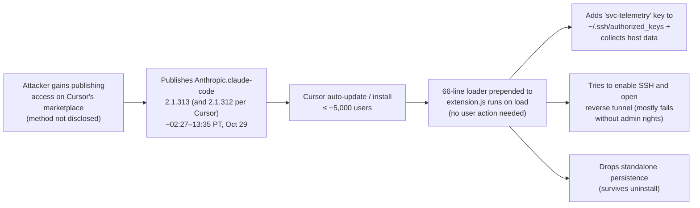

# LLM Updates — 2026-Oct-31

Compiled Sat Oct 31 2026, early morning Los Angeles time, covering **Oct 30 → Oct 31**. No frontier model shipped
(trackers record no releases on Oct 30). The main stories are about security and the web's relationship with
training data. A **trojanized build of the Claude Code extension** sat on **Cursor's** extension marketplace for about
11 hours. Four of the largest labs, **OpenAI, Google, Microsoft and Anthropic**, committed to one robots.txt token for
opting out of AI training. OpenAI also published teen-safety changes and a fair-use advocacy post. Two catch-up items
were not in earlier briefs. **The Information** reports that DeepSeek and Moonshot trained their latest models heavily
on **GPT-6 Astra** outputs. Surge AI's **DAYJOB: Tax** benchmark has the best agent passing about 1 in 9 professional
tax assignments.

**The item most worth your time is the extension compromise, if you or your team use Cursor. Uninstalling does not
remove the payload, and the version number matched a real Claude Code release, so it looked routine. More broadly,
it is a supply-chain attack on the distribution channel, not on the model or its maker: the AI coding agent was the
lure, and the third-party marketplace was the weak point. The opt-out token is the most useful policy news in a
while for site operators. It is voluntary and only a draft, but four major crawlers agreeing on one line of
robots.txt is new.**

- **Trojanized Claude Code extension on Cursor (Oct 29, reported Oct 29–30).** Builds **2.1.313** (and per Cursor's
  updated notice **2.1.312**) were live on Cursor's marketplace from about **02:27 to 13:35 PT on Oct 29**. A 66-line
  loader added an attacker SSH key and persistence; at most **~5,000** users. Anthropic says it did not build or
  publish the copy; the entry point is not public (§1).
- **One AI-training opt-out token (Oct 30).** `__usage_ai-training` in robots.txt, from an IETF individual draft by
  Anthropic's Kevin Kelley. Microsoft starts **Feb 1, 2027**, Google "in 2027", OpenAI "in the coming months", and
  Anthropic says it has started. OpenAI also posted "Fair use benefits everyone" (§2).
- **OpenAI teen protections and Community Safety Report (Oct 30).** Teen limits now cover practical weapons and
  security-system know-how; stronger age prediction; violence-fixated chats can be ended. **200+** law-enforcement
  referrals in Q3; first report due early 2027 (§3).
- **Distillation report (catch-up, Oct 28).** The Information: DeepSeek and Moonshot "relied heavily" on GPT-6 Astra
  outputs for **V4.1 Flash 1017** and **Kimi K3.1 Pro**. No company has confirmed it (§4).
- **Evals and research (§5).** DAYJOB: Tax, top pass rate **10.8%** (Claude Sonnet 5.5). New arXiv papers on a single
  training algorithm, distortion-free watermarking and probes that catch agent rule-breaking.
- **Also (§6).** Claude Code **v2.1.316** deprecates Opus 4.8 fast mode (removal Nov 30). Anthropic credit-rating
  story (BB+ from KBRA, a >10% yield to Blackstone). OpenAI's Dot agent gets a texting beta.

---

## 1. Trojanized Claude Code extension on Cursor's marketplace (Oct 29–30)

Cursor's notice, Phorion's write-up, BleepingComputer and The Register could not be fetched (DNS). Details come from
search snippets of those plus The Hacker News, OX Security, OpenSourceMalware, Morphisec, GovInfoSecurity and Unite.AI.

| | Detail |
|---|---|
| **What** | A tampered copy of the official Claude Code extension, published under the Anthropic listing on **Cursor's** VS Code-compatible extension marketplace. The legitimate code was intact; a malicious loader was added at the top of `extension.js` |
| **Window and reach** | About **11 hours** on **Oct 29** (02:27–13:35 PT). Cursor estimates **at most 5,000** users. Cursor's later notice names both **2.1.312 and 2.1.313**; some write-ups still call 2.1.312 clean |
| **Payload** | Adds an attacker key (comment `svc-telemetry`) to `~/.ssh/authorized_keys`, collects host data, and tries to enable SSH and open a reverse tunnel. Cursor says bugs in the code made the tunnel step fail unless Cursor ran with admin rights, but the key and data-collection steps ran on most machines. Reported on macOS, Linux and Windows |
| **Where it was not** | Early reports (and Phorion's first post) named **Open VSX**. Cursor later told OpenSourceMalware that the package came from Cursor's marketplace, and OpenSourceMalware lists Open VSX, Microsoft's marketplace and npm as clean. An Anthropic security engineer reportedly said it never appeared on any Anthropic-run host |
| **Responses** | Anthropic (Felix Rieseberg): an attacker "used access to Cursor's marketplace to publish a tampered copy… which we didn't build or publish"; Anthropic denies a breach of its systems. Cursor pulled the versions, rotated keys and took the attacker's server offline |
| **What to do** | Update to **2.1.314** or later, check `authorized_keys` for the `svc-telemetry` key, remove persistence scripts and tunnel processes (Cursor ships macOS and Windows scripts). Morphisec suggests rebuilding affected hosts. Uninstalling the extension alone is **not** enough |

**Interpretation.** This follows the LiteLLM PyPI compromise (Oct-25 brief) as the second AI developer-tool
supply-chain incident in a week. The version number matched a genuine upstream release (2.1.313 was not in
Anthropic's changelog, which skipped from 2.1.312 to 2.1.314), so a malicious update looked like a routine one. The
open question is how the attacker got publishing rights on Cursor's mirror. Until Cursor explains that, teams on
Cursor should treat marketplace auto-updates for agent extensions the way they treat package-manager updates: pin
versions and check what changed.

## 2. One robots.txt token to opt out of AI training (Oct 30)

From OpenAI's post (snippets), The Next Web, datastudios, TokenPost, FourWeekMBA, CellCog and the IETF draft listing.

| | Detail |
|---|---|
| **The signal** | One robots.txt policy token, **`__usage_ai-training`**, meaning "do not use this content for training". Defined in an individual IETF Internet-Draft, *Machine-Readable Training Preference Signal*, by **Kevin Kelley (Anthropic)**, dated Oct 30 2026 and discussed on the IETF **AI Preferences (AIPREF)** working-group list. It has no formal standing yet |
| **Who and when** | **Microsoft** starts applying it as it crawls from **Feb 1, 2027**. **Google** aims for **2027**; an opt-out via the token without a named Google-Extended rule will count as a Google-Extended disallow. **OpenAI**: "the coming months". **Anthropic** says implementation has started, with full coverage across its services taking longer |
| **Scope** | Training only, not fetching for search or live answers. It does not remove content already in training sets. Company-specific controls (GPTBot, Google-Extended and others) keep working alongside it |
| **Why it matters** | OpenAI's post says site operators previously had to "identify individual crawlers and maintain separate rules for each and every provider" |
| **Same day** | OpenAI's **"Fair use benefits everyone"** collects excerpts from court briefs by authors, librarians, academics, accessibility groups and startups arguing that training on copyrighted works is fair use |

**Interpretation.** For publishers, this replaces a growing list of crawler-specific rules with one line, though only
for the four signatories and only once they implement it, mostly in 2027. It is a preference, not an enforcement
mechanism, and it does not apply retroactively. OpenAI publishing its fair-use argument on the same day shows the
deal: labs offer an easier opt-out and in return argue that training without one is lawful.

## 3. OpenAI: community safety report and new teen protections (Oct 30)

From OpenAI's post (snippets) and coverage (Unite.AI, Blockchain.News, datastudios, CellCog).

- **Teens.** Rules that already barred helping teens obtain weapons now also cover practical information about weapons
  and security systems that could facilitate violence, even with no sign of violent intent. Help with prevention,
  de-escalation and reaching a trusted adult stays available.
- **Age prediction.** It now keeps re-evaluating signals and moves likely minors into the under-18 experience. Adults
  misclassified can verify their age through **Persona**.
- **Violence safeguards (all users, per coverage).** ChatGPT can end chats that fixate on violence. Limits on
  mass-attack content are tighter. Parents with linked accounts may be told when a teen's account is paused for
  violence-related violations.
- **Reporting.** A twice-yearly **Community Safety Report** on violence prevention, the first in early 2027 covering
  H2 2026. OpenAI says it made **more than 200** law-enforcement referrals in Q3 2026.

**Interpretation.** These are product-policy changes, not model changes. The referral figure is the first quarterly
number of its kind from OpenAI, and the promised report is what will let outsiders check whether the safeguards work.
Common Sense Media's rating of ChatGPT for Teens ("Unacceptable Risk") is the baseline critics will compare against.

## 4. Catch-up: DeepSeek and Moonshot reportedly trained on GPT-6 Astra outputs (Oct 28)

Not in the Oct-28 to Oct-30 briefs. From Reuters' summary of The Information (via syndication), Techzine, IBTimes and
Seoul Economic Daily (Oct 30, title only).

- **Claim.** People with direct knowledge told The Information that DeepSeek and Moonshot relied heavily on outputs
  from OpenAI's **GPT-6 Astra** to train **DeepSeek V4.1 Flash 1017** (Oct 17) and **Kimi K3.1 Pro** (Oct 23).
- **Context.** On Sept 30 OpenAI tied part of a distillation campaign that began in July to people associated with
  Moonshot. Anthropic has said its countermeasures cut data harvested by distillation by about 90–99%; Seoul Economic
  Daily frames the move to Astra as a response to Claude's tighter defences.
- **Status.** OpenAI, DeepSeek and Moonshot did not comment. Moonshot has previously denied distillation. No technical
  evidence has been published.

**Interpretation.** If accurate, this would partly explain how two open-weight models closed much of the gap within
weeks of Astra's release. It also bears on the Kimi K3.1 Pro weights promised for Nov 4 (watch-item 125): open weights
distilled from a closed model would carry that model's capabilities without its safeguards.

## 5. Evals and research

- **DAYJOB: Tax (Surge AI, late Oct).** 50 expert-built assignments (individual, business, partnership, estate,
  international and corporate tax, plus reviews and disputes). Agents must dig through client records, reconcile
  conflicting information and produce returns, workpapers and advice. A task passes only if it meets **≥95%** of rubric
  criteria. Best: **Claude Sonnet 5.5 10.8%**, Fable 5.1 9.6%, Opus 5.5 9.2%. Failures are mostly judgment errors (one
  example: a missed home-sale deadline), not arithmetic. Only 2 tasks are public; Surge built and graded the benchmark.
  It follows DAYJOB Healthcare/Finance, where the best agent passed 24.7%.
- **arXiv, Oct 30–31 (from the agents-radar digest; abstracts not read directly):**
  - *Training Foundation Models with a Single Algorithm* (2610.40564, Song, Zhang, Tajwar et al.): pretraining,
    mid-training, SFT and RL expressed as one family of maximum-likelihood objectives. One digest cites a ~40%
    shorter training schedule; unverified.
  - *TextSeal2* (2610.40613, Sander, Fernandez et al.): a distortion-free LLM watermark that survives speculative
    decoding with no measurable inference overhead.
  - *Pre-Crime for Agents, at the Last Second* (2610.40588): a linear probe on hidden states flags an agent about to
    break a rule before the output appears. This is the same idea as OpenAI's L0 probes (Oct-30 brief).
  - *Efficient Scalable Oversight via Rewinding* (2610.40535, Guan, Kalai, Rothblum et al.): a proof-system approach
    in which "rewinding" lets weak verifiers check stronger systems.
  - *VeriCUA* (2610.40578): a VLM verifier that judges computer-use trajectories, for evaluation and RL.
  - *ShallowDefend* (2610.40627): uses the fact that safety alignment sits in shallow layers to build a multi-turn
    jailbreak defence.

## 6. Smaller items

- **Claude Code v2.1.316** (changelog, read directly). **Fast mode for Opus 4.8 is deprecated** from Oct 30 and
  **removed Nov 30**; after that, requests return an error, with no fallback (move to Opus 5.5). New
  `CLAUDE_CODE_DISABLE_ULTRATHINK` and `CLAUDE_CODE_SUBAGENT_EFFORT`. On the gateway: pooled group budgets and a
  layered policy mode. Fixes: shell commands no longer outlive the session; Bash alias handling.
- **Anthropic credit (FT, via coverage).** KBRA rated Anthropic **BB+** (one notch below investment grade) in June,
  previously unreported. Anthropic is offering Blackstone **>10%** yield on **$9B** of junior debt in a **$60B** chip
  financing ("Project North Star", ~1.5 GW of Google TPUs). Blackstone reportedly says an investment-grade rating
  after the IPO is not assured. Still no IPO price range (watch-item 135).
- **OpenAI Dot texting beta.** A limited US beta lets some ChatGPT Pro users text the Dot agent tasks, photos or
  voice notes and get proactive updates; a third-party provider handles the messaging.
- **"AI bubble bailout" resolution.** Reps. Casar and Waters lead a House Democratic resolution opposing any
  government bailout of AI companies (high Hacker News interest; no vote scheduled).

**Excluded.** A claim that Pro plans got doubled Codex limits alongside the Dot beta (could not be confirmed; it may be
the expired holiday promo); Anthropic's "Managed Agents" and exploit-chain research pages (re-indexed Oct 30 but
already covered in the Oct-29 brief); an undated VentureBeat Grok 4.6 piece (stale); Qwen4 (no release; see watch-item
150).

---

## Watch-items into the next brief

| # | Item | Status after Oct 30–31 |
|---|---|---|
| 125 | Kimi K3.1 Pro weights | Still not public; promised by Nov 4. Now also under the distillation allegation (§4) |
| 135 | Anthropic IPO | No price range or roadshow date. BB+ rating and Blackstone financing reported (§6) |
| 146 | Large 4 independent checks | DataCamp cites a vals.ai Terminal-Bench 4.0 score of **22.7%**; unclear if it was run on the preview or the released weights |
| 149 | Claude Code on NIPRNet | No Pentagon or Anthropic statement found |
| 150 | Qwen4 | Not released; Alibaba has given no date |

Items 71, 88–124, 126–134, 136–145, 147 and 148 carry over unchanged; nothing new was found on them.

New items:

151. **Cursor marketplace compromise.** Root cause (how publishing access was obtained), whether 2.1.312 is confirmed
     malicious, and any second-stage activity through the planted keys.
152. **`__usage_ai-training` token.** OpenAI's implementation date; whether other crawlers (Meta, Apple, Amazon,
     Common Crawl) sign on; whether AIPREF adopts the draft.
153. **GPT-6 Astra distillation.** Any OpenAI confirmation, account bans or technical evidence; a response from
     DeepSeek or Moonshot.
154. **OpenAI Community Safety Report.** First report (early 2027) and whether it gives false-positive rates for the
     violence safeguards and age prediction.

---

### Method & caveats

- **Compiled** Sat Oct 31 2026, ~06:00 Los Angeles time, covering **Oct 30 → Oct 31** (plus The Information's Oct 28
  report and Surge's DAYJOB: Tax as catch-up).
- **What is measured, claimed, or reported.**
  - **Read directly from primary source:** the Claude Code changelog; Anthropic's news index (no new posts since Oct
    28); agents-radar and big_model_radar GitHub digests (OpenAI post titles and dates, arXiv listings, Hacker News
    rankings).
  - **Company statements, via coverage:** Cursor's and Anthropic's statements on the extension (§1); the four labs'
    opt-out commitments (§2); OpenAI's safety post (§3).
  - **Third-party benchmark, self-reported:** DAYJOB: Tax (§5). The Muse, Grok and GPT-6 Astra rates come from a
    leaderboard snippet.
  - **Anonymous or single-outlet sourcing:** The Information's distillation report (§4); FT's credit story (§6).
  - **Digest-level only:** the arXiv papers in §5 (titles and summaries from an auto-generated digest).
- **Interpretation, labelled as such:** the lead and the interpretation paragraphs in §1–§4.
- **Scraping resilience.** Direct fetches failed (DNS) for `cursor.com`, `phorion.io`, `bleepingcomputer.com`,
  `theregister.com`, `ppc.land`, `dev.to`, `surgehq.ai`, `arxiv.org`, `llm-stats.com`, `theneuron.ai`,
  `samonai.substack.com`, `ai-tldr.dev` and `digitalapplied.com`. `anthropic.com`, `github.com` and
  `raw.githubusercontent.com` were readable. Everything else comes from the search index.

### Sources (by section)

- **Extension compromise.** [Cursor security notice](https://cursor.com/blog/claude-code-extension-security-notice) · [Phorion on X](https://x.com/PhorionTech/status/2116054355631620128) · [Phorion write-up](https://phorion.io/blog/offical-claude-code-vsx-compromise/) · [The Hacker News](https://thehackernews.com/2026/10/official-claude-code-vs-code-extension.html) · [BleepingComputer](https://www.bleepingcomputer.com/news/security/malicious-claude-code-extension-on-cursor-planted-ssh-backdoors/) · [The Register](https://www.theregister.com/cyber-crime/2026/10/30/anthropic-that-claude-code-extension-compromise-couldnt-be-us/5306682) · [OpenSourceMalware](https://opensourcemalware.com/blog/trojanized-claude-code-extension-plants-persistent-ssh-backdoor) · [OX Security](https://www.ox.security/blog/malicious-claude-code-extension-cursor-ssh-backdoor/) · [Morphisec](https://www.morphisec.com/blog/trusted-tool-malicious-build-what-the-trojanized-claude-code-extension-means-for-developer-endpoints/) · [GovInfoSecurity](https://www.govinfosecurity.com/cursor-confirms-anthropic-claude-code-extension-compromised-a-33263) · [Unite.AI](https://www.unite.ai/cursor-discloses-ssh-backdoor-attempt-in-malicious-claude-code-extension/) · [Patrick Wardle on X](https://x.com/patrickwardle/status/2116096636791537833)
- **Opt-out token.** [OpenAI, Helping websites express AI training preferences](https://openai.com/index/helping-websites-express-ai-training-preferences/) · [OpenAI, Fair use benefits everyone](https://openai.com/index/fair-use-benefits-everyone/) · [The Next Web](https://thenextweb.com/news/ai-training-opt-out-robots-txt-google-openai-microsoft-anthropic) · [datastudios](https://www.datastudios.org/post/openai-google-microsoft-anthropic-robots-txt-ai-training-opt-out-token) · [TokenPost](https://www.tokenpost.com/news/technology/45153) · [FourWeekMBA](https://fourweekmba.com/ai-openai-google-microsoft-anthropic-back-one-ai-opt-out/) · [CellCog](https://cellcog.ai/blog/ai-training-robots-txt-signal/) · [ppc.land](https://ppc.land/google-microsoft-openai-and-anthropic-back-one-ai-training-opt-out/)
- **Teen protections.** [OpenAI, Community safety report and new protections for teens](https://openai.com/index/community-safety-report-and-new-protections-for-teens/) · [Unite.AI](https://www.unite.ai/openai-announces-community-safety-report-and-new-teen-weapons-limits/) · [Blockchain.News](https://blockchain.news/news/openai-adds-teen-safeguards-violence-limits-and-safety-reporting) · [datastudios](https://www.datastudios.org/post/openai-chatgpt-teens-weapons-information-limits-violence-chat-ending) · [Common Sense Media risk assessment](https://institute.commonsensemedia.org/risk-assessments/chatgpt-teens)
- **Distillation.** [Reuters via WinCountry](https://wincountry.com/2026/10/28/deepseek-moonshot-used-openais-gpt-6-astra-to-train-latest-models-the-information-reports/) · [Techzine](https://www.techzine.eu/news/analytics/145373/deepseek-and-moonshot-ai-are-reportedly-using-gpt-6-astra-for-training/) · [IBTimes](https://www.ibtimes.co.uk/deepseek-moonshot-openai-gpt-6-astra-distillation-1828951) · [Seoul Economic Daily](https://en.sedaily.com/international/2026/10/30/deepseek-moonshot-target-openais-gpt-6-astra-after-claude)
- **Evals and research.** [Surge AI, DAYJOB: Tax](https://surgehq.ai/blog/dayjob-tax) · [DAYJOB: Tax leaderboard](https://surgehq.ai/benchmarks/dayjob-tax) · [DAYJOB-tax samples on Hugging Face](https://huggingface.co/datasets/surgeai/DAYJOB-tax) · [richland.au on DAYJOB](https://richland.au/blog/dayjob-best-agent-passes-247-of-long-horizon-professional-tasks-median-config-passes-06) · [agents-radar ArXiv digest 2026-10-31](https://github.com/kouweizhu/agents-radar/issues/744) · [agents-radar ArXiv digest 2026-10-30](https://github.com/kouweizhu/agents-radar/issues/728) · [arXiv 2610.40564](https://arxiv.org/abs/2610.40564) · [arXiv 2610.40613](https://arxiv.org/abs/2610.40613) · [arXiv 2610.40588](https://arxiv.org/abs/2610.40588) · [arXiv 2610.40535](https://arxiv.org/abs/2610.40535) · [arXiv 2610.40578](https://arxiv.org/abs/2610.40578) · [arXiv 2610.40627](https://arxiv.org/abs/2610.40627)
- **Smaller items.** [Claude Code changelog](https://github.com/anthropics/claude-code/blob/main/CHANGELOG.md) · [Dealroom, Anthropic rated BB](https://dealroom.co/news/163182-anthropic-rated-junk-at-bb-as-it-chases-2t-ipo/) · [FT, Blackstone on Anthropic rating](https://www.ft.com/content/59383c7f-8d82-493f-bf01-d2e862a1018f) · [Anthropic Blackstone yield](https://book.st-hakky.com/en/news/anthropic-offers-blackstone-double-digit-yields) · [RuntimeWire, Dot texting](https://runtimewire.com/article/openai-dots-texting-beta) · [House Progressive Caucus resolution](https://progressives.house.gov/2026/10/reps-casar-waters-lead-democratic-resolution-opposing-a-i-bubble-bailout-for-big-tech-commit-to-protecting-american-people-instead) · [agents-radar Hacker News digest](https://github.com/kouweizhu/agents-radar/issues/740) · [big_model_radar official digest #733](https://github.com/96loveslife/big_model_radar/issues/733)
- **Watch-items.** [Kimi K3.1 Pro weights status](https://letsdatascience.com/news/moonshot-releases-kimi-k31-pro-api-open-weights-due-nov-4-786e160c) · [DataCamp, Large 4](https://www.datacamp.com/blog/mistral-4-large-le-chonk) · [Yahoo Finance, Anthropic IPO timing](https://finance.yahoo.com/markets/stocks/articles/anthropic-targets-2-trillion-ipo-150408036.html)
